# Tiksi user guide

A screenshot walkthrough of capture, design, materials and project work.

[Open the interactive guide](https://mattadurham.github.io/tiksi/#/guide) · [Download the PDF](js/guide-assets/tiksi-user-guide.pdf)

Open **GUIDE** at the top of Tiksi for chapter search, expandable screenshots and short recordings. The screenshots use a synthetic sample property with drawn reference images and fictional products/prices. They contain no owner project data.

## Contents

- [Your first renovation workflow](#start)
- [Save, open and move your work](#files)
- [Bring in a scan or Polycam capture](#capture)
- [Draw and correct a floorplan](#plan)
- [Inspect and edit the 3D model](#model)
- [Tags, saved views and the Tiksi menu](#tags)
- [Edit elsewhere and compare before/after](#exchange)
- [Choose and customize finishes](#materials)
- [Keep photos attached to the room](#photos)
- [Read tape measurements from a walk-through video](#measure)
- [Reconstruct a model from photos](#reconstruct)
- [Research real products and suppliers](#sourcing)
- [Turn the design into scoped work](#projects)
- [Keep specifications and ordering links](#products)
- [Compare scope against the budget](#budget)
- [Sequence the work](#schedule)
- [Print a useful specification sheet](#sheets)
- [Make a drawing set from the model](#documents)
- [Settings, backups and storage](#settings)
- [Shortcuts and common questions](#shortcuts)

## Your first renovation workflow

Tiksi connects a property, its design, reference photos and project work. Start with one room and follow it all the way to a scope and a specification sheet.

The same sample property appears throughout this guide. The left rail changes views; FILE holds saving, importing and settings.

### Where everything lives

| Workspace | Use it for |
| --- | --- |
| FILE | Open, import, save, exchange models and change settings. |
| PLAN | Trace and measure the room; edit walls, openings and levels. |
| MODEL | Inspect the 3D design, imported scans, photo pins and before/after. |
| MATERIALS | Choose and tune finishes or make a material from a photo. |
| PHOTOS | Keep site images, notes, room links and model pins together. |
| MEASURE | Read tape measurements from walk-through video frames and apply them to the model. |
| PHOTO TO 3D | Reconstruct a textured model from overlapping photographs. |
| SOURCING | Research products and compare cited supplier evidence. |
| PROJECTS | Turn the design into scoped work, quantities and dependencies. |
| PRODUCTS | Keep specifications, vendor links and selected product prices. |
| BUDGET | Compare low, likely and high costs against a budget cap. |
| SCHEDULE | See durations, task dependencies and the critical path. |
| CUT SHEETS | Print a specification sheet for a scope item or product. |
| DOCUMENTS | Lay out live plans, sections, elevations, 3D views and schedules on drawing sheets; keep saved PDFs. |

### A useful first session

1. Choose FILE → Project → NEW PROPERTY, or keep the demo property while you learn.
2. Use FILE → Import for a scan, Polycam link or photos. If you already have a floorplan image, use PLAN → UPLOAD IMAGE.
3. In PLAN, check the scale and review or draw walls, rooms, doors and windows. Open MODEL to inspect the result.
4. In PHOTOS, add reference images and pin them to the model. In MATERIALS, choose the proposed finishes.
5. In PROJECTS, add scope items, quantities, costs and durations. Link products and model elements to the work.
6. Review BUDGET, SCHEDULE and CUT SHEETS. Finish with FILE → Project → SAVE PROJECT so the work travels in a .tiksi file.

> **Good to know:** The screenshots and recordings use a synthetic sample renovation. Their drawings, images, products and prices illustrate the controls; they are not a surveyed room or a supplier quote.

## Save, open and move your work

**Where:** FILE → Project

Save a property as a .tiksi file. It carries the plan, models, original captures, pinned photos, materials, linked projects and specified products together.

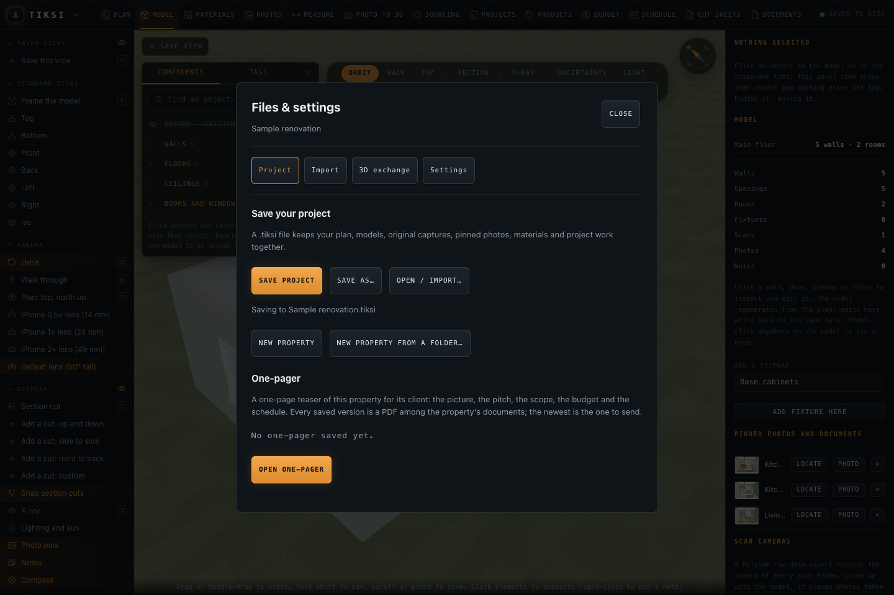

FILE → Project is the home for SAVE PROJECT, SAVE AS, OPEN / IMPORT and NEW PROPERTY.

### Try it

1. With the local server, edits save into the project’s .tiksi file on the Mac. Wait for SAVED TO DISK. FILE → Project → SAVE PROJECT also flushes pending edits.
2. Use SAVE AS to export another copy. In the static hosted edition, choose a filename and destination on first save when your browser offers a picker; later saves update that file or download it.
3. To reopen work, choose OPEN / IMPORT and select its .tiksi file, or drop the file on Tiksi.
4. Opening updates the property with the same ID and leaves unrelated properties in place. Choose the property at the top of the app to switch between them.
5. FILE → Settings → Where this project is kept shows the canonical file path on the Mac. Existing bundles in the server’s configured project folders are discovered automatically. The static edition instead offers CHOOSE FOLDER and OPEN FROM FOLDER.

Find saving, importing and settings in one place

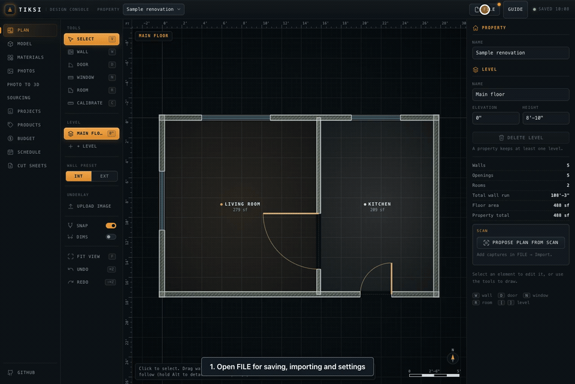

Open FILE, look at Project, switch to Import, inspect 3D exchange, then open Settings. Saving and opening project files are in the Project tab. The recording shows the app controls; your operating system supplies the file picker.

[Download the video](js/guide-assets/files.mp4)

### Other features here

**Keyboard saving.** Cmd/Ctrl+S saves; Cmd/Ctrl+Shift+S saves a new copy; Cmd/Ctrl+O opens a project file.

**Shared project folders.** Desktop and Tailscale clients of the same local server see the same project files and original assets. A different server or the static edition is a separate workspace.

**File copy vs design fork.** SAVE AS preserves the property IDs. Reopening that copy updates the same property; it does not create a second independent design in this workspace.

**Conflicting copies.** The local server combines unrelated edits and asks which values to use when the Mac and this device changed the same records. Recovery copies are kept. In the static edition, open a newer linked-folder copy before saving over it.

**Whole-workspace backup.** FILE → Settings → Workspace backup & maintenance → SAVE WORKSPACE BACKUP includes every property.

> **Good to know:** The local server saves project bundles on the Mac and keeps browser working data in memory. First connection migrates old browser data to disk with a recovery bundle. Keep the Mac reachable until SAVED TO DISK appears; closing unsaved offline work warns. The static edition retains browser autosave and portable exports.

## Bring in a scan or Polycam capture

**Where:** FILE → Import

Start from a phone scan, a shared Polycam capture, a mesh or point cloud, or a set of reference photos. Successful imports keep their original files with the property.

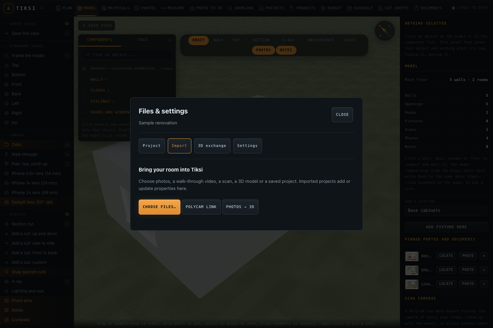

FILE → Import offers CHOOSE FILES, POLYCAM LINK and PHOTOS → 3D.

### Try it

1. For an exported scan, open FILE → Import → CHOOSE FILES. Choose a self-contained GLB or the complete exported ZIP with its textures.
2. For a shared capture, choose POLYCAM LINK and paste the share URL. You can also paste a Polycam URL into the console when no text field is focused.
3. Follow the import log. If the public link cannot provide a model, download the model from Polycam and use the file-drop fallback.
4. A normal file import opens its reference model in MODEL. Select the mesh in the left column and choose PROPOSE PLAN FROM SCAN when you want editable walls, rooms, openings, levels and a tracing underlay. Correct the proposal in PLAN.
5. The Polycam link workflow proposes a plan during import. When that workflow adds a scan to an existing plan, choose whether it is the next floor, a rescan, a separate building or reference only before applying it.

### Other features here

**Meshes, clouds and splats.** MODEL can display several capture types. A mesh has surfaces; a cloud has points; a splat is a visual reference.

**Propose plan later.** In MODEL, select a mesh scan and choose PROPOSE PLAN FROM SCAN. The PLAN property inspector also offers the action for its available source mesh.

**Fixtures from the scan.** After a plan proposal, or later with PROPOSE FIXTURES FROM SCAN (MODEL mesh inspector or the PLAN scan card), Tiksi reads counter runs, wall cabinets, tall appliances, beds, sofas, tables, desks and storage from the mesh. Each proposal shows its confidence and the heights it rests on; tick the ones that are really there. Click a fixture in MODEL to correct its sizes or mark it tape measured; ADD FIXTURE HERE adds one by hand. Fixtures save with the project, follow Undo, show as outlines in PLAN and become tagged groups in the SketchUp mirror, where moving, turning, stretching or deleting one comes back to Tiksi.

**Multi-file imports.** Keep OBJ/MTL/images and glTF/buffers/images together. Choose their complete package rather than a model that refers to missing texture files.

**Originals and handoffs.** FILE → 3D exchange retains original source downloads and diagnostic handoffs for formats that need an agent or authoring application.

> **Good to know:** A shared Polycam link must expose a downloadable artifact. Room proposals need review, especially around furniture, glazing and diagonal walls. Point clouds and splats are references; the mesh-to-plan action does not automatically turn them into building elements.

## Draw and correct a floorplan

**Where:** PLAN

The plan is editable building geometry. Walls, openings and rooms become the 3D model and can link to photos, materials and scope items.

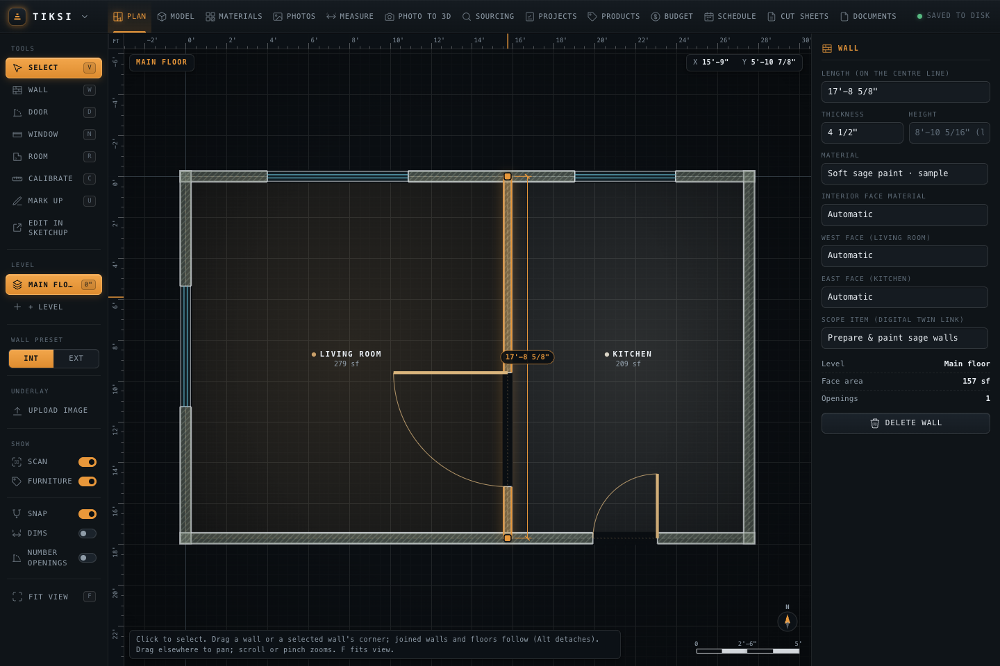

Plan tools are on the left of the canvas. Select an element to edit dimensions, materials and scope links in the right inspector.

### Try it

1. Use UPLOAD IMAGE for a tracing underlay, or select a photo in PHOTOS and choose PLAN UNDERLAY.
2. Choose CALIBRATE, mark two points with a known separation, enter the real distance in the inspector and apply the scale.
3. Choose WALL, then click successive wall endpoints. Use the interior/exterior preset for the starting thickness. Escape ends the current drawing action.
4. Place doors and windows on walls. Give each room a floor with the ROOM tool so it can have its own finish and area: click once inside a room the walls close, or click corner by corner where the walls leave it open.
5. Choose SELECT and click an element to select it; a click never moves anything. Type precise dimensions in the inspector, or drag a wall or a selected wall's corner. Joined walls and the floors on them follow the edit.
6. Use + LEVEL for another storey and set its elevation and wall height. Each level has its own underlay and plan geometry.

Select a wall and change its dimensions

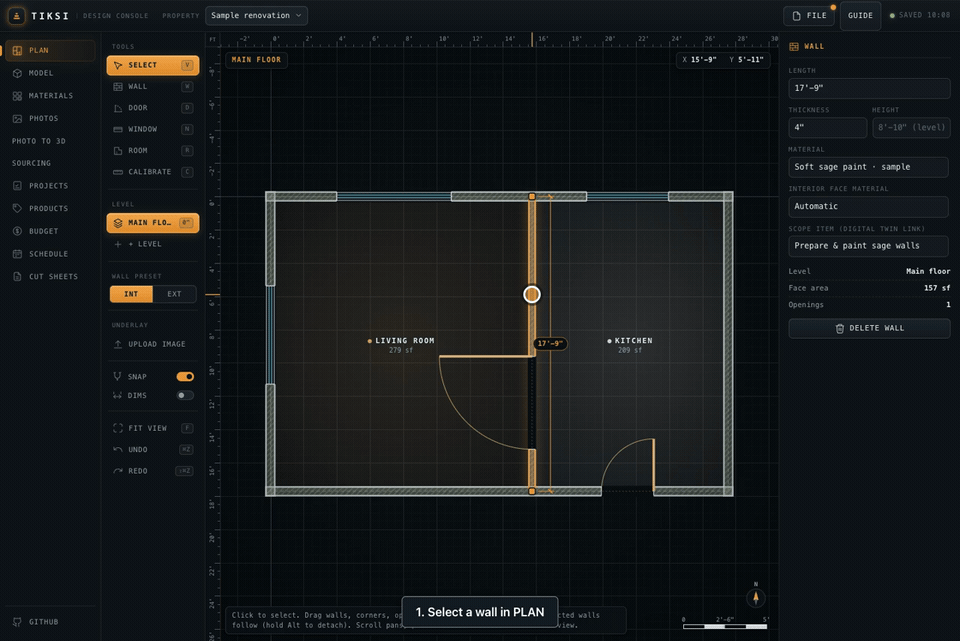

In PLAN, use SELECT and click a wall. Edit the wall height in the inspector to eight feet. Open MODEL to inspect the updated design.

[Download the video](js/guide-assets/plan.mp4)

### Other features here

**Sticky walls.** Dragging a wall slides its straight run and connected geometry. Dragging a corner turns the walls there, and walls and floors attached along them stay on them. Hold Alt/Option to move that wall on its own.

**Floor a room in one click.** With ROOM, a click inside an area the walls close floors it, with its corners on the wall centre lines; the canvas outlines that area before you click. Where the walls leave a room open, click its corners one by one instead. Start on a wall or Alt-click to outline a floor inside a closed room.

**Floors follow walls.** A floor never moves on its own; dragging one pans the view. Its corners that sit on a wall as drawn are attached and move with the wall. Select a floor to see them: solid corners are attached, hollow ones are loose. Drag a corner to reshape the floor, or use SNAP CORNERS TO WALLS.

**Snapping and dimensions.** SNAP helps with wall ends, wall centre lines, floor corners, axes and angles. DIMS displays wall dimension strings.

**Opening schedule.** NUMBER OPENINGS (under SNAP and DIMS) tags every door D1, D2... and every window W1, W2... on the level and lists them with the rooms each one connects and its width × height. Numbers run bottom level first, then top to bottom and left to right across the plan, so they stay put when you edit sizes. Type a corrected size into a row (Enter moves down the column); it fits the wall and Undo reverts it. Click a row to select that opening. PRINT or SAVE PNG makes the numbered plan with the table, ready to send for corrections like "D4 is 30 × 80". The switch only changes the view.

**Underlay editing.** Click the image to select it and change opacity; drag it only while selected to align it. Remove it without deleting the traced walls.

**Navigation and undo.** Drag empty canvas or a floor to pan. The scroll wheel or a pinch zooms about the cursor; plan has no orbit. Space-drag or middle-drag pans anywhere; F fits the view. SHOW toggles the scan underlay (G) and furniture, cabinet and fixture footprints (K). UNDO and REDO are in the top bar in PLAN and MODEL. One wall gesture includes its joined walls, openings and floor corners.

> **Good to know:** Calibrate the underlay before tracing: calibration changes the image scale, not walls you already drew. Rooms need their own ROOM floors to create floor surfaces and floor-area takeoffs. Recheck scan-generated geometry against measurements on site.

## Inspect and edit the 3D model

**Where:** MODEL

The 3D view combines the plan-generated building, imported captures and photo pins. It is also a place to edit model elements and inspect imported materials.

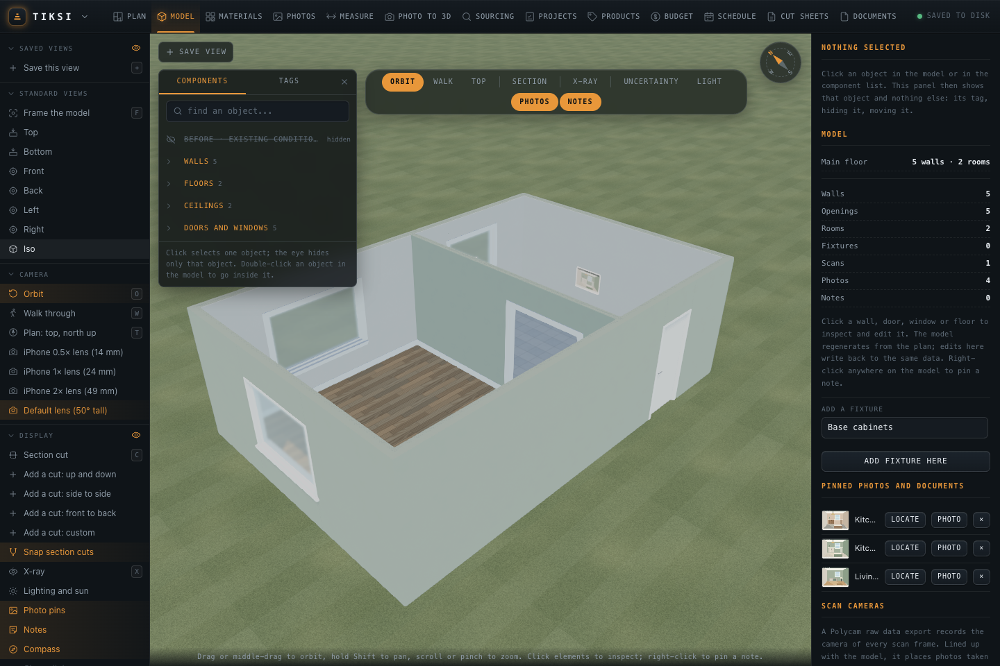

Here every group is ON SCREEN (Tiksi menu); by default the tools live in the menu under the Tiksi logo. The inspector follows the selected wall, room surface or imported model.

### Try it

1. Open MODEL and use FRAME if the room is outside the camera. Drag or middle-drag to orbit about the point under the cursor, hold Shift to pan (even mid-drag), scroll to zoom, or use the TOP control for a plan-like view. On a trackpad, pinch also zooms.
2. Click a wall, floor or ceiling to inspect it. Change the offered dimensions or material in the inspector.
3. Choose MOVE WALLS, select a native wall and drag its gizmo. Joined walls and room corners follow. Return to PLAN for exact outlines; imported mesh surfaces do not expose native wall controls.
4. Use SECTION to cut through the building and reveal interiors. Use X-RAY to inspect overlapping references.
5. For lighting and render quality, open FILE → Settings → Model environment. For an image export, use FILE → 3D exchange → SAVE VIEW IMAGE while MODEL is open.

### Other features here

**Undo and redo.** Use the top-bar buttons or Cmd/Ctrl+Z and Cmd/Ctrl+Shift+Z (Ctrl+Y also redoes). PLAN and MODEL share up to 80 geometry edits per project during this session, including moves and geometry inspector changes. Disk saves and view switches retain history; a reload or file import starts fresh. Unrelated shared edits are kept; a conflicting geometry change disables restoration rather than overwriting it. Photos, notes, imported references and underlay placement are outside geometry undo.

**Walk mode.** Choose WALK, then use W/A/S/D or the arrow keys to move and Shift to move faster. Drag to look or click the canvas to capture the mouse. Escape releases it or exits walk mode.

**Measure surfaces.** Choose MEASURE and click two surface points to display a distance. CLEAR MEASURES removes temporary measurements; image export can include them.

**Levels.** Show or hide levels in the model while retaining their geometry in the property.

**Imported references.** Select a scan/model to inspect placement, scale and available materials. A reference remains separate from native plan elements.

**Photos and documents on surfaces.** PIN (P) hangs a photo or a document flat on the wall, floor or scan surface you click, like a print put up by hand. A photo hangs at a print size (11 x 14 in unless you choose another); a PDF page or sheet image hangs at its true size, so a 24 x 36 in drawing is 24 x 36 in on the wall. A pin on a wall keeps its place on that wall and moves with it when the wall moves. Select a pinned document and choose READ IT to fly in front of it, or OPEN THE PDF. PHOTOS in the mode bar hides or shows every pin, camera and numbered position.

**Photo mode.** PHOTO MODE (on a selected pin, PHOTO in the pinned list, or an orange camera pyramid in the model) stands where the photo was taken and lays the photo over the model, OVER with an opacity slider or SIDE BY SIDE. The lens comes from the photo file (an iPhone ultra-wide photo is about 102° across), and a photo with no camera yet starts at the scan frame taken nearest in time, when scan cameras are imported. Line it up by eye, or choose FIT WITH POINTS and click a sharp corner in the photo, then the same spot in the model, four times or more: the camera is solved and the average error shown. A crooked photo is turned upright. SAVE CAMERA FOR THIS PHOTO keeps it, and the camera shows as a pyramid in the model. Anything that will not line up is where the model and the site differ. Esc or DONE ends.

**Numbered photo positions.** MAKE NUMBERED POSITION turns a photo's found camera into a numbered position, marked like a section on a drawing in the model and on the plan. A position collects the before photo, a dated rendering of the current design from exactly that camera each time you choose RENDER ALL POSITIONS (or RENDER THIS POSITION), and the after photo (ADD AFTER PHOTO). VIEW FROM HERE stands at the position with its latest photo over the model. Numbers are never reused.

**Scan cameras.** A Polycam raw data export (turn on Developer Mode in Polycam before scanning) records the camera of every scan frame. Under SCAN CAMERAS, with nothing selected, IMPORT POLYCAM CAMERAS reads them from the export folder, and LINE UP WITH THE MODEL fits each tracking session to the model from its depth maps, reporting how many points land within 5 cm. ADD SHARP FRAMES AS PHOTOS then adds scan frames as photos with their cameras already placed. PLACE PHOTOS AUTOMATICALLY sends photos to the placement helper on the Mac running Tiksi, which matches them against the scan frames; install it once with python3 tools/install-photo-placement.py and fill in the export folder path. Check each placed photo in PHOTO MODE; UNDO AUTOMATIC PLACEMENT puts the previous cameras back.

**Notes anywhere.** Right-click a wall, floor, scan or the ground and choose ADD NOTE HERE, or use NOTE (N) and click. The note links to the room and wall under it. Right-click a note to edit, move or delete it; NOTES in the mode bar hides or shows them all. Both switches are kept with the property.

**Edit in SketchUp.** EDIT IN SKETCHUP (in MODEL and PLAN) brings the project's .skp up to date and opens it in SketchUp. Save there and walls, openings and rooms come back. It needs the project kept in a folder and Tiksi running on the Mac with SketchUp.

**Finish takeoff.** A selected imported model can map material slots and create a measured finish estimate. See the exchange chapter for that workflow.

> **Good to know:** Start with Low or Medium quality on a laptop and raise it when needed. A screenshot or exported render communicates appearance; it does not replace a dimensional site check.

## Tags, saved views and the Tiksi menu

**Where:** MODEL → TAGS

Every part of the model sits on a tag, the way it does in SketchUp: walls, floors, ceilings, doors and windows, fixtures, and each part of an imported model. Hide a tag to look inside, save the view as a tab, and keep the screen clear by leaving the tools in the Tiksi menu.

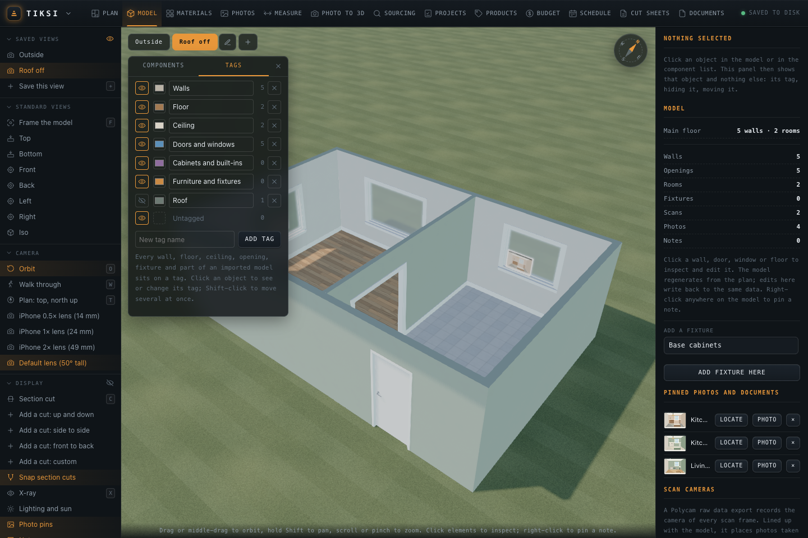

The Tiksi menu is open over MODEL. Roof is hidden in the tag list on the right, so the room under the roof shows. The saved views are tabs at the top left of the model.

### Try it

1. Open MODEL. With nothing selected, the panel on the right lists the tags with how many objects each holds. Click an eye to hide or show a tag.
2. Click an object to see its tag in the panel and choose another. Shift-click more objects first to move them all at once; on an imported model, TAG EVERY PART OF THIS MODEL moves the whole model.
3. Rename a tag by typing over its name, change its colour with the swatch, add one with ADD TAG, or delete one with the X: its objects move to Untagged.
4. Choose the + at the top left of the model to save the current camera, with the tags shown now, as a view. Click a tab to go back to it; double-click to rename; right-click to update it, move it or delete it. Page Up and Page Down step through the tabs.
5. Click the Tiksi logo for every tool and view. Tick ON SCREEN on a group to keep it beside the model; untick it to put it back in the menu.

### Other features here

**Automatic tags.** An imported model is tagged the first time it loads. A SketchUp file keeps its own tags. Without them, part names decide (Roof anywhere in a name wins, otherwise the first building word: wall, door, floor, ceiling, cabinet, and so on), and then shape: up-facing or sloped faces above the storey are Roof, a thin slab at the floor is Floor, one at the top of the storey is Ceiling, tall vertical faces are Walls, and the rest is Furniture and fixtures. DETECT TAGS AGAIN on a selected model starts over.

**Plan elements.** Walls, floors, ceilings, doors and windows, built-in fixtures and loose furniture each start on their own tag. A new wall goes on the walls tag; one you moved stays where you put it.

**Drawings follow the tags.** DOCUMENTS draws plans, sections, elevations and 3D views with the model's tags. Each view also has its own TAGS list: leave a tag as the model has it, or show or hide it in that view only. A 3D view can start from a saved view, camera and tags together.

**SketchUp.** Exports to SketchUp, and the SketchUp mirror beside a project file, put each object on a SketchUp tag with the same name and visibility.

**What stays on the screen.** The ON SCREEN choices belong to this browser and apply to every project. Keyboard shortcuts work whether or not a group is on the screen.

> **Good to know:** Tags only change what is shown. Hidden objects are still in the project, still counted in takeoffs, and still exported.

## Edit elsewhere and compare before/after

**Where:** FILE → 3D exchange

Export a Tiksi design or selected imported model, edit it in SketchUp or Blender, then return the result while keeping a before state and the project work.

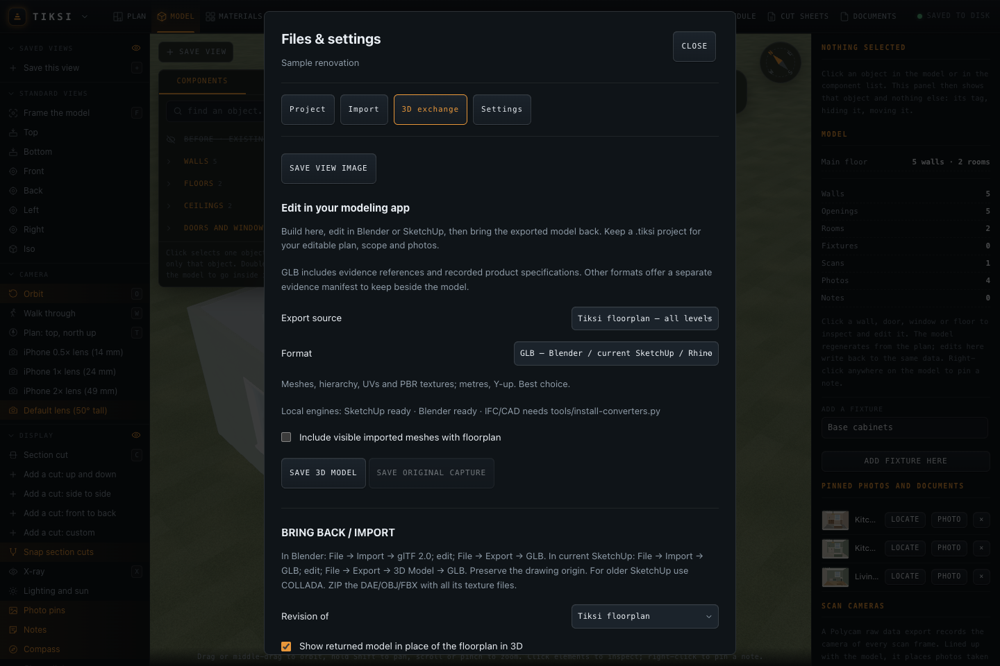

The exchange panel chooses what to export, the file format and the model that a returned revision belongs to.

### Try it

1. Save the .tiksi project first. Open FILE → 3D exchange and choose the floorplan or imported model to export.
2. Choose SketchUp, Blender or an interchange format such as GLB. Save the generated file and open it in the target application.
3. Edit and save/export from the other application. Keep the drawing origin and units consistent so the returned model aligns.
4. In the exchange panel, choose the prior model or Tiksi floorplan under Revision of, then choose IMPORT / BRING BACK MODEL. Keep Show returned model in place of the floorplan enabled. Tiksi preserves the before state automatically.
5. In MODEL, use BEFORE and AFTER to compare from the same camera. Select the visible model to inspect the appropriate materials.
6. Map material slots to catalog finishes and choose CREATE FINISH ESTIMATE. Review the resulting scope quantities, product matches and prices in PROJECTS and BUDGET.

Compare the preserved before state with the proposed design

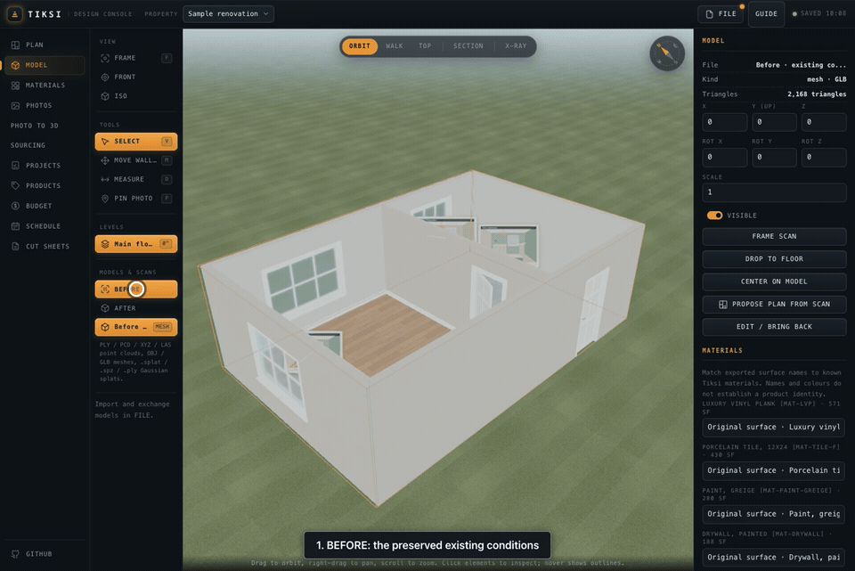

Open MODEL with a saved comparison. Choose BEFORE, inspect the earlier model, then choose AFTER. The camera stays in place while the visible design changes.

[Download the video](js/guide-assets/exchange.mp4)

### Other features here

**Native engines.** SketchUp and Blender use installed local engines. Optional CAD readers cover IFC, STEP/IGES, DXF surfaces, Rhino render meshes, E57 and LAZ.

**Other exports.** GLB carries PBR maps; COLLADA and OBJ include texture packages; STL carries geometry. Original native files remain available separately.

**Originals and conversion history.** Choose an imported source and SAVE ORIGINAL CAPTURE to download it. Expand Conversion history / agent handoffs, then REFRESH CONVERSIONS to save a handoff or delete a server copy. Server job history is separate from .tiksi saves.

**Agent interpretation.** Unconverted native files keep their original bytes, logs and interpretation packet. Download the packet for Codex or Claude to continue the work.

**Measured finishes.** Triangle surface quantities include transforms. Unique saved per-square-foot product matches can supply draft prices and product links.

> **Good to know:** A returned mesh does not automatically rewrite parametric walls or dimensions. Use PROPOSE PLAN FROM SCAN and review the result if you need a new editable plan. BEFORE / AFTER appears for returned revisions; ordinary plan edits do not create that comparison automatically. Keep native sources for their constraints and BIM relationships. Review measured areas, waste, labor and prices before ordering.

## Choose and customize finishes

**Where:** MATERIALS

Materials control the appearance of walls, floors and ceilings. Use the built-in catalog, customize it, or turn a close-up photograph into a surface material.

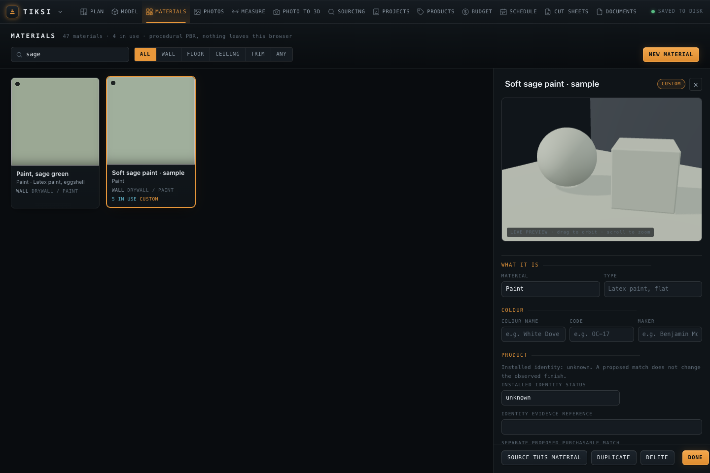

Select a material to open its preview and controls. The catalog can be searched and filtered by use.

### Try it

1. Open MATERIALS and search or filter the catalog. Select a material to preview it.
2. Adjust color, roughness and the controls offered by its pattern. For tile or plank patterns, set real repeat dimensions.
3. Use DUPLICATE when you want a separate variation. Use NEW MATERIAL for a new custom finish.
4. For a photographed finish, select its image in PHOTOS and choose MATERIAL, or select/upload a source image in the material editor.
5. Assign the material from a selected wall or room in PLAN or MODEL. Use SOURCE THIS MATERIAL to research a purchasable match.

### Other features here

**Pattern controls.** Color, accent, repeat size, roughness, metalness and normal strength let you tune procedural patterns. Drag the live preview to orbit; scroll to zoom.

**Usage links.** The editor shows where a material is in use, helping you understand what an edit will change.

**Built-in reset.** RESET TO DEFAULT restores a built-in material. Custom copies can be kept as separate alternatives.

**Appearance vs product.** A visual finish is not yet a manufacturer specification. Link a sourced product and its price to the scope when selected.

## Keep photos attached to the room

**Where:** PHOTOS

The photo gallery holds site references and panoramas with notes, room links, model links and scope links. A photo can also become a plan underlay, a material or a 3D pin.

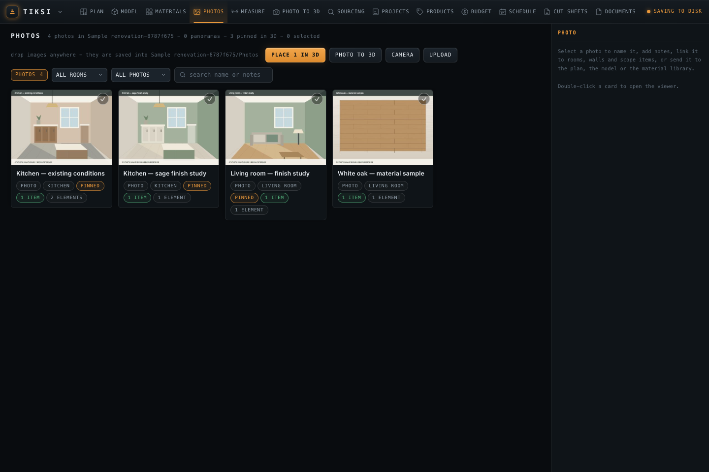

Select a gallery card to open its inspector. Send to offers PLAN UNDERLAY, PIN IN 3D, MATERIAL and panorama lighting.

### Try it

1. Use UPLOAD to add reference images, or CAMERA on a supported phone/browser.
2. Select a card and give it a useful name, room and notes. Link the relevant scope items and model elements.
3. Choose PIN IN 3D, then click the matching surface in MODEL. Use the gallery’s PLACE … IN 3D action to place unpinned photos one after another.
4. Return to PHOTOS to filter by room, kind or pin status. Double-click a card or choose ZOOM for a large viewer.
5. Choose DOWNLOAD when you need the original file, or save the property as .tiksi to carry all the images with the project.

Place a reference photo on a model surface

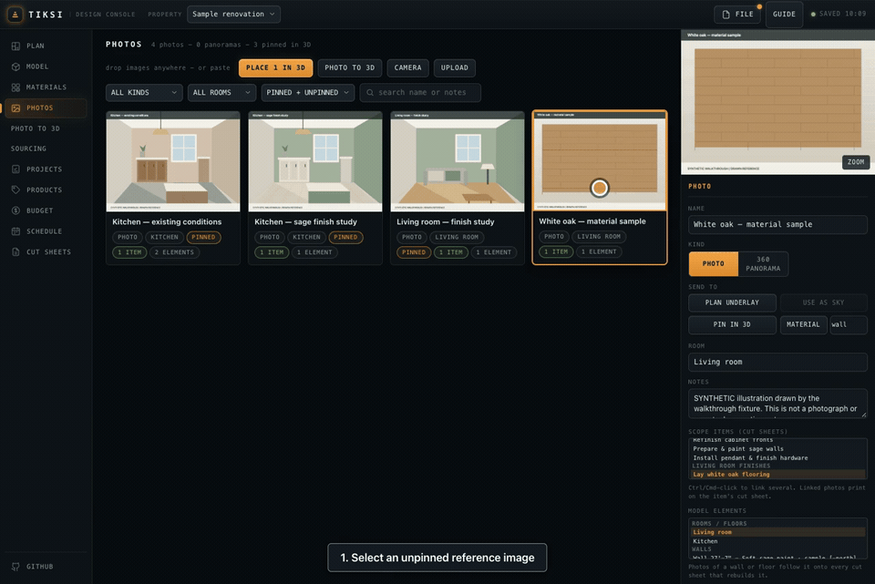

Open PHOTOS and select an unpinned reference card. Choose PIN IN 3D, then click the matching surface in MODEL to place it. Finish placement, then use PHOTO PINS → LOCATE to find a saved pin. The photo stays linked to the property.

[Download the video](js/guide-assets/photos.mp4)

### Other features here

**Plan reference.** PLAN UNDERLAY sends the selected image to the active level for tracing and calibration.

**Material from a photo.** MATERIAL creates a photo-based finish that you can tune in MATERIALS.

**360 panorama.** Mark a true equirectangular image as 360 PANORAMA, then USE AS SKY for the model environment.

**Cut-sheet evidence.** Scope links make relevant photos appear on the corresponding specification sheet.

**Match in 3D.** MATCH IN 3D opens MODEL from where the photo was taken with the photo over the model, to check walls, openings and fixtures against the site. CAMERA VIEW in the details says whether a view is saved.

**Find or move a pin.** In MODEL, clear the selection and use a PINNED PHOTOS AND DOCUMENTS → LOCATE button to fly to a pin. Select the pin for notes, print size, TURN A QUARTER, MOVE PIN or REMOVE PIN; removing a pin keeps the photo.

> **Good to know:** Where a photo hangs and where it was taken are separate. Its lens comes from the file; its camera comes from PHOTO MODE (by eye or four points), a Polycam scan frame, or automatic placement. The sample images in this guide are illustrations.

## Read tape measurements from a walk-through video

**Where:** MEASURE

A phone video of someone holding a tape against cabinets, doors, appliances and fixtures holds many more measurements than a quick look finds. MEASURE keeps the original video with the project, points you at the seconds where a tape blade is visible, and records each reading you take from a frame. It finds likely frames; a person reads the numbers.

### Try it

1. Open MEASURE and choose ADD VIDEO (MP4 or MOV, up to 600 MB), or drop the file on the view. PHOTOS and FILE → Import send videos here too. The original file is kept in the project.
2. With the local Tiksi server and ffmpeg on the Mac, the video is analysed once: a strip of one thumbnail per second appears under the frame, and seconds where a long yellow strip (a tape blade) is visible are outlined in yellow.
3. Use TAPE ▶ (Shift+→) to jump between those seconds. Each jump looks at the frames around that moment and shows the sharpest one in which the blade is still visible. → and ← step one second; . and , step a tenth; B looks for the sharpest frame near any moment.
4. Scroll to zoom and drag to pan. Shift+drag (or CROP) draws a box around the numbers; the box is kept with the reading.
5. Type the value as the tape shows it: 33 1/2, 33-1/2", 2'-9 1/2" or 85 cm. In imperial units a bare number means inches; the field shows how it was read. Add what was measured, the direction (width, height, depth) and how sure you are (clear, probable, unreadable).
6. Attach the reading to a door or window width or height or a wall length, or keep it as a note. SAVE READING stores it with its frame. APPLY changes the model the same way a typed edit in PLAN does, so UNDO in the top bar reverts it.
7. Readings nobody has explained yet (no element, nothing said about what was measured, or unreadable numbers) collect in ASK THE OWNER with their frames. COPY LIST copies the questions as text to send.

### Other features here

**Without ffmpeg.** The server reports that frame extraction needs ffmpeg (brew install ffmpeg). Videos are still kept, and a video this browser can play is reviewed in its own player; readings capture the frame shown.

**What the candidates mean.** Each second is checked for yellow pixels that form one long, narrow shape of reasonable size. Yellow walls, wood and small yellow objects are passed over. The timeline shows each candidate's strip size and length ratio. It ranks frames for review and does not read the numbers.

**Readings and the model.** A reading that was applied and later undone or edited shows NOT IN MODEL. Changing an applied reading's value or element makes it a new proposal to apply.

**Saved with the project.** The video, the frame saved for each reading and the crop travel inside the .tiksi file. The contact sheet and candidates are derived and rebuilt when needed.

> **Good to know:** Unsupported or damaged files are reported, not dropped: a file that is not MP4/MOV is refused with the reason, and a video that cannot be decoded is kept and marked NOT READABLE with the decoder's message.

## Reconstruct a model from photos

**Where:** PHOTO TO 3D

On a supported Mac, Apple Object Capture can turn overlapping original photographs into a textured model. Use Polycam for a room capture when that is the more practical route.

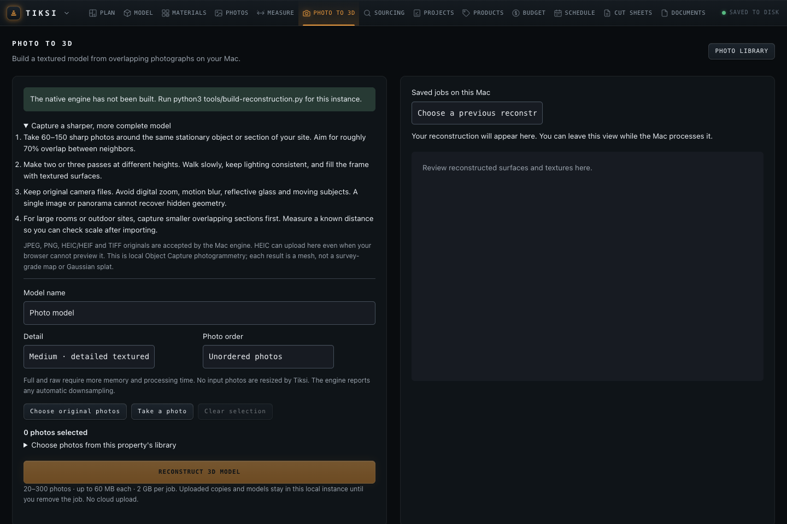

PHOTO TO 3D separates selecting photos and reconstruction settings from reviewing saved jobs and importing a result.

### Try it

1. Take sharp photographs while moving around the subject or space: aim for 60–150 images with about 70% overlap from two or three heights. Keep lighting consistent and retain the originals.
2. Open PHOTO TO 3D. Choose original photos or select stored gallery images; the local engine requires at least 20 images.
3. Name the model, choose detail and photo order, then start RECONSTRUCT 3D MODEL. Preview detail is useful for checking a capture before a larger run.
4. Monitor the job. You can leave the workspace and return to the saved job on this Mac.
5. When complete, choose Review in 3D, Save GLB or Save native OBJ and maps. Choose Add to this property to keep the result with the design, then check its placement and scale in MODEL against a known dimension.

### Other features here

**Original image retention.** Selected originals are sent to this local Mac for the reconstruction job. Property photos retain their original bytes.

**Detail settings.** Higher detail can take more time and memory. A poor capture is not fixed simply by selecting Raw.

**Capture limits.** The current engine accepts 20–300 original photographs, up to 60 MB each and 2 GB per job. Panoramas are excluded. Keep the Mac awake during processing.

**Job management.** Cancel a running job when needed. Removing a terminal job deletes that job’s server copies separately from property photos.

> **Good to know:** Reconstruction needs the local server, the native worker and supported Mac hardware. Reflective, transparent or low-texture spaces can reconstruct poorly. No reconstruction is shown as completed in this guide using the illustrated sample images.

## Research real products and suppliers

**Where:** SOURCING

Start from a material, a model element, a product or a brief. Sourcing researches alternatives and keeps the evidence with the selections you save.

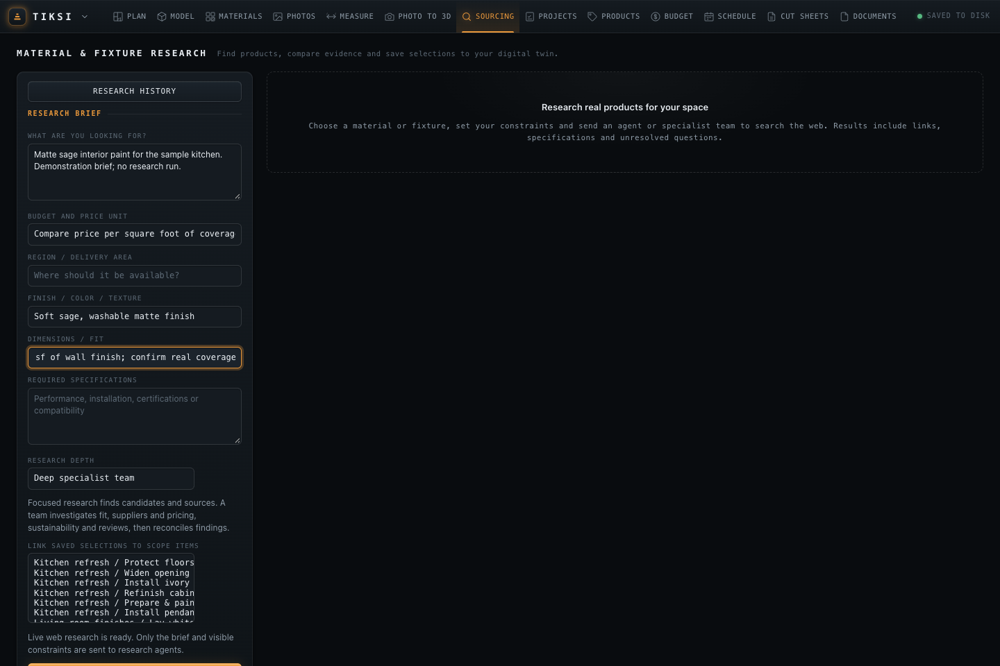

The sourcing brief collects the required product, budget, region, dimensions and specifications before research starts.

### Try it

1. Open SOURCING, or choose SOURCE THIS MATERIAL / RESEARCH ALTERNATIVES from the relevant material or product.
2. Describe what you need and include finish, size, price unit, budget, region and required performance. Link scope items when appropriate.
3. Choose Focused agent or Deep specialist team, then START RESEARCH. The local server needs its research provider to be ready.
4. Review candidates, vendor offers and cited evidence. Select candidates and use COMPARE SELECTED for a side-by-side view.
5. Use SAVE TO PRODUCTS for a chosen candidate. Review the saved product and its scope links before using its price in the project.

### Other features here

**Browse while it works.** Return to other workspaces while research runs, then reopen the job.

**Evidence and unknowns.** Inspect opened sources, fit notes, conflicts and missing information instead of relying on a product name alone.

**Revisit progress.** The job panel exposes current status and cancellation. Returning to SOURCING restores the current saved job; cancellation does not resume it later.

**Selection history.** Saved product selections carry their research context and evidence in project files.

> **Good to know:** Live sourcing needs the local server and a current, signed-in Codex CLI on its host. The availability message explains setup problems. The screenshot shows a brief, not fabricated live results. Saving a candidate does not order it; confirm current supplier price, availability, price units and fit before purchasing.

## Turn the design into scoped work

**Where:** PROJECTS

A project is a package of work such as kitchen finishes. Its scope items hold quantities, cost ranges, durations, dependencies and links back to the design.

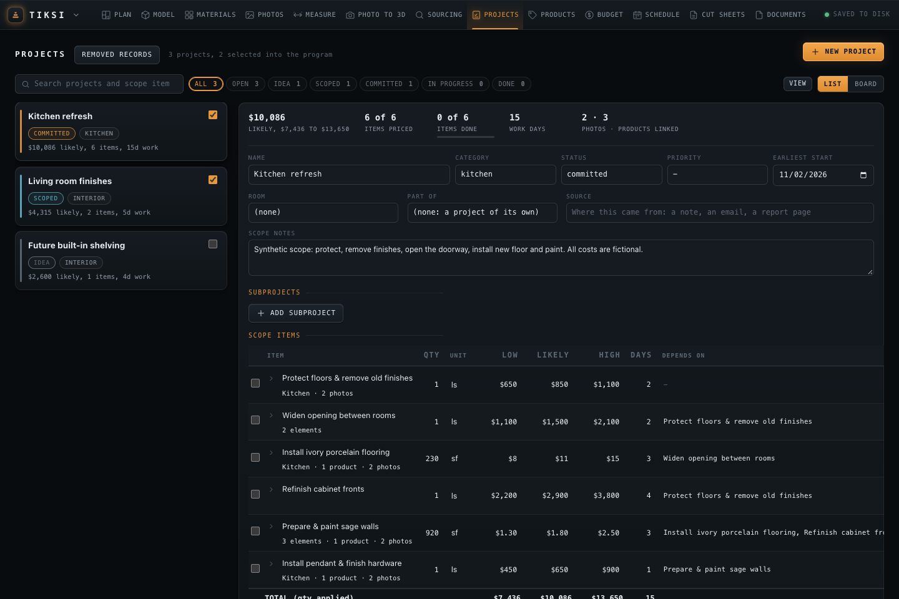

Choose a project to edit its scope. Each row can carry quantity, unit, low/likely/high unit costs, days and predecessors.

### Try it

1. Choose NEW PROJECT and type its name in the field that opens (Esc removes a new project you have not used). Set its category, status and earliest start, and write the scope notes.
2. Use ADD ITEM for each piece of work. Name it clearly and enter its quantity and unit.
3. Enter low, likely and high unit costs. Keep quantity and price units consistent; the totals are calculated from these inputs.
4. Add duration in days. Use the predecessor summary control to choose the items that must finish first.
5. Open a scope item with the arrow beside its name to see its status, notes, linked rooms and walls, products and photos. Link rooms, walls and products there; each link opens PLAN, PRODUCTS or PHOTOS on that record. Photos can be linked to an item in PHOTOS.
6. Tick the box at the start of a row when the item is done. Done items move to the bottom and the project counts them.
7. Use the project’s selection checkbox to include or exclude it from the budget program and schedule.
8. For a list of small jobs, such as a punch list, use ADD SUBPROJECT. Each subproject has its own status, priority, room and source, and is listed under its project, open ones first.

### Other features here

**Find a project.** Search matches project names, notes, source and room, and every scope item name and note; press / to jump to the box. The status chips show how many projects and subprojects have each status. VIEW filters by category, room, priority and program, sorts, and groups the list. The list remembers these in this browser for each property.

**Board.** BOARD shows one column per status. Drag a card to another column, or focus it and press Left or Right, to change its status.

**Priced and done.** The line above a project’s fields shows its likely total, how many items have a price and how many are done. A project with no prices says so instead of showing $0.

**Draft finish estimates.** CREATE FINISH ESTIMATE on an imported model can seed measured scope items. Review and complete them here.

**Dependencies.** Select several predecessors when a task depends on more than one item. Check the schedule for cycles or missing durations.

**Element links.** A scope item can refer to the wall, room or model surface that generated the work.

**Selection vs deletion.** Deselecting a project removes it from program calculations while retaining its scope for comparison.

**Subprojects.** A subproject is a project inside a project, one level deep. Change its priority and status from the parent’s SUBPROJECTS table, move it with Part of, and record where it came from in Source. BUDGET and SCHEDULE show it as Project / Subproject. Deleting a project deletes its subprojects.

**Across properties.** PROJECTS, BUDGET, SCHEDULE and CUT SHEETS show the projects of the active property. A new project belongs to the active property; choose another property in PROPERTY to see its projects.

> **Good to know:** Costs are per quantity unit: 120 square feet at $5 per square foot totals $600. Use one lump-sum quantity for a lump-sum quote. Set zero duration days for budget-only items; they stay out of the schedule.

## Keep specifications and ordering links

**Where:** PRODUCTS

Products are the real fixtures and materials you may buy. Keep manufacturer details, specifications, price units and vendor links connected to the scope.

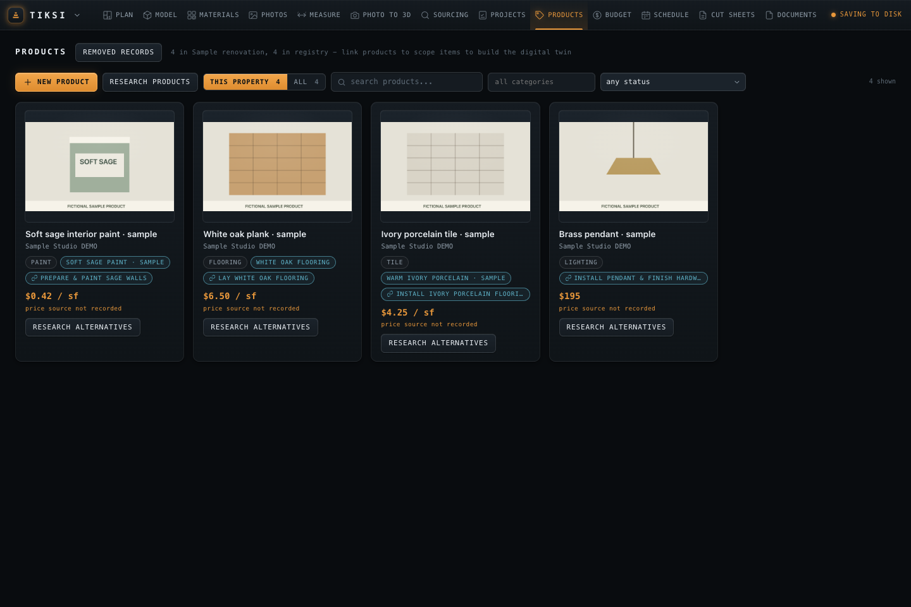

Open a product card to edit its image, price and where that price came from, vendor and manufacturer links, specification lines, spec documents and work items.

### Try it

1. Choose NEW PRODUCT for a manual entry, or save a candidate from SOURCING. A new product needs an image: paste an image link, upload a picture or paste one into the form.
2. Enter brand, model, category, specification lines and notes. Type a few letters in Category to narrow the list, or type a new category. Add the vendor link (where to buy) and the manufacturer link (the maker's product page).
3. Record the price with its unit: each, square foot or linear foot, for example. Under the price, keep the link to the page showing it; Tiksi records the date it was checked. REFRESH asks a research agent for the current price of that exact model and changes the price only when it finds a verified USD price.
4. Tick the work items the product is for. A ticked item lists the product on its cut sheet, and the product is saved in that property's project file.
5. Open the saved manuals and spec sheets, the spec folder or the project folder from the editor (on the Mac that keeps the project folders), or use CUT SHEETS to print the saved specification.

### Other features here

**This property or all.** THIS PROPERTY shows the products linked to the open property's work or materials, or added while it was open. ALL shows every property's products.

**Status filter.** Find products missing an image or price, prices not checked in 90 days, products with spec documents, or products not yet linked to work.

**Research alternatives.** Reopen sourcing from an existing product without losing its current saved specification.

**Evidence history.** Products saved from research retain cited evidence and source context. Every price change keeps its source link and date.

**Estimate matching.** A unique product/material match with a per-square-foot price can contribute to a model finish estimate. Ambiguous matches stay unpriced.

> **Good to know:** Tiksi stores purchasing information and vendor links. It does not place orders, manage supplier inventory or confirm a current quote. The sample prices in this guide are fictional.

## Compare scope against the budget

**Where:** BUDGET

The current-budget report rolls up selected projects and scope items into low, likely and high estimates. Use it to compare the renovation program with a budget cap.

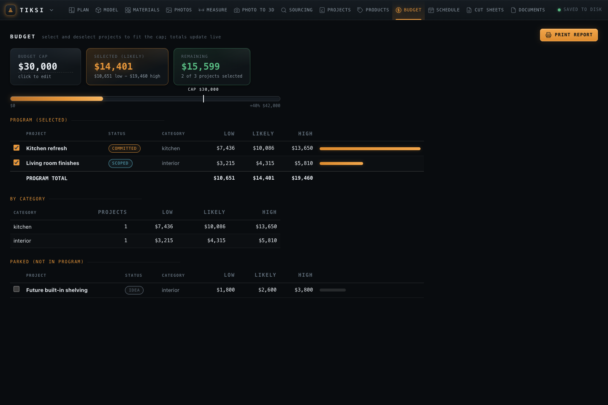

Budget totals follow the selected projects and their scope quantities and cost inputs. PRINT REPORT creates a shareable report.

### Try it

1. Enter or revise scope quantities and unit costs in PROJECTS first.
2. Open BUDGET and set the program budget cap in the offered control.
3. Compare low, likely and high totals, the category/project breakdown and the remaining budget.
4. Check or uncheck projects directly in BUDGET, or use their PROJECTS checkboxes, to compare alternatives without deleting scope.
5. Use PRINT REPORT to print or save a PDF through the browser print dialog.

### Other features here

**Cost ranges.** The report preserves uncertainty as low/likely/high values instead of presenting one guessed price.

**Program selection.** Only the selected projects of the active property contribute to the program totals.

**Quantity changes.** Updating a scope item quantity or cost updates the report. Products provide specification context; scope costs still need review.

> **Good to know:** Budget totals are only as complete as the scope inputs. Include labor, waste, freight, tax and contingency where applicable to your estimate.

## Sequence the work

**Where:** SCHEDULE

The schedule uses scope-item durations and predecessors to lay out the selected projects. The critical path shows which dependency chain controls the finish.

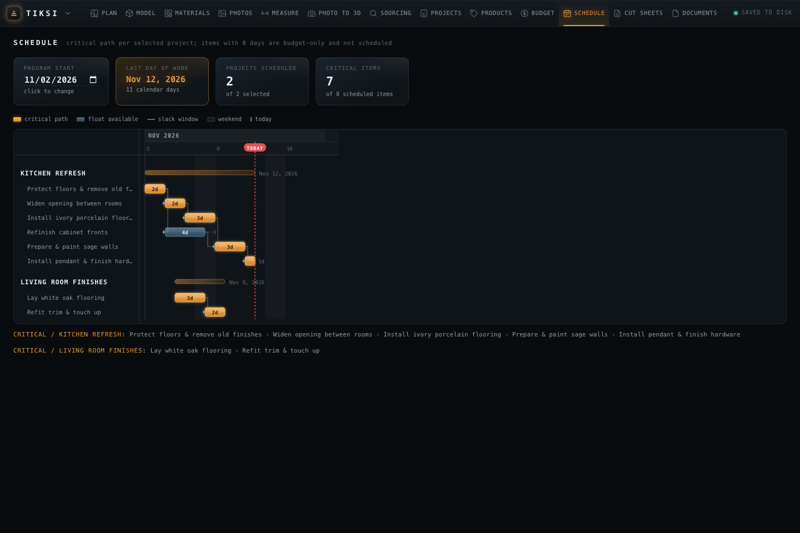

The Gantt view connects tasks with dependency arrows and distinguishes critical work from tasks with float.

### Try it

1. In PROJECTS, enter each scope item’s duration and select its predecessors.
2. Set the project’s earliest start and ensure the project is selected for the program.
3. Open SCHEDULE and set Program start. Inspect the Gantt chart, task dates, dependencies and critical path. A later project Earliest start delays that project.
4. Return to PROJECTS to fix missing durations, dependency cycles or sequencing assumptions, then review the updated schedule.

### Other features here

**Critical path.** A delay along the controlling dependency chain moves the modeled project finish.

**Float.** Some tasks can move within their float without extending the modeled finish.

**Today marker.** The time axis shows today so you can compare the planned sequence with the current date.

**Calendar days.** Durations use calendar days, with weekends shaded. Items at zero days are budget-only and are omitted. Dependencies and critical paths are calculated within each selected project.

> **Good to know:** The schedule is calculated from the entered durations and dependencies. It does not automatically resolve crew capacity, delivery dates or permit constraints; include those in your planning.

## Print a useful specification sheet

**Where:** CUT SHEETS

Cut sheets gather the information attached to a scope item or product into a printable handoff: dimensions, materials, photos, specified products and cost context.

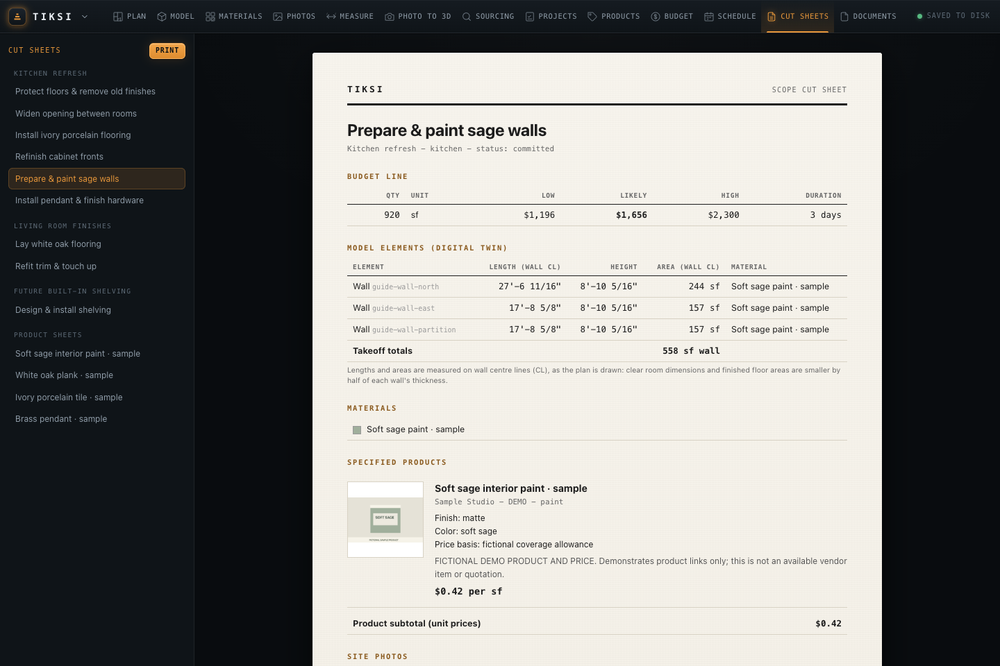

Choose a scope item or product from the list, review its sheet, then PRINT.

### Try it

1. Link the relevant model elements, materials, photos and products before printing.
2. Open CUT SHEETS and select the scope item you want to communicate, or choose a product sheet.
3. Review the generated content. Missing information is best completed in PROJECTS, PRODUCTS or PHOTOS.
4. Choose PRINT and use the browser print dialog to print or save a PDF.

### Other features here

**Scope-item sheets.** Combine the work description with linked elements, takeoffs, materials, site photos and products.

**Product sheets.** Show the saved manufacturer/model details, specification lines, price unit and vendor link.

> **Good to know:** These are specification handoffs built from your saved information. Review them before issuing instructions or ordering materials.

## Make a drawing set from the model

**Where:** DOCUMENTS

DOCUMENTS lays the model out on drawing sheets, the way a layout program sits beside a 3D modeller. Plans, sections, elevations and 3D views are placed at a drawing scale and redraw whenever the model changes, so the set never falls behind the design.

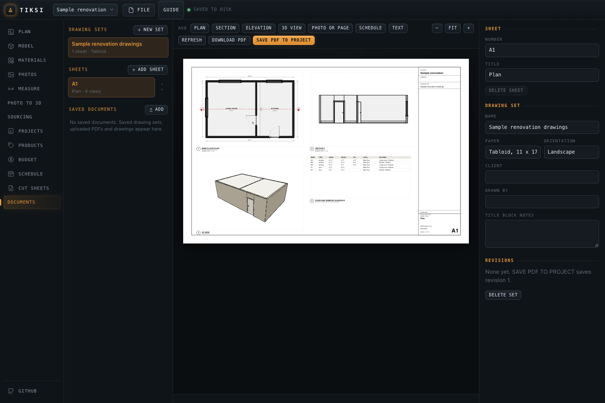

A sheet with a floor plan cut at 3'-11", a section through the plan, a 3D view and a door schedule, with the title block down the right edge.

### Try it

1. Open DOCUMENTS and choose NEW SET. A set starts with one sheet on 11 x 17 paper; change the paper, orientation and title block in the panel on the right.
2. Use ADD to place a PLAN, SECTION, ELEVATION, 3D VIEW, PHOTO OR PAGE, SCHEDULE or TEXT on the sheet. Drag a view to move it and drag its corner to resize it.
3. Select a view to set its scale, style, level, cut height or camera. Double-click a model view to adjust it on the sheet: drag to pan, scroll to change the scale, or orbit a 3D view.
4. Add sheets with ADD SHEET. Drawing numbers run across the set, and section cuts are marked on the plans.
5. DOWNLOAD PDF for a copy, or SAVE PDF TO PROJECT to keep it in the property as the next revision. Saved PDFs, uploaded drawings and product documents are listed under SAVED DOCUMENTS.

### Other features here

**Live views.** Plan cuts, sections, elevations and 3D views render from the current model, including imported SketchUp and scan models, every time the model changes.

**Drawing scale.** Orthographic views use architectural scales from 1" = 1'-0" to 1/32" = 1'-0", with a FIT button to frame the plan.

**Plan layer.** Plans draw the cut walls solid, door swings, windows, wall dimensions and room names with areas as crisp vectors over the model.

**Schedules.** Door and window, room, product and scope item lists stay in step with PLAN, PRODUCTS and PROJECTS.

**Revisions.** Each saved PDF becomes the next revision in the title block and a document of the property, so it travels in the project file.

> **Good to know:** Views are rendered images of the model at the chosen scale; check dimensions on site before ordering or cutting. PDFs are printed at 150 dots per inch.

## Settings, backups and storage

**Where:** FILE → Settings

Display units, model environment, project folders and workspace maintenance live in the same File panel. Most everyday work needs only project saves.

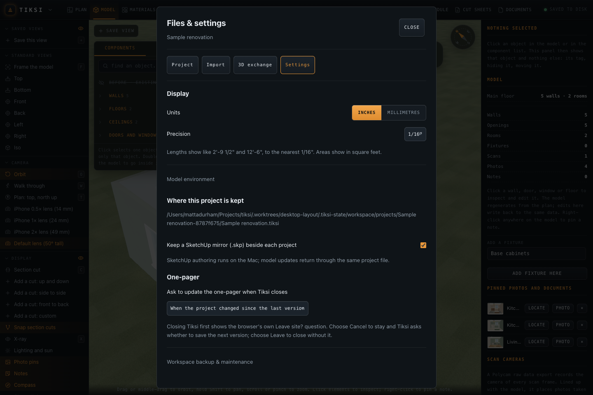

Settings groups display, model environment and workspace maintenance. This synthetic screenshot shows the static edition’s folder controls; the local server displays the canonical Mac file path instead.

### Try it

1. Open FILE → Settings to choose feet/square feet or metres/square metres.
2. For rendering, open MODEL first, then FILE → Settings → Model environment. Adjust quality, lighting and the offered view settings.
3. With the local server, Where this project is kept shows its canonical .tiksi path on the Mac. Desktop and Tailscale clients share those files and originals.
4. In the static edition, CHOOSE FOLDER links the open project to a folder. OPEN FROM FOLDER reopens a saved copy, and KEEP THEM IN ONE FOLDER links projects without a folder of their own. These controls depend on browser folder permission.
5. Open Workspace backup & maintenance and choose SAVE WORKSPACE BACKUP to export every property together. Browser-storage maintenance applies to the static edition.

### Other features here

**Keep a SketchUp mirror.** With the local server and SketchUp on this Mac, each project gets a .skp beside its canonical .tiksi. Keep Tiksi open on the Mac while authoring so saved native edits return to the shared project; phone clients see the synced results. The static edition instead needs a linked folder. EDIT IN SKETCHUP in MODEL or PLAN opens the native file on the Mac.

**Save workspace backup.** Exports every property together. Keep a .tiksi per property for ordinary project handoffs.

**Add demo projects.** Adds sample projects to the workspace without replacing unrelated properties.

**Clean unused storage.** Removes unreferenced browser assets only after the offered review/confirmation. Keep them if you need them for an older JSON-only project.

**Replace from backup.** A separate explicit restoration action that replaces the workspace. Use ordinary OPEN / IMPORT to merge a project instead.

> **Good to know:** Local-server project files are authoritative. Migration preserves a recovery bundle before removing old browser data. SAVED TO DISK — CLOSE OLDER TIKSI TABS means the files are saved; close older app tabs to finish browser cleanup. Converter and reconstruction jobs are separate copies, so removing a job does not manage the saved project files.

## Shortcuts and common questions

Use the visible tooltips and inspector labels when you forget a control. These are the most useful navigation, saving and recovery patterns.

### Other features here

**Save / open.** Cmd/Ctrl+S: save. Cmd/Ctrl+Shift+S: save as. Cmd/Ctrl+O: open.

**Plan navigation.** F: fit view. Drag empty canvas: pan. Scroll wheel or pinch: zoom. Space-drag or middle-drag: pan. G: scan underlay. K: furniture. [ and ]: step between levels.

**Plan drawing.** V: select. W: wall. D: door. N: window. R: room. C: calibrate. With ROOM, a click inside closed walls floors that room and Alt-click starts an outline; click the first point or double-click to close an outline.

**Model navigation.** Drag or middle-drag: orbit. Shift+drag or right-drag: pan. Wheel or pinch: zoom. F: frame. O: orbit. W: walk. T: top. C: section. X: X-ray. G: the Scan capture tag. K: the Furniture and fixtures tag. Page Up / Page Down: previous or next saved view. M: move walls. D: measure. P: pin photo. N: note. Right-click: note menu.

**Geometry undo.** Top-bar UNDO / REDO work in PLAN, MODEL and MEASURE (applied tape readings). Cmd/Ctrl+Z: undo. Cmd/Ctrl+Shift+Z or Ctrl+Y: redo. History is per project for the current session. Escape ends an active tool action.

**Move one wall.** Alt/Option while dragging isolates that wall from the normal connected-wall behavior; floors stay where they are.

**Where is save/import?.** Open FILE at the top. Project handles .tiksi files; Import handles captures and photos; 3D exchange handles editing in other applications.

**Why is my phone empty?.** Use the same Mac and server port through Tailscale. Reload the phone web app after an upgrade, then check the connection and SAVED TO DISK status. The local server shares every saved project and its assets. The static hosted edition and branch previews are separate workspaces.

**Why is a model untextured?.** Import the complete texture package or a self-contained GLB. An OBJ or glTF that points to missing files cannot supply those images.

**Why is reconstruction disabled?.** Check the local engine status and the photo count. The native engine requires supported Mac hardware and at least 20 original images.

**Why is my estimate unpriced?.** Add a verified price with the matching unit. Ambiguous product matches and units other than the supported takeoff price unit need manual review.

**Can I return to this chapter?.** The guide URL includes its chapter. Bookmark or copy the address, or use GUIDE at the top of Tiksi.

---

The guide is generated from `js/guide-content.js`. Screenshots and demos are reproducible with `tools/capture-guide.mjs` and the synthetic `tools/guide-fixture.mjs`; capture runs refuse the live port. Rebuild this Markdown copy with `node tools/build-guide-markdown.mjs`.
