# Tiksi user guide

A screenshot walkthrough of capture, design, materials and project work.

[Open the interactive guide](https://mattadurham.github.io/tiksi/#/guide) · [Download the PDF](js/guide-assets/tiksi-user-guide.pdf)

Open **GUIDE** in the Tiksi menu (the logo at the top left) for chapter search, expandable screenshots and short recordings. The screenshots use a synthetic sample property with drawn reference images and fictional products/prices. They contain no owner project data.

## Contents

- [Your first renovation workflow](#start)
- [Save, open and move your work](#files)
- [Bring in a scan or Polycam capture](#capture)
- [Inspect the 3D model](#model)
- [Components, tags, saved views and the left pane](#tags)
- [Edit elsewhere and compare before/after](#exchange)
- [Choose and customize finishes](#materials)
- [Keep photos attached to the room](#photos)
- [Read tape measurements from a walk-through video](#measure)
- [Reconstruct a model from photos](#reconstruct)
- [Research real products and suppliers](#sourcing)
- [Keep specifications and ordering links](#products)
- [Price a project room by room](#budget)
- [Schedule the work](#schedule)
- [Print a useful specification sheet](#sheets)
- [Make a drawing set from the model](#documents)
- [Print the trim package and the proposal](#job-documents)
- [Send the client a one-pager](#one-pager)
- [Send the client a page in the lab](#lab)
- [Settings, backups and storage](#settings)
- [Use Tiksi on a phone](#phone)
- [Shortcuts and common questions](#shortcuts)

## Your first renovation workflow

Tiksi connects a property, its design, reference photos and project work. Start with one room and follow it all the way to a price, a schedule and a specification sheet.

The same sample property appears throughout this guide. The six tabs across the top change pages; beside them are the property, UNDO and REDO, and FILE (saving, importing and settings). The Tiksi menu (the logo) holds the GUIDE and the screen options.

### Where everything lives

| Workspace | Use it for |
| --- | --- |
| FILE | Save, open and import projects, exchange models with other programs, bring back removed records and change settings. On the top bar beside UNDO and REDO. |
| MODEL | Inspect the 3D design with its dimensions, room areas and door and window numbers, imported scans, photo pins and before/after; draw trim and paint finishes. |
| PHOTOS | PHOTOS keeps site images, notes, room links and model pins together; VIDEOS reads tape measurements from walk-through videos and applies them to the model. |
| PRODUCTS | PRODUCTS keeps real products with their store pages, prices and spec sheets; MATERIALS sets each finish and how it looks; TRIM CATALOG holds every moulding, board and panel wall trim is drawn with; FIND A PRODUCT researches products and suppliers. FLOAT opens PRODUCTS in a window over MODEL; DOCK puts it back. |
| ESTIMATE | Set up and price each project room by room: drawn trim worked out into boards, supplies and carpenter hours, scope items, who does the work, markups and bids; all projects against a budget cap. |
| SCHEDULE | When the work happens, in working days: the carpenter's rooms in order with their tasks, what each line waits for, and the program's dates. |
| DOCUMENTS | Drawing sets and saved PDFs; the trim package and the proposal; cut sheets for scope items and products; SEND, for the one-pager, the proposal and the client page. |

### A useful first session

1. Choose FILE → Project → NEW PROPERTY, or keep the demo property while you learn. Back from a site visit with everything in one folder? Choose NEW PROPERTY FROM A FOLDER instead and skip the next step.
2. Use FILE → Import for a scan, Polycam link or photos.
3. In MODEL, check the walls, rooms, doors and windows with DIMENSIONS, ROOMS and NUMBERS. Change them in SketchUp with EDIT IN SKETCHUP; saves there come back to Tiksi.
4. In PHOTOS, add reference images and pin them to the model. In PRODUCTS → MATERIALS, choose the proposed finishes.
5. In ESTIMATE, start a project with + NEW PROJECT, add its rooms, and add each room's scope items with quantities, prices and working days. Link products and model elements to the work from each item's record.
6. Review SCHEDULE, then print from DOCUMENTS and send the client what they need from DOCUMENTS → SEND. Finish with FILE → Project → SAVE PROJECT so the work travels in a .tiksi file.

> **Good to know:** The screenshots and recordings use a synthetic sample renovation. Their drawings, images, products and prices illustrate the controls; they are not a surveyed room or a supplier quote.

## Save, open and move your work

**Where:** FILE → Project

Save a property as a .tiksi file. It carries the plan, models, original captures, pinned photos, materials, linked projects and specified products together.

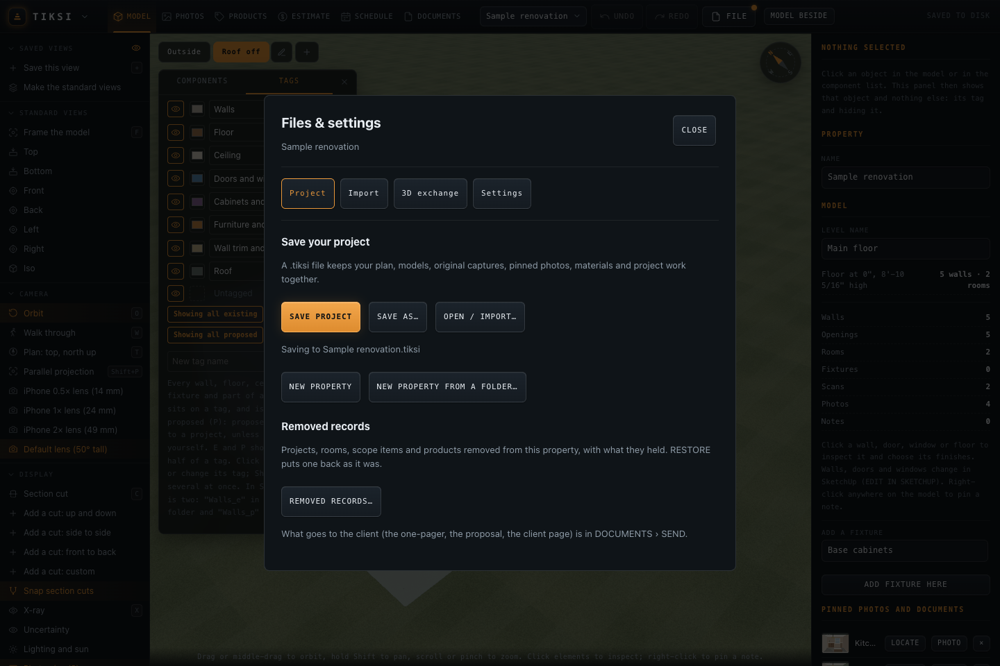

FILE → Project is the home for SAVE PROJECT, SAVE AS, OPEN / IMPORT, NEW PROPERTY and REMOVED RECORDS.

### Try it

1. With the local server, edits save into the project’s .tiksi file on the Mac. Wait for SAVED TO DISK. FILE → Project → SAVE PROJECT also flushes pending edits.
2. Use SAVE AS to export another copy. In the static hosted edition, choose a filename and destination on first save when your browser offers a picker; later saves update that file or download it.
3. To reopen work, choose OPEN / IMPORT and select its .tiksi file, or drop the file on Tiksi.
4. Opening updates the property with the same ID and leaves unrelated properties in place. Choose the property on the top bar to switch between them.
5. FILE → Settings → Where this project is kept shows the canonical file path on the Mac. Existing bundles in the server’s configured project folders are discovered automatically. The static edition instead offers CHOOSE FOLDER and OPEN FROM FOLDER.

Find saving, importing and settings in one place

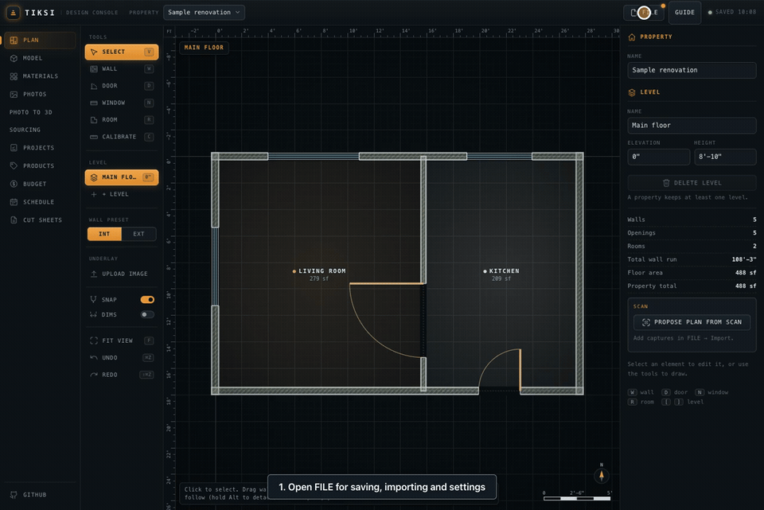

Open FILE, look at Project, switch to Import, inspect 3D exchange, then open Settings. Saving and opening project files are in the Project tab. The recording shows the app controls; your operating system supplies the file picker.

[Download the video](js/guide-assets/files.mp4)

### Other features here

**Keyboard saving.** Cmd/Ctrl+S saves; Cmd/Ctrl+Shift+S saves a new copy; Cmd/Ctrl+O opens a project file.

**Shared project folders.** Desktop and Tailscale clients of the same local server see the same project files and original assets. Each device keeps its own open property, level and tag choices; changing them on one does not move the other. A different server or the static edition is a separate workspace.

**File copy vs design fork.** SAVE AS preserves the property IDs. Reopening that copy updates the same property; it does not create a second independent design in this workspace.

**Conflicting copies.** The local server combines unrelated edits and asks which values to use when the Mac and this device changed the same records. Recovery copies are kept. In the static edition, open a newer linked-folder copy before saving over it.

**Whole-workspace backup.** FILE → Settings → Workspace backup & maintenance → SAVE WORKSPACE BACKUP includes every property.

**Removed records.** FILE → Project → REMOVED RECORDS… lists the projects, rooms, scope items and products removed from the open property, with what they held. RESTORE puts one back with its original IDs; nothing that exists now is overwritten.

> **Good to know:** The local server saves project bundles on the Mac. First connection migrates old browser data to disk with a recovery bundle. On the Mac itself, wait for SAVED TO DISK before closing; closing with unsaved work warns. A phone or another computer keeps what it has not sent yet in its own browser and sends it the next time Tiksi is opened there; while an original too large to keep is unsent, the phone bar reads Keep open. The static edition retains browser autosave and portable exports.

## Bring in a scan or Polycam capture

**Where:** FILE → Import

Start from a phone scan, a shared Polycam capture, a mesh or point cloud, or a set of reference photos. Successful imports keep their original files with the property.

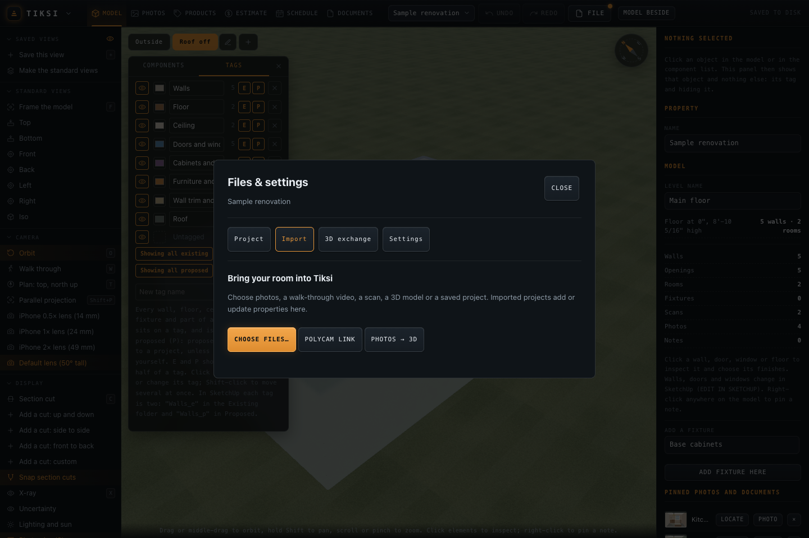

FILE → Import offers CHOOSE FILES, POLYCAM LINK and PHOTOS → 3D.

### Try it

1. For an exported scan, open FILE → Import → CHOOSE FILES. Choose a self-contained GLB or the complete exported ZIP with its textures.
2. For a shared capture, choose POLYCAM LINK and paste the share URL. You can also paste a Polycam URL into the console when no text field is focused.
3. Follow the import log. If the public link cannot provide a model, download the model from Polycam and use the file-drop fallback.
4. A normal file import opens its reference model in MODEL. Select the mesh in the left column and choose PROPOSE PLAN FROM SCAN when you want walls, rooms, openings and levels. Correct the proposal in SketchUp with EDIT IN SKETCHUP.
5. The Polycam link workflow proposes a plan during import. When that workflow adds a scan to an existing plan, choose whether it is the next floor, a rescan, a separate building or reference only before applying it.

### Other features here

**Meshes, clouds and splats.** MODEL can display several capture types. A mesh has surfaces; a cloud has points; a splat is a visual reference.

**Propose plan later.** In MODEL, select a mesh scan and choose PROPOSE PLAN FROM SCAN.

**Fixtures from the scan.** After a plan proposal, or later with PROPOSE FIXTURES FROM SCAN (the MODEL mesh inspector), Tiksi reads counter runs, wall cabinets, tall appliances, beds, sofas, tables, desks and storage from the mesh. Each proposal shows its confidence and the heights it rests on; tick the ones that are really there. Click a fixture in MODEL to correct its sizes or mark it tape measured; ADD FIXTURE HERE adds one by hand. Fixtures save with the project, follow Undo and become tagged groups in the SketchUp mirror, where moving, turning, stretching or deleting one comes back to Tiksi.

**A whole folder at once.** FILE → Project → NEW PROPERTY FROM A FOLDER (or CHOOSE A FOLDER in the New Property dialog) makes a property from the folder of a site visit. Tiksi first lists what the folder holds: every scan, photo, PDF and video that will come in, each with a tick you can clear, with a tick for each subfolder as well, and every file that stays behind with the reason. Nothing is made until you press CREATE. A note in the folder holding a Polycam share link brings that scan in, and the plan is proposed from the first mesh. With the local server on the Mac, the Mac’s own folder window opens, the files are read where they are, and the project file is kept in a Tiksi folder inside the folder you picked; nothing else in it is moved, renamed or deleted. Audio recordings, office files and anything over 600 MB stay in the folder and are listed.

**Multi-file imports.** Keep OBJ/MTL/images and glTF/buffers/images together. Choose their complete package rather than a model that refers to missing texture files.

**Originals and handoffs.** FILE → 3D exchange retains original source downloads and diagnostic handoffs for formats that need an agent or authoring application.

> **Good to know:** A shared Polycam link must expose a downloadable artifact. Room proposals need review, especially around furniture, glazing and diagonal walls. Point clouds and splats are references; the mesh-to-plan action does not automatically turn them into building elements.

## Inspect the 3D model

**Where:** MODEL

The 3D view combines the building, imported captures and photo pins. It shows walls, rooms, doors and windows with their sizes and finishes; their shape changes in SketchUp.

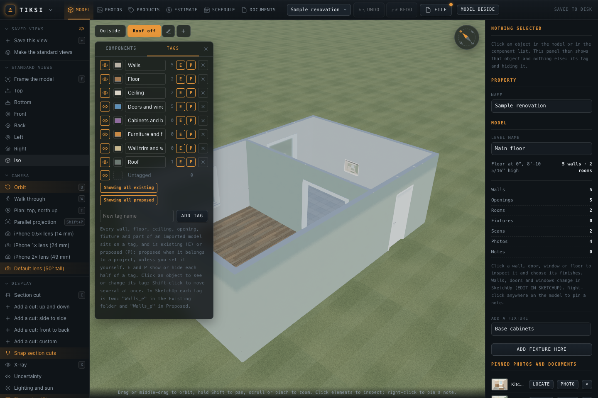

The left pane holds MODEL's views, tools and switches, in groups that fold to their headers; here every bar is shown over the model too. The inspector follows the selected wall, room surface or imported model.

### Try it

1. Open MODEL and use FRAME if the room is outside the camera. Drag or middle-drag to orbit about the point under the cursor, hold Shift to pan (even mid-drag), scroll to zoom, or use TOP for a plan, drawn in PARALLEL projection. On a trackpad, pinch also zooms. STANDARD VIEWS in the left pane look at the model from the top, bottom, front, back, left, right or a corner (ISO).
2. Click a wall to select its face: the surface one room sees, from inside corner to inside corner. The panel gives its square feet gross and net of doors and windows, its length and its baseboard length, and its finish. Shift-click adds more faces and the panel totals them; SELECT THIS ROOM'S WALLS on a floor selects them all. Walls, doors and windows change in SketchUp: EDIT IN SKETCHUP opens the project's model there, and a save comes back to Tiksi.
3. Under DISPLAY in the left pane, turn on Wall dimensions, Room names and areas, and Door and window numbers to label every wall's length, each room's name and area, and each door and window's number. The labels read the same from any angle.
4. Use SECTION to cut through the building and reveal interiors: the cut floats in the view as a see-through plane. Drag its arrow to slide it and a ring to turn it. Choose DONE when the cuts are placed: the planes, their handles and the strip go away and a clean section is left. Use X-RAY to inspect overlapping references.
5. For lighting and render quality, open Lighting and sun under DISPLAY. For an image, choose Render a still image there, or RENDER THIS VIEW on a saved view's tab.

### Other features here

**Undo and redo.** Press Cmd/Ctrl+Z and Cmd/Ctrl+Shift+Z (Ctrl+Y also redoes), or choose UNDO and REDO on the top bar. MODEL and PHOTOS → VIDEOS share up to 80 edits per project during this session, such as finishes, door states, trim and applied tape readings. Disk saves and view switches retain history; a reload or file import starts fresh. Unrelated shared edits are kept; a conflicting change disables restoration rather than overwriting it. Photos, notes and imported references are outside this undo.

**Walk mode.** Choose WALK, then use W/A/S/D or the arrow keys to move and Shift to move faster. Drag to look or click the canvas to capture the mouse; looking only turns you where you stand. Double-click a spot (double-tap on a touch screen) to go there. Walls, fixtures and the surfaces of imported models are solid: you stop about a foot short of them and slide along them, and doors let you through. Escape releases the mouse or exits walk mode.

**Measure surfaces.** Choose Measure (D) under TOOLS and click two surface points to display a distance. Measures are temporary: Clear measures removes them, and a still image can include them. Readings to keep come from walk-through videos in PHOTOS → VIDEOS.

**Field of view.** Choose FIELD OF VIEW (Z), as in SketchUp, then press and drag on the model: up narrows the view and down widens it, while the camera stays where it stands (the middle button still orbits and scroll still moves the camera). The panel shows the angle across the picture's long and short sides and its 35 mm equivalent, and has the iPhone 17 Pro lenses: 0.5× (14 mm, the ultra wide), 1× (24 mm, the lens Polycam keyframes come from) and 2× (48 mm), plus DEFAULT. An outline shows the phone's 4:3 picture, fitted in the window, so the model lines up with keyframes and photos taken at that lens. The lenses are also under CAMERA in the left pane and in the phone's view panel. A saved view keeps its lens.

**Parallel projection.** Parallel projection, under CAMERA in the left pane (Shift+P), draws the model with no perspective: lines that are parallel in the building stay parallel on the screen, as on a drawing. It is the far end of FIELD OF VIEW: keep dragging up past the narrowest angle, or choose PARALLEL in its panel; drag down to bring the perspective back. Plan: top, north up (T) turns it on and Orbit turns it off again. Zoom, pan and orbit work as usual, and a saved view keeps it.

**Wall faces.** MODEL draws and selects the finished wall from inside corner to inside corner. An exposed wall end joins the same face when it continues the visible run, including across a small step at the joint. A return that turns a corner has its own surface. Each room along a shared wall has its own face. Click the face or a return to see its finish and takeoff. AREA, GROSS includes the doors and windows. AREA, NET subtracts their openings. BASEBOARD LENGTH measures the finished wall at the floor between door openings. Applying a finish paints the whole selected run, and one UNDO restores the previous finish. THE WALL BEHIND opens the wall itself, for its research, scope, products, photos and trim.

**Wall trim by the room.** A click on a section of wall trim (a baseboard, a rail, a field of boxes or battens on one wall face) opens WALL TRIM. CHANGES REACH says how far a change goes: SELECTED (only the sections selected), GROUP (their subproject group, or else the same trim at the same height round the room), ROOM (all the trim in the room; this is the default) or PROJECT (the project the sections belong to, or every section that belongs to none). Each button shows how many sections it covers. MOULDINGS lists each kind of trim in the selection with a dropdown showing its moulding drawn to size; it opens into the catalog's mouldings of that kind, drawn the same way, and choosing one swaps every section of that kind the change reaches (with the open list focused, the up and down arrows step through it live). The whole catalog is PRODUCTS > TRIM CATALOG: open it floating over the model (OPEN THE TRIM CATALOG, or FLOAT in PRODUCTS) and drag a card onto a moulding dropdown to swap that kind, onto the panel to swap the selection, onto trim in the model to swap it, or onto a wall face, which swaps that face's trim of the same kind or, with none, adds it. PANEL LAYOUT holds the numbers a room shares: the box width to aim for, the gap between boxes, the margins at the ends, above and below, the rows, and a least box width under which a stretch of wall is left plain. The gap and margins are the same on every wall; the box width is not: each stretch of wall between doors, windows and corners takes the whole number of equal boxes that comes closest to the width aimed for, so a smaller width makes every box narrower until another one fits. ONE REVEAL ALL ROUND sets the margins equal to the gap. EDIT BY DRAGGING (E) does the same with the pointer: drag a rail, or the inside of a box, up or down to move that height line; drag a box's side to resize every box; drag the space between two boxes to change the gap (Alt moves that one divider only); drag the space round the boxes to change the margins (Shift keeps gap and margins equal). A height line carries what is on it: the same kind of trim near the same height moves by the same amount, the field under a rail stretches to it, trim standing on the floor stays there, and a line stops on a window stool when it comes within 1/2 in of one. While dragging, the sections that will change are outlined and the line under the view gives the live sizes. Trim keeps off what is on the wall without moving the layout: a wall's boxes and battens are laid out as if nothing were on it (only doors and windows break a field), so they stay symmetrical. A board or box moulding that crosses an outlet, switch plate or thermostat is notched round it with 1/2 in to spare and stays one board; a baseboard or rail stops either side of it. At a radiator or heater cover, battens, stiles and boxes start 1/2 in above its top, and a rail or baseboard behind it stops 1/2 in short of each side. Right-click a section for ADD A PANEL HERE and REMOVE A PANEL HERE (that stretch of that wall only; FIT THE PANELS AGAIN undoes it), ADD A ROW, the reach, selecting the group's, room's or project's trim, and MARK AS FINAL. A section marked final cannot be changed by accident: dragging, the panel, the catalog, deleting and any change made to the group, room or project pass it by until UNMARK FINAL (right-click, or the button in the panel). Selecting the group's, room's or project's trim leaves final sections out, and a pop-up says how many before it selects the rest. Every change is one step for UNDO.

**Dimensions, rooms and numbers.** DIMENSIONS labels each wall with its length measured on its centre line, on a line beside the wall just above the floor. ROOMS labels each room with its name and floor area to the wall centre lines. NUMBERS labels each door D1, D2... and each window W1, W2..., the same marks as the door and window schedule in DOCUMENTS. Labels stay upright and readable from any angle; a hidden level or a section cut hides its labels. Each switch is kept with the property.

**Section cuts.** SECTION starts with one flat cut that slides up and down. The strip at the bottom of the view adds more: UP AND DOWN, SIDE TO SIDE, FRONT TO BACK, or CUSTOM, an upright cut facing you that the rings turn to any angle. Up to six cuts work at once; click a numbered cut to move its handles there. SNAP holds turns to 15° and slides to 5 cm (1 inch in feet and inches); switch it off to move freely. FLIP cuts away the other side, PLANES hides the floating planes while the cut stays, and REMOVE deletes the cut. DONE puts away the planes, their handles and the strip and leaves a clean section; EDIT CUTS, faint in the bottom right corner, brings them back. A saved view keeps its cuts, and whether they were done.

**Standard views.** STANDARD VIEWS in the left pane go to TOP, BOTTOM, FRONT, BACK, LEFT, RIGHT and ISO, as SketchUp has them. FRONT looks from the plan's bottom edge toward its top; the four sides keep a slight lift so floors and sills read. TOP looks straight down, north up the screen. BOTTOM looks straight up from under the model; the ground is put away while the camera is below it, and any other view puts it back.

**Lighting.** Open Lighting and sun under DISPLAY and choose a preset. Trim detail uses angled light and stronger contrast to reveal moulding and joints. Bright work light spreads light evenly for layout. Natural follows the sun settings; Overcast softens shadows, Soft interior lifts indoor light, and Lamplight shows what the modeled fixtures contribute. Brightness lifts the picture and Contrast separates light and dark tones. Under Fine tune lights, Fill light lifts shadows, Angled light lights across profiles, and Contact shadows darken joins on High and Ultra when the view is still. Room lights can be on after dark, always on, or off. Lamp level adjusts their estimated output, and Lamp color sets the color of fixtures that have none specified. Sun and sky holds time, direction and location. Presets leave those settings alone. The sun casts shadows and reaches rooms through openings. Lighting is saved with the property. The same panel holds the render quality and how see-through X-ray is.

**Levels.** Show or hide levels in the model while retaining their geometry in the property.

**Imported references.** Select a scan/model to inspect placement, scale and available materials. A reference remains separate from native plan elements.

**Hidden scans load when shown.** A scan or model that is hidden is not loaded when MODEL opens. It loads the first time you show it (its VISIBLE box, or BEFORE / AFTER), so that first switch takes a moment; until then its row reads OFF.

**The model beside any page.** MODEL BESIDE, in the top bar, keeps the model open in a pane to the right of every other page. Drag the bar between them to give either side more room (arrow keys move it too; a double-click puts it back to half and half); the switch and the share are remembered in this browser. The pane shows the model and the buttons over it: orbit, zoom and select there, and click it before using MODEL’s keys, which otherwise stay with the page. OPEN MODEL opens the MODEL page on the same view; the X closes the pane. A selection is drawn with a thick orange edge and an orange tint over everything it covers, fainter where something else is in front of it.

**On a phone or tablet.** A phone or tablet draws at its own quality: Medium until you choose another under Lighting and sun in MODEL, where it reads QUALITY ON THIS DEVICE. The choice is kept on that device and never changes the quality saved with the property, which computers use. To keep the page alive on a small device, MODEL there also lights only the four rooms nearest the camera, draws at most 500,000 points of a point cloud, shrinks large textures inside imported models, and does not load a scan file over 150 MB: it says the scan is too large for this device. In the phone layout the side panel has Measure, BEFORE / AFTER, the open saved view's Rename, Update and Delete, and LOAD ANYWAY for a scan that was not loaded; a banner over the model says what a tap does, with DONE. A tap on a note opens it to edit or delete, and in Top view one finger pans.

**Photos and documents on surfaces.** PIN (P) hangs a photo or a document flat on the wall, floor or scan surface you click, like a print put up by hand. A photo hangs at a print size (11 x 14 in unless you choose another); a PDF page or sheet image hangs at its true size, so a 24 x 36 in drawing is 24 x 36 in on the wall. A pin on a wall keeps its place on that wall and moves with it when the wall moves. Select a pinned document and choose READ IT to fly in front of it, or OPEN THE PDF. Photo pins, under DISPLAY, hides or shows every pin, camera and numbered position.

**Photo mode.** PHOTO MODE (on a selected pin, PHOTO in the pinned list, or an orange camera pyramid in the model) stands where the photo was taken and lays the photo over the model, OVER with an opacity slider or SIDE BY SIDE. The lens comes from the photo file (an iPhone ultra-wide photo is about 102° across), and a photo with no camera yet starts at the scan frame taken nearest in time, when scan cameras are imported. Line it up by eye, or choose FIT WITH POINTS and click a sharp corner in the photo, then the same spot in the model, four times or more: the camera is solved and the average error shown. A crooked photo is turned upright. SAVE CAMERA FOR THIS PHOTO keeps it, and the camera shows as a pyramid in the model. Anything that will not line up is where the model and the site differ. Esc or DONE ends.

**Numbered photo positions.** MAKE NUMBERED POSITION turns a photo's found camera into a numbered position, marked like a section on a drawing in the model. A position collects the before photo, a dated rendering of the current design from exactly that camera each time you choose RENDER ALL POSITIONS (or RENDER THIS POSITION), and the after photo (ADD AFTER PHOTO). VIEW FROM HERE stands at the position with its latest photo over the model. Numbers are never reused.

**Scan cameras.** A Polycam raw data export (turn on Developer Mode in Polycam before scanning) records the camera of every scan frame. Under SCAN CAMERAS, with nothing selected, IMPORT POLYCAM CAMERAS reads them from the export folder, and LINE UP WITH THE MODEL fits each tracking session to the model from its depth maps, reporting how many points land within 5 cm. ADD SHARP FRAMES AS PHOTOS then adds scan frames as photos with their cameras already placed. PLACE PHOTOS AUTOMATICALLY sends photos to the placement helper on the Mac running Tiksi, which matches them against the scan frames; install it once with python3 tools/install-photo-placement.py and fill in the export folder path. Check each placed photo in PHOTO MODE; UNDO AUTOMATIC PLACEMENT puts the previous cameras back.

**Notes anywhere.** Right-click a wall, floor, scan or the ground and choose ADD NOTE HERE, or use NOTE (N) and click. The note links to the room and wall under it. Right-click a note to edit, move or delete it; Notes, under DISPLAY, hides or shows them all. Both switches are kept with the property.

**Open and closed doors.** Interior doors stand ajar so you can see through rooms, and exterior doors are shut. Right-click a door and choose CLOSE DOOR or OPEN DOOR to change that one; its panel on the right has the same choice under SHOWN. CLOSE ALL DOORS, at the bottom of the right-click menu and under DISPLAY in the left pane, shuts every interior door at once, and OPEN ALL DOORS stands them ajar again. Each is one step for Undo. DOCUMENTS plans still draw every door's swing.

**Mark up the model.** MARK UP (U) turns the view into a drawing surface, with its tools in a bar at the bottom: pen, highlighter, line, eraser, numbered note and MOVE, six colours and three line widths. An Apple Pencil or a tablet pen draws with its pressure, and fingers still orbit and zoom; while the pencil is down a resting hand is ignored. With no pencil, a finger or the mouse draws, and two fingers, the wheel, a right-drag or a Space-drag move the view; the finger button in the bar switches between drawing and moving. Ink goes onto the surfaces of the model itself: a stroke across a wall is drawn on that wall, follows it round a corner, stays on the plane of the wall over a window opening, and shows from any view, so marks from anywhere join the open markup. The box button in the bar (S) switches to ink flat on the screen instead: that ink belongs to the camera it was drawn from, so move the view and it is put away, the chip above the bar flies back to it, and the next flat mark from a new view starts a new markup. LINE (L) draws straight lines the way SketchUp does: click a point on a face, then the next; the line stays on the plane of that face and snaps to the ends, middles and edges you can see (those of the model and of the lines already drawn) and to the red, green and blue axes, and parallel or perpendicular to the edge touched last, with a label saying which. Type a length and press Enter to place the next point that far along; Shift holds the direction, the arrow keys hold the red, green or blue axis, a click on the first point closes the shape and Esc ends the line. A numbered note is pinned to the wall, floor or scan under it and shows from any view; tap it to change its words. The list in the bar opens, renames, ticks off or deletes each markup and saves a picture of it. UNDO and REDO step through the marks while MARK UP is on. Markups are kept in the project file.

**Uncertainty.** Uncertainty, under DISPLAY, shades the model by how well each part of its geometry is known: measured, observed, inferred or unknown.

**Which room a piece belongs to.** The PROJECT section of a selection's panel puts the selected trim sections and plan elements in a project and one of its rooms, the way ESTIMATE prices them. Linking a piece to a single scope item is done from that item's record in ESTIMATE.

**Edit in SketchUp.** EDIT IN SKETCHUP (in MODEL) brings the project's .skp up to date and opens it in SketchUp. Save there and walls, openings and rooms come back. It needs the project kept in a folder and Tiksi running on the Mac with SketchUp.

**Finish takeoff.** A selected imported model can map material slots and create a measured finish estimate. See the exchange chapter for that workflow.

> **Good to know:** Start with Low or Medium quality on a laptop and raise it when needed. A screenshot or exported render communicates appearance; it does not replace a dimensional site check.

## Components, tags, saved views and the left pane

**Where:** MODEL → COMPONENTS

MODEL lists every object, the way SketchUp does: each chair, cabinet and other component of an imported model, and each wall, floor, ceiling, door, window and fixture of the plan. Click one object to see only that object in the panel on the right, where you change its tag, hide it or move it. Every object also sits on a tag; hide a tag to look inside, save the view as a tab, and fold the left pane's groups to keep it short.

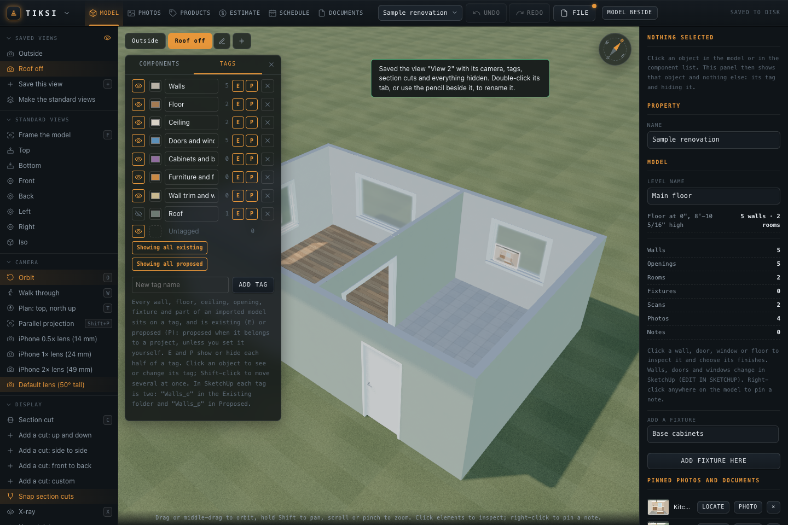

MODEL as it starts: its views, tools and tags in the left pane. Roof is hidden in the TAGS tab of the component list, so the room under the roof shows. The saved views are tabs at the top left of the model and the first group of the pane.

### Try it

1. Open MODEL. The component list floats over the left of the model: each imported model with its objects, then the plan's walls, floors, ceilings, openings and fixtures. Type in its box to find an object by name.
2. Click an object in the list or in the model. One click picks the whole object (a cabinet with its doors and handles), and the panel on the right shows that object and nothing else. Click again straight away to go one object further in (the handle); INSIDE IT in the panel does the same.
3. In the panel, choose another tag for the object, or New tag... to make one. Only that object changes tag. Shift-click more objects first to change them together; SELECT ALL picks every copy of a component.
4. Choose HIDE (or press H, or click the eye beside the object in the list) to hide only that object. Its tag and everything else on that tag stay as they are. SHOW ALL HIDDEN in the list (Shift+H) brings back everything hidden this way.
5. To move an object of an imported model, type how far under MOVE, or choose MOVE IT IN THE VIEW (M) and drag an arrow. PUT IT BACK returns it to where the model file has it.
6. Open the TAGS tab of the list for the tags themselves, with how many objects each holds. Click an eye to hide or show a whole tag. Rename a tag by typing over its name, change its colour with the swatch, add one with ADD TAG, or delete one with the X: its objects move to Untagged.
7. Choose the + at the top left of the model (or SAVE THIS VIEW in the left pane) to save the current camera as a view, with everything that decides what shows: the tags, the section cuts and whether they were done, x-ray, hidden levels, objects hidden one by one, which imported models show, BEFORE or AFTER, photo pins and notes. Click a tab to go back to it; double-click to rename; right-click to update it to what shows now (its camera too), move it or delete it. Page Up and Page Down step through the tabs. What shows is each view's own: while a view is the open tab, whatever you hide or show (tags, objects one by one, cuts, x-ray, levels, models) is kept in that view as you change it, and going to another view shows that view as it was left. Only its camera waits for UPDATE TO WHAT SHOWS NOW.
8. Every view, tool and switch of MODEL is in the left pane. Click a group's header to fold it to the header, and again to open it. The eye beside SAVED VIEWS and COMPONENTS shows or hides the saved-view tabs and the component list over the model.
9. RESTART TIKSI at the bottom of the Tiksi menu (the logo) saves what is waiting, then starts the Mac's Tiksi server again with the newest code (after a merge, say). The page reloads by itself when the server is back, in a few seconds. If photo to 3D or another long job is running on the Mac, Tiksi names it and asks before stopping it.

### Other features here

**Automatic tags.** An imported model is tagged the first time it loads. A SketchUp file keeps its own tags. Without them, part names decide (Roof anywhere in a name wins, otherwise the first building word: wall, door, floor, ceiling, cabinet, and so on), and then shape: up-facing or sloped faces above the storey are Roof, a thin slab at the floor is Floor, one at the top of the storey is Ceiling, tall vertical faces are Walls, and the rest is Furniture and fixtures. DETECT TAGS AGAIN on a selected model starts over.

**Plan elements.** Walls, floors, ceilings, doors and windows, built-in fixtures and loose furniture each start on their own tag. A new wall goes on the walls tag; one you moved stays where you put it.

**What one object is.** In a SketchUp model an object is a component, with everything nested in it, or a group. In other files it is a named part. A model that is one solid piece (a scan mesh, a point cloud) is a single object: clicking it selects the whole model.

**The whole model.** Click a model's name at the top of its objects in the list, or the model's name in an object's panel, for the whole model: its position, materials, component schedule and DETECT TAGS AGAIN.

**Hidden and moved objects.** Both are saved with the project. Drawings in DOCUMENTS leave out hidden objects and show moved ones where they now stand. Converting a SketchUp model again, or importing a new version of it, starts both over: everything shown, everything where the file has it.

**Drawings follow the tags.** DOCUMENTS draws plans, sections, elevations and 3D views with the model's tags. Each view also has its own TAGS list: leave a tag as the model has it, or show or hide it in that view only. A 3D view can start from a saved view, camera and tags together.

**SketchUp.** Exports to SketchUp, and the SketchUp mirror beside a project file, put each object on a SketchUp tag with the same name and visibility.

**What stays on the screen.** Folded groups, the eyes, the left pane itself (Tiksi menu → Left pane) and whether the page tabs show their words (right-click the tabs: Icon only, or Icon and word) belong to this browser and apply to every project. Keyboard shortcuts work whether or not a group is open.

> **Good to know:** Tags and HIDE only change what is shown. Hidden objects are still in the project, still counted in takeoffs, and still exported. A moved object is exported where it now stands.

## Edit elsewhere and compare before/after

**Where:** FILE → 3D exchange

Export a Tiksi design or selected imported model, edit it in SketchUp or Blender, then return the result while keeping a before state and the project work.

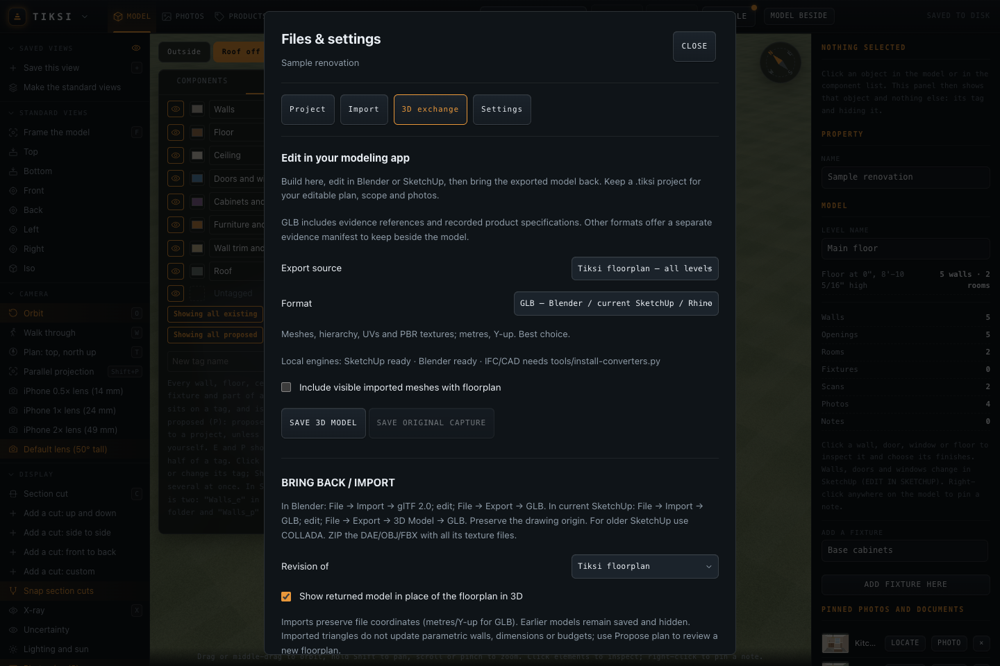

The exchange panel chooses what to export, the file format and the model that a returned revision belongs to.

### Try it

1. Save the .tiksi project first. Open FILE → 3D exchange and choose the floorplan or imported model to export.
2. Choose SketchUp, Blender or an interchange format such as GLB. Save the generated file and open it in the target application.
3. Edit and save/export from the other application. Keep the drawing origin and units consistent so the returned model aligns.
4. In the exchange panel, choose the prior model or Tiksi floorplan under Revision of, then choose IMPORT / BRING BACK MODEL. Keep Show returned model in place of the floorplan enabled. Tiksi preserves the before state automatically.
5. In MODEL, use BEFORE and AFTER to compare from the same camera. Select the visible model to inspect the appropriate materials.
6. Map material slots to catalog finishes and choose CREATE FINISH ESTIMATE. Review the resulting scope quantities, product matches and prices in ESTIMATE.

Compare the preserved before state with the proposed design

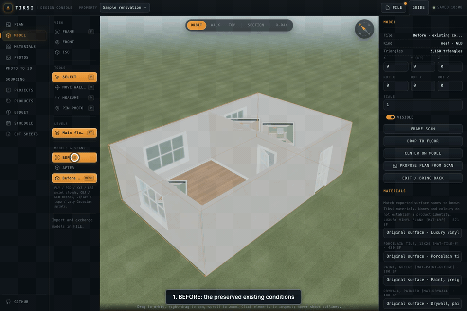

Open MODEL with a saved comparison. Choose BEFORE, inspect the earlier model, then choose AFTER. The camera stays in place while the visible design changes.

[Download the video](js/guide-assets/exchange.mp4)

### Other features here

**Native engines.** SketchUp and Blender use installed local engines. Optional CAD readers cover IFC, STEP/IGES, DXF surfaces, Rhino render meshes, E57 and LAZ.

**Other exports.** GLB carries PBR maps; COLLADA and OBJ include texture packages; STL carries geometry. Original native files remain available separately.

**Originals and conversion history.** Choose an imported source and SAVE ORIGINAL CAPTURE to download it. Expand Conversion history / agent handoffs, then REFRESH CONVERSIONS to save a handoff or delete a server copy. Server job history is separate from .tiksi saves.

**Agent interpretation.** Unconverted native files keep their original bytes, logs and interpretation packet. Download the packet for Codex or Claude to continue the work.

**Measured finishes.** Triangle surface quantities include transforms. Unique saved per-square-foot product matches can supply draft prices and product links.

> **Good to know:** A returned mesh does not automatically rewrite parametric walls or dimensions. Use PROPOSE PLAN FROM SCAN and review the result if you need a new editable plan. BEFORE / AFTER appears for returned revisions; ordinary plan edits do not create that comparison automatically. Keep native sources for their constraints and BIM relationships. Review measured areas, waste, labor and prices before ordering.

## Choose and customize finishes

**Where:** PRODUCTS → MATERIALS

Materials control the appearance of walls, floors and ceilings. Use the built-in catalog, customize it, or turn a close-up photograph into a surface material.

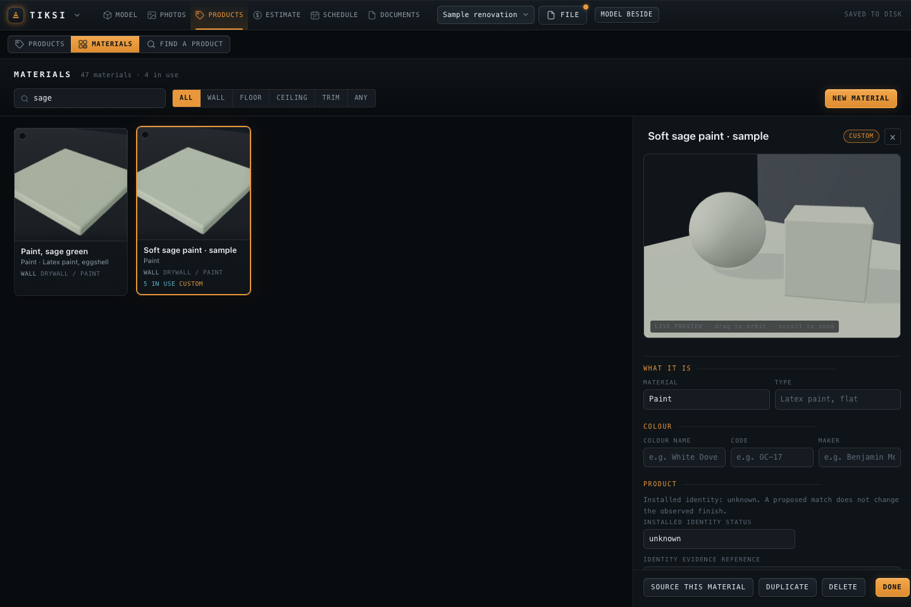

Select a material to open its preview and controls. The catalog can be searched and filtered by use.

### Try it

1. Open PRODUCTS → MATERIALS and search or filter the catalog. Select a material to preview it.
2. Adjust color, roughness and the controls offered by its pattern. For tile or plank patterns, set real repeat dimensions.
3. Use DUPLICATE when you want a separate variation. Use NEW MATERIAL for a new custom finish.
4. For a photographed finish, select its image in PHOTOS and choose MATERIAL (the new material opens here), or select/upload a source image in the material editor.
5. Put it on the model with PAINT in MODEL (Tools, or press B): choose the finish in the panel, then click a wall, a trim section, a door, a floor or a ceiling. Use SOURCE THIS MATERIAL to research a purchasable match.

### Other features here

**Paint one piece at a time.** A PAINT click paints the one piece under the pointer, as in paint by numbers. Trim and casings divide a wall: the wall above a chair rail is one piece and the wall below it another, and the panel names the piece under the pointer with its square feet and the finish it wears now. Every click is one UNDO step.

**Paint more with one click.** ONE CLICK PAINTS sets how far a click reaches. THE SAME AROUND THE ROOM (or Shift-click) paints the same band of every wall of the room, or all of the room's trim that wears the same finish. THE WHOLE WALL OR GROUP (or Cmd-click) paints a wall floor to ceiling, or a trim section with the rest of its group. PAINT THE SELECTED paints what SELECT has selected.

**Pick up and take off.** Alt-click, or PICK UP A FINISH FROM THE MODEL, takes the finish under the pointer as the one to paint with. NO PAINT OF ITS OWN takes a piece's paint off again. NEW PAINT COLOUR adds a colour with its maker and code and paints with it at once.

**Pattern controls.** Color, accent, repeat size, roughness, metalness and normal strength let you tune procedural patterns. Drag the live preview to orbit; scroll to zoom.

**Usage links.** The editor shows where a material is in use, helping you understand what an edit will change.

**Built-in reset.** RESET TO DEFAULT restores a built-in material. Custom copies can be kept as separate alternatives.

**Appearance vs product.** A visual finish is not yet a manufacturer specification. Under PRODUCT, choose the product it is from PRODUCTS; with one linked, the typed maker and number are put away. With none, type them and ADD TO PRODUCTS makes the record. A proposed product can be kept beside the installed one.

## Keep photos attached to the room

**Where:** PHOTOS

The photo gallery holds site references and panoramas with notes, room links, model links and scope links. A photo can also become a material or a 3D pin. With Tiksi running on the Mac, the gallery is the project folder: every picture in it and its subfolders shows where it is, and Tiksi keeps no copy.

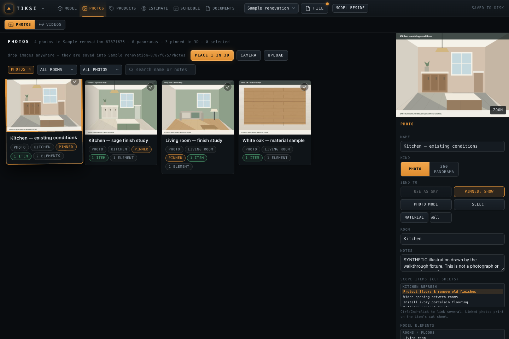

Select a gallery card to open its inspector. Send to offers PIN IN 3D, MATERIAL and panorama lighting.

### Try it

1. Put pictures anywhere in the project folder, or use UPLOAD or CAMERA (on a phone): a photo added in Tiksi is saved into the folder's Photos folder.
2. Select a card and give it a useful name, room and notes. Link the relevant scope items (listed by project and room, as ESTIMATE has them) and model elements.
3. Choose PIN IN 3D, then click the matching surface in MODEL. Use the gallery’s PLACE … IN 3D action to place unpinned photos one after another.
4. Return to PHOTOS to filter by room, or by pinned, unpinned or selected. Double-click a card or choose ZOOM for a large viewer.
5. Choose DOWNLOAD or SHOW IN FINDER when you need the original file.

Place a reference photo on a model surface

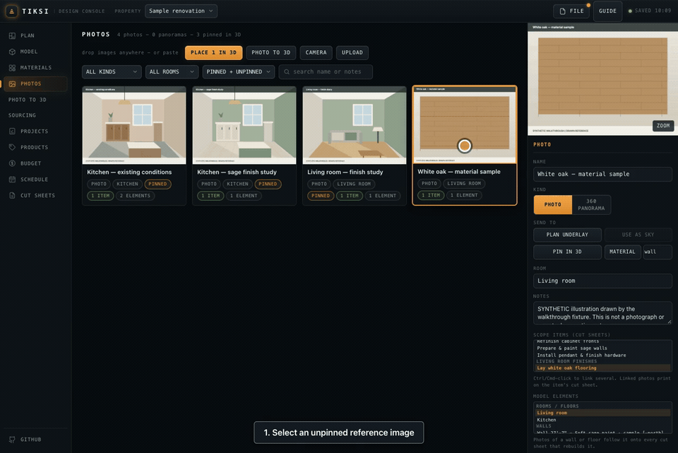

Open PHOTOS and select an unpinned reference card. Choose PIN IN 3D, then click the matching surface in MODEL to place it. Finish placement, then use PHOTO PINS → LOCATE to find a saved pin. The photo stays linked to the property.

[Download the video](js/guide-assets/photos.mp4)

### Other features here

**Photos, scan frames and renderings.** Each picture is in a group with its own button above the gallery: PHOTOS, 360 PANORAMAS, SCAN FRAMES (the keyframe photos of a Polycam raw data export in the folder; its depth and confidence maps are not pictures and are not listed), RENDERINGS (pictures in a folder named for renders, or in the project's build folder) and DOCUMENTS. Press a button to hide that group; this device remembers it. A picture can be put on a saved view (SAVED VIEW in its details): it then goes with that view to the client page when SEND TO THE LAB has it ticked. RENDER THIS VIEW in MODEL does that for the still it makes, and a rendering in the renders folder named for a view goes on that view by its name.

**Select the good ones.** Tick the corner of a card, choose SELECT in the details, or press S in the viewer while stepping through with the arrow keys. The SELECTED filter then shows only those, so a few hundred scan frames are gone through once.

**Photos Tiksi held.** Photos added before Tiksi read the project folder are moved into its Photos folder the first time PHOTOS opens, with their notes, pins and links, and Tiksi lets go of its copy. A photo already in the folder is linked to that file instead of written twice.

**Material from a photo.** MATERIAL creates a photo-based finish and opens it in PRODUCTS → MATERIALS to tune.

**360 panorama.** Mark a true equirectangular image as 360 PANORAMA, then USE AS SKY for the model environment.

**Cut-sheet evidence.** Scope links make relevant photos appear on the corresponding specification sheet.

**Match in 3D.** MATCH IN 3D opens MODEL from where the photo was taken with the photo over the model, to check walls, openings and fixtures against the site. CAMERA VIEW in the details says whether a view is saved.

**Find or move a pin.** In MODEL, clear the selection and use a PINNED PHOTOS AND DOCUMENTS → LOCATE button to fly to a pin. Select the pin for notes, print size, TURN A QUARTER, MOVE PIN or REMOVE PIN; removing a pin keeps the photo.

> **Good to know:** Where a photo hangs and where it was taken are separate. Its lens comes from the file; its camera comes from PHOTO MODE (by eye or four points), a Polycam scan frame, or automatic placement. The sample images in this guide are illustrations.

## Read tape measurements from a walk-through video

**Where:** PHOTOS → VIDEOS

A phone video of someone holding a tape against walls, doors and windows holds many more measurements than a quick look finds. VIDEOS keeps the original video with the project, points you at the seconds where a tape blade is visible, and records each reading you take from a frame. It finds likely frames; a person reads the numbers.

### Try it

1. Open PHOTOS → VIDEOS and choose ADD VIDEO (MP4 or MOV, up to 600 MB), or drop the file on the view. A video dropped on PHOTOS or chosen in FILE → Import comes here too. The original file is kept in the project.
2. With the local Tiksi server and ffmpeg on the Mac, the video is analysed once: a strip of one thumbnail per second appears under the frame, and seconds where a long yellow strip (a tape blade) is visible are outlined in yellow.
3. Use TAPE ▶ (Shift+→) to jump between those seconds. Each jump looks at the frames around that moment and shows the sharpest one in which the blade is still visible. → and ← step one second; . and , step a tenth; B looks for the sharpest frame near any moment.
4. Scroll to zoom and drag to pan. Shift+drag (or CROP) draws a box around the numbers; the box is kept with the reading.
5. Type the value as the tape shows it: 33 1/2, 33-1/2", 2'-9 1/2" or 850 mm. A bare number means inches, or millimetres when Settings shows millimetres; the field shows how it was read. Add what was measured, the direction (width, height, depth) and how sure you are (clear, probable, unreadable).
6. Attach the reading to a wall's length, a door opening's width or height, a door leaf's width, or a window's width or height, or keep it as a note. SAVE READING stores it with its frame. APPLY changes that size in the model, so UNDO on the top bar reverts it.
7. Readings nobody has explained yet (no element, nothing said about what was measured, or unreadable numbers) collect in ASK THE OWNER with their frames. COPY LIST copies the questions as text to send.

### Other features here

**Without ffmpeg.** The server reports that frame extraction needs ffmpeg (brew install ffmpeg). Videos are still kept, and a video this browser can play is reviewed in its own player; readings capture the frame shown.

**What the candidates mean.** Each second is checked for yellow pixels that form one long, narrow shape of reasonable size. Yellow walls, wood and small yellow objects are passed over. The timeline shows each candidate's strip size and length ratio. It ranks frames for review and does not read the numbers.

**Readings and the model.** A reading that was applied and later undone or edited shows NOT IN MODEL. Changing an applied reading's value or element makes it a new proposal to apply.

**Saved with the project.** The video, the frame saved for each reading and the crop travel inside the .tiksi file. The contact sheet and candidates are derived and rebuilt when needed.

> **Good to know:** Unsupported or damaged files are reported, not dropped: a file that is not MP4/MOV is refused with the reason, and a video that cannot be decoded is kept and marked NOT READABLE with the decoder's message.

## Reconstruct a model from photos

**Where:** FILE → Import → PHOTOS → 3D

On a supported Mac, Apple Object Capture can turn overlapping original photographs into a textured model. Use Polycam for a room capture when that is the more practical route.

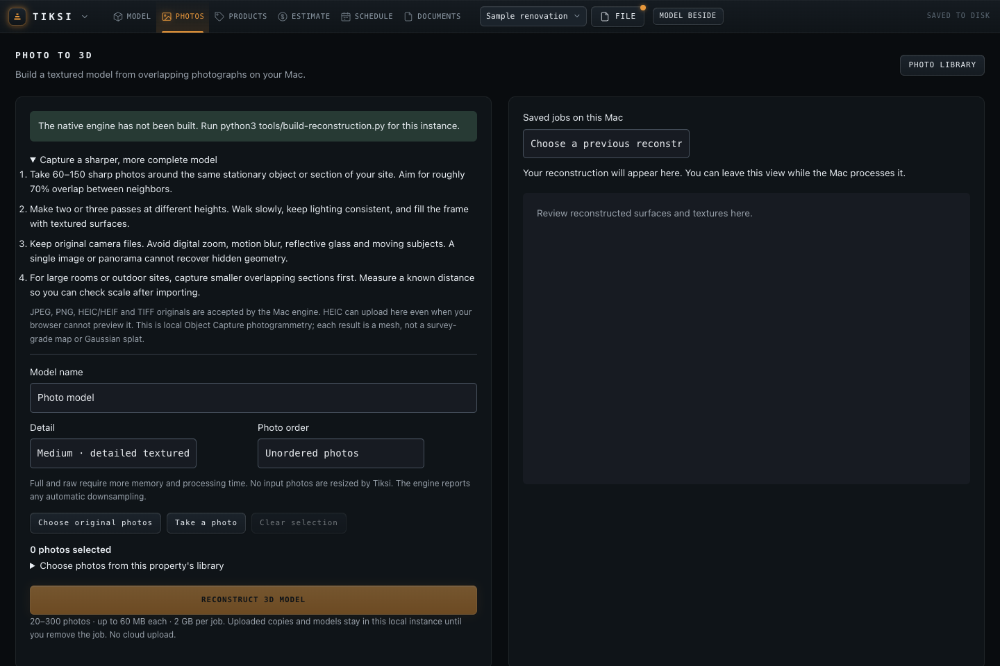

PHOTO TO 3D, opened from FILE → Import, separates selecting photos and reconstruction settings from reviewing saved jobs and importing a result.

### Try it

1. Take sharp photographs while moving around the subject or space: aim for 60–150 images with about 70% overlap from two or three heights. Keep lighting consistent and retain the originals.
2. Open FILE → Import → PHOTOS → 3D. Choose original photos or select stored gallery images; the local engine requires at least 20 images.
3. Name the model, choose detail and photo order, then start RECONSTRUCT 3D MODEL. Preview detail is useful for checking a capture before a larger run.
4. Monitor the job. You can leave the page and come back to the saved job on this Mac through FILE → Import → PHOTOS → 3D.
5. When complete, choose Review in 3D, Save GLB or Save native OBJ and maps. Choose Add to this property to keep the result with the design, then check its placement and scale in MODEL against a known dimension.

### Other features here

**Original image retention.** Selected originals are sent to this local Mac for the reconstruction job. Property photos retain their original bytes.

**Detail settings.** Higher detail can take more time and memory. A poor capture is not fixed simply by selecting Raw.

**Capture limits.** The current engine accepts 20–300 original photographs, up to 60 MB each and 2 GB per job. Panoramas are excluded. Keep the Mac awake during processing.

**Job management.** Cancel a running job when needed. Removing a terminal job deletes that job’s server copies separately from property photos.

> **Good to know:** Reconstruction needs the local server, the native worker and supported Mac hardware. Reflective, transparent or low-texture spaces can reconstruct poorly. No reconstruction is shown as completed in this guide using the illustrated sample images.

## Research real products and suppliers

**Where:** PRODUCTS → FIND A PRODUCT

Start from a material, a model element, a scope item, a product or a brief. FIND A PRODUCT researches alternatives and keeps the evidence with the selections you save.

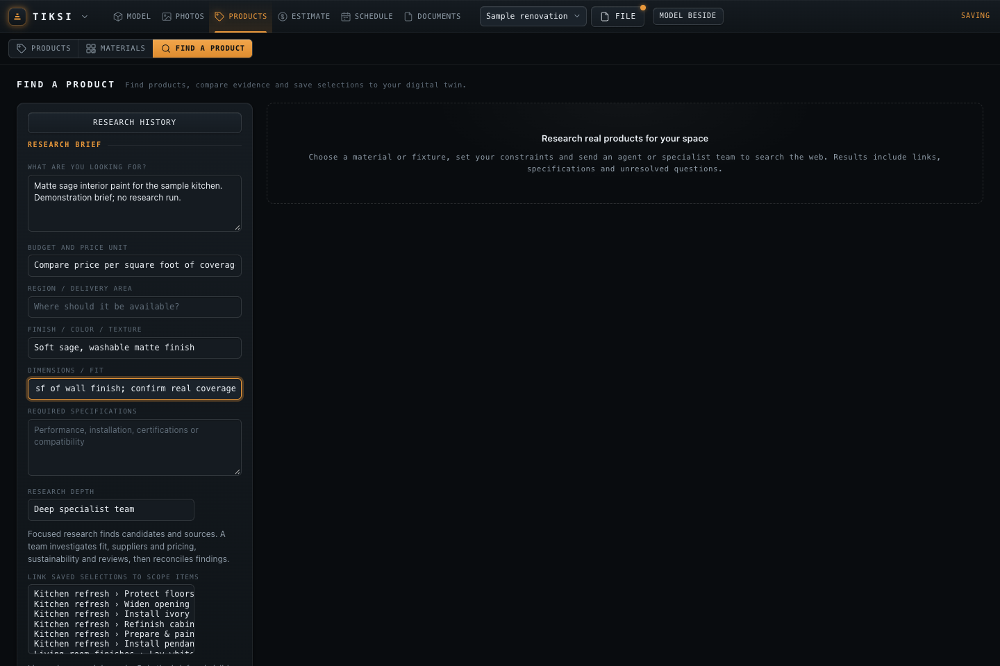

The brief collects the required product, budget, region, dimensions and specifications before research starts.

### Try it

1. Open PRODUCTS → FIND A PRODUCT, or choose SOURCE THIS MATERIAL (a material), RESEARCH ALTERNATIVES (a product) or FIND A PRODUCT (a scope item's record in ESTIMATE).
2. Describe what you need and include finish, size, price unit, budget, region and required performance. Link scope items (listed by project and room) when appropriate.
3. Choose Focused agent or Deep specialist team, then START RESEARCH. The local server needs its research provider to be ready.
4. Review candidates, vendor offers and cited evidence. Select candidates and use COMPARE SELECTED for a side-by-side view.
5. Use SAVE TO PRODUCTS for a chosen candidate. Review the saved product and its scope links before using its price in the project.

### Other features here

**Browse while it works.** Return to other workspaces while research runs, then reopen the job.

**Evidence and unknowns.** Inspect opened sources, fit notes, conflicts and missing information instead of relying on a product name alone.

**Revisit progress.** The job panel exposes current status and cancellation. Returning to FIND A PRODUCT restores the current saved job; cancellation does not resume it later.

**Selection history.** Saved product selections carry their research context and evidence in project files.

> **Good to know:** Live research needs the local server and a current, signed-in Codex CLI on its host. The availability message explains setup problems. The screenshot shows a brief, not fabricated live results. Saving a candidate does not order it; confirm current supplier price, availability, price units and fit before purchasing.

## Keep specifications and ordering links

**Where:** PRODUCTS

Products are the real fixtures and materials you may buy. Keep manufacturer details, specifications, price units and vendor links connected to the scope.

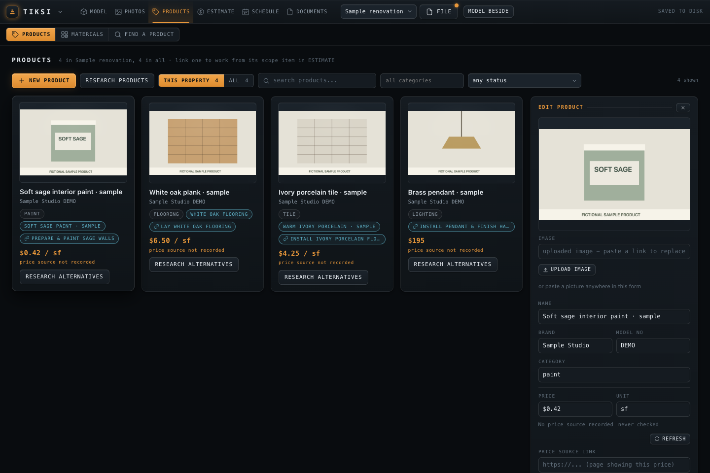

Open a product card to edit its image, price and where that price came from, vendor and manufacturer links, specification lines and spec documents, and to see the work it is used in.

### Try it

1. Choose NEW PRODUCT for a manual entry, or save a candidate from FIND A PRODUCT. A new product needs an image: paste an image link, upload a picture or paste one into the form.
2. Enter brand, model, category, specification lines and notes. Type a few letters in Category to narrow the list, or type a new category. Add the vendor link (where to buy) and the manufacturer link (the maker's product page).
3. Record the price with its unit: each, square foot or linear foot, for example. Under the price, keep the link to the page showing it; Tiksi records the date it was checked. REFRESH asks a research agent for the current price of that exact model and changes the price only when it finds a verified USD price.
4. Link a product to the work from the scope item's record in ESTIMATE (Products, + Link a product). The product then lists the items it is used in, each opening its project in ESTIMATE; the item lists the product on its cut sheet; and the product is saved in that property's project file.
5. Open the saved manuals and spec sheets, the spec folder or the project folder from the editor (on the Mac that keeps the project folders), or use CUT SHEETS to print the saved specification.

### Other features here

**This property or all.** THIS PROPERTY shows the products linked to the open property's work or materials, or added while it was open. ALL shows every property's products.

**Status filter.** Find products missing an image or price, prices not checked in 90 days, products with spec documents, or products not yet linked to work.

**Research alternatives.** RESEARCH ALTERNATIVES opens FIND A PRODUCT from an existing product without losing its current saved specification.

**Boards from the estimate.** Every trim board a project buys is a product here, one per store item (an 8 ft and a 12 ft board are two), with the store page, item number and the price seen there, made when ESTIMATE first opens the project. ESTIMATE prices each board from its record, so a price checked or changed here changes the estimate.

**Evidence history.** Products saved from research retain cited evidence and source context. Every price change keeps its source link and date.

**Estimate matching.** A unique product/material match with a per-square-foot price can contribute to a model finish estimate. Ambiguous matches stay unpriced.

> **Good to know:** Tiksi stores purchasing information and vendor links. It does not place orders, manage supplier inventory or confirm a current quote. The sample prices in this guide are fictional.

## Price a project room by room

**Where:** ESTIMATE

ESTIMATE is where a project is set up and priced. A project holds its rooms. Each room has its drawn trim, worked out the way a finish carpenter would (every piece with its ends, the boards to buy at the cheapest store length, the supplies and the hours), and the rest of the work done in it as scope items. Then come the project's contingency, overhead and profit, and tax. Change the drawing or a number and the price follows.

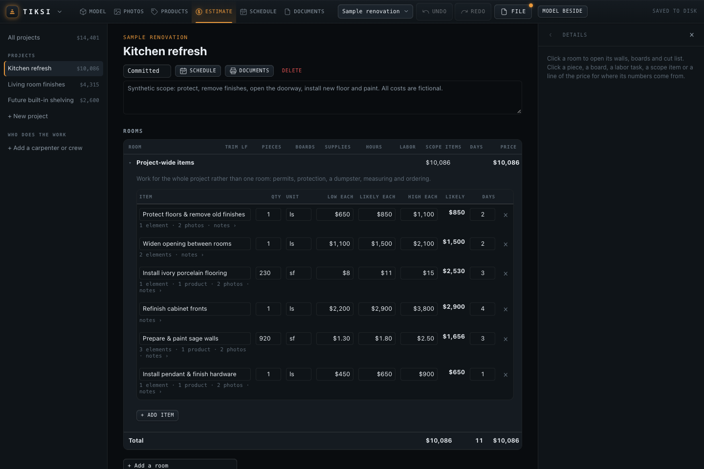

A project's rooms, each with its trim, boards, supplies, hours, scope items and price.

### Try it

1. + NEW PROJECT, at the foot of the projects on the left, starts a project for the open property. Type its name over the title, set its status (Idea, Scoped, Committed, In progress, Done) and write its notes under it. DELETE takes it away with its rooms.
2. + Add a room, under the rooms table, adds a room from the model by its name, or a room or area not in the model, named where it is added. Open a room to rename it, link it to a room in the model, or REMOVE THIS ROOM.
3. Draw the trim in MODEL with each section in its room (WALL TRIM, or right-click; the PROJECT section of the panel puts selected pieces in a project's room). Open the room for its walls as drawn with the boards each is cut from, its cut list and its labor. In the labor table type over a quantity or a time (hours each) to change it for that room; RESET goes back to the drawing's count. + Add a task adds one the drawing does not count.
4. Under SCOPE ITEMS in the room, + ADD ITEM adds the rest of the work: type its name, quantity, unit, low, likely and high price each, and working days; × removes it. Under the name, pick the work and finish level from the price book and, for a measured item, the quantity it counts. PROJECT-WIDE ITEMS holds work for the whole job: permits, protection, a dumpster, measuring and ordering.
5. Click an item's details link for its record in the right-hand column: its status, what it starts after, notes, the rooms and walls it is linked to in the model, its products and photos, CUT SHEET and FIND A PRODUCT. Click a piece, a board, a labor task or a line of the price for where its numbers come from. A task lists every room it is in (click one to go there); a moulding lists the store items bought, each with its store page and its record in PRODUCTS.
6. Under WHO DOES THE WORK (left) add a carpenter or crew with their hourly rate and, for any task, their own time. Choose them under WHO DOES IT in a project's price.
7. Under HOW THE PRICE IS BUILT set the rate (without a carpenter chosen), contingency, overhead and profit, the discount, tax on materials, the spare boards and the price book area. The price reads in one column: materials, labor, discount, tax and total; the discount comes off before tax, and tax is on the materials as bought. Click any number on the page, in the rooms table or the price, for how it is worked out on the right; each answer links on down, from a room's supplies to the supplies list, one product and the measure of the drawing it is counted from. SCHEDULE, ALL PROJECTS, the proposal and the one-pager follow.
8. Record carpenters' bids under BIDS RECEIVED, beside the estimate's labor.
9. ALL PROJECTS (top left) ticks projects into the program and compares them with the budget cap; PRINT REPORT prints it.

### Other features here

**Pieces and boards.** Inside corners are coped (the longer piece runs square into the corner), outside corners mitred, runs longer than a board spliced with 45° scarfs. Each room is cut from its own boards; each board is bought at the cheapest length the store sells that holds its cuts, plus a spare of each moulding.

**Hours.** Each task's quantity, counted from the drawing (feet of base, rail and cap, frames, battens, copes, outside corners, scarfs, caulk, fill and paint, with setup and cleanup each day in a room), times its time: the carpenter's own when one is chosen and has one, otherwise the published production rate. A time or quantity typed in a room wins over both. Low and high hours come from the published rates' range.

**Add from the model.** With MODEL BESIDE on, right-click a room, a wall, a door or window, a fixture or an object of an imported model and choose the ADD entry: it adds to the room opened last in ESTIMATE, or to the project-wide items when no room is open. The item arrives measured: a room brings its walls net of doors and windows, floor, ceiling, baseboard and perimeter, and its door and window counts; an object brings its count, face area and length from its box, and ADD ALL adds every copy of it. Right-click one of several selected things to add them all as one item.

**Work, finish level and unit.** Under an item's name, pick the work (paint, refinish, replace, install …), the finish level (Budget, Mid, High end) and, for a measured item, which quantity it counts. Quantity, unit and the low, likely and high prices each follow from the price book: installed prices with a placeholder material for each level, to be replaced with the product you choose. The price book area, under HOW THE PRICE IS BUILT, applies a cost area such as New York City to every item of the project. A price typed by hand stands until you pick the work or level again. A room also counts the toilets, vanities, tubs and dishwashers drawn in it and estimates recessed lights at one per 25 sf of ceiling; a base cabinet run brings its length and counter top. Permits are priced per permit from each place’s own fees: add an item and pick one under Permits.

**Draft finish estimates.** CREATE FINISH ESTIMATE on an imported model in MODEL seeds measured scope items. Review and complete them here.

**Counted once.** A scope item whose model elements are all drawn trim of the same project (boards written in by an earlier trim package) is left out of the money and the days; REMOVE THEM takes such items away.

**Store prices.** Each board bought is a record in PRODUCTS (one per store item: an 8 ft and a 12 ft board are two), with its store page, item number and the price seen there. Check or change the price in PRODUCTS and the estimate follows.

**Removed, not lost.** A removed project, room or scope item is kept with the property: FILE → Project → REMOVED RECORDS… puts it back as it was.

**Across properties.** ESTIMATE, SCHEDULE and CUT SHEETS show the projects of the property chosen on the top bar. A new project belongs to that property.

**Undo.** UNDO and REDO on the top bar cover the projects, their rooms and scope items, the estimate settings, typed quantities and times, and bids.

> **Good to know:** Prices are each: 120 square feet at $5 a square foot is $600; use a quantity of 1 for a lump-sum quote. An item with no working days stays out of the schedule. Hours are the weakest numbers: they come from estimating books, not from the carpenter who will do the work, until you type their own times; send the installer bid form (in the trim package) and compare. Trim imported as a model, not drawn as trim sections, is not in the estimate.

## Schedule the work

**Where:** SCHEDULE

SCHEDULE shows when the work happens, in working days, Monday to Friday. One carpenter does a project's trim room after room; scope items run with the job unless they are set to start after something.

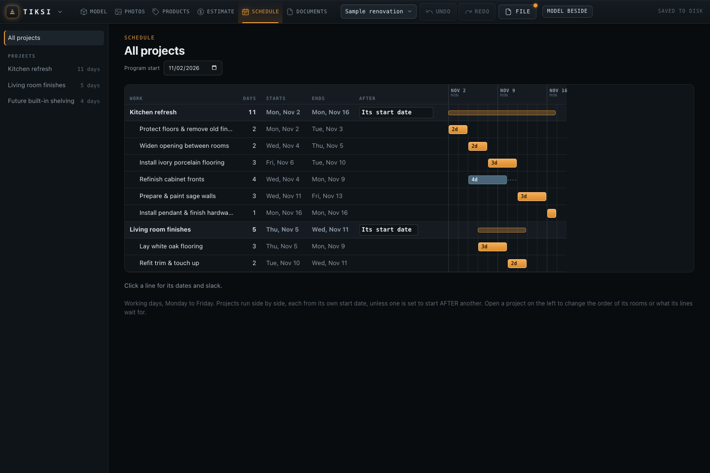

One table: each line's days, start, end and what it waits for, with a chart of working days beside it.

### Try it

1. Choose a project on the left. Set its start date at the top.
2. Move a room up or down to change the order the carpenter works in. Double-click a room (or click its ▸) for its tasks in the order they are done, from setup to cleanup, each with its hours.
3. For a scope item, choose what it starts AFTER: another item or a room's trim. Give scope items their working days in ESTIMATE; a room's days come from its hours at 6 productive hours a day.
4. ALL PROJECTS lays the program out from the program start: projects side by side, each from its own start date, or AFTER the project it should follow.
5. Click a line for its dates and slack.

### Other features here

**Working days.** Bars and dates skip weekends, so a 5-day room started on a Thursday ends the next Wednesday. Holidays are not known.

**Critical work.** Lines that set the finish are amber; others show the slack they can move within.

> **Good to know:** The schedule does not know crew sizes beyond the one carpenter, deliveries or inspections; set lines to start after what they wait for.

## Print a useful specification sheet

**Where:** DOCUMENTS → CUT SHEETS

Cut sheets gather the information attached to a scope item or product into a printable handoff: dimensions, materials, photos, specified products and cost context.

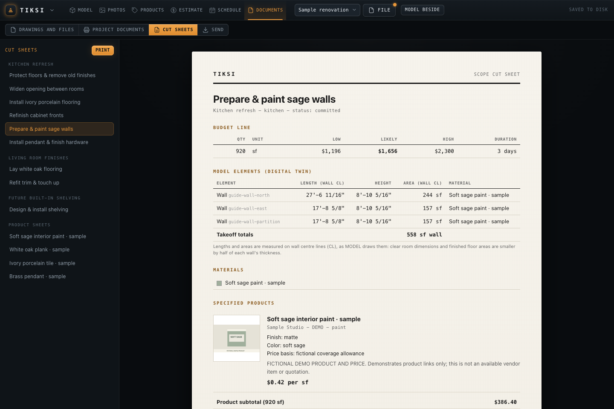

Choose a scope item or product from the list, review its sheet, then PRINT.

### Try it

1. Link the relevant model elements, materials, photos and products before printing.
2. Open DOCUMENTS, choose CUT SHEETS and select the scope item you want to communicate, or choose a product sheet. CUT SHEET in a scope item's record in ESTIMATE opens that item's sheet.
3. Review the generated content. Missing information is best completed in ESTIMATE, PRODUCTS or PHOTOS.
4. Choose PRINT and use the browser print dialog to print or save a PDF.

### Other features here

**Scope-item sheets.** Combine the work description with linked elements, takeoffs, materials, site photos and products.

**Product sheets.** Show the saved manufacturer/model details, specification lines, price unit and vendor link.

> **Good to know:** These are specification handoffs built from your saved information. Review them before issuing instructions or ordering materials.

## Make a drawing set from the model

**Where:** DOCUMENTS

DOCUMENTS lays the model out on drawing sheets, the way a layout program sits beside a 3D modeller. Plans, sections, elevations and 3D views are placed at a drawing scale and redraw whenever the model changes, so the set never falls behind the design.

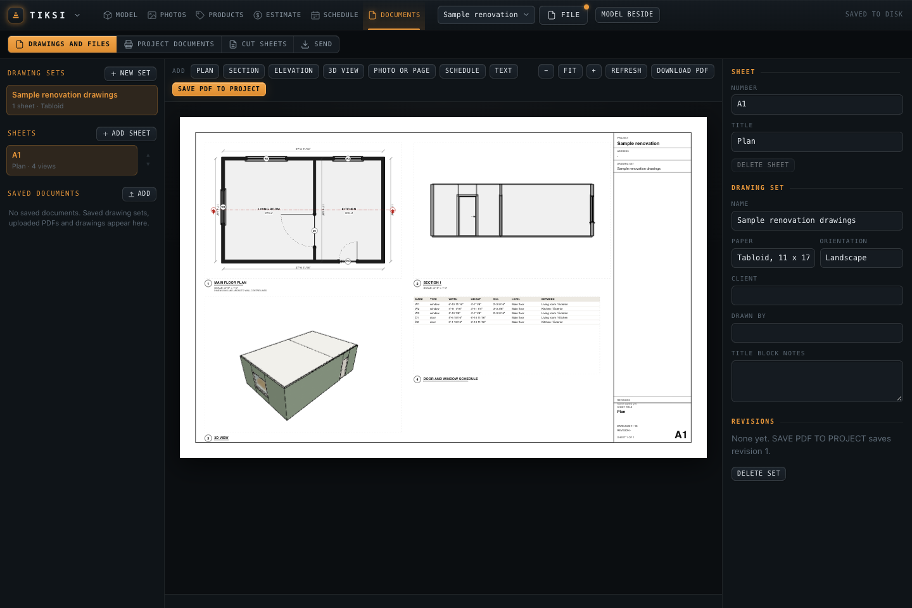

A sheet with a floor plan cut at 3'-11", a section through the plan, a 3D view and a door schedule, with the title block down the right edge.

### Try it

1. Open DOCUMENTS and choose NEW SET. A set starts with one sheet on 11 x 17 paper; change the paper, orientation and title block in the panel on the right.
2. Use ADD to place a PLAN, SECTION, ELEVATION, 3D VIEW, PHOTO OR PAGE, SCHEDULE or TEXT on the sheet. Drag a view to move it and drag its corner to resize it.
3. Select a view to set its scale, style, level, cut height or camera. Double-click a model view to adjust it on the sheet: drag to pan, scroll to change the scale, or orbit a 3D view.
4. Add sheets with ADD SHEET. Drawing numbers run across the set, and section cuts are marked on the plans.
5. DOWNLOAD PDF for a copy, or SAVE PDF TO PROJECT to keep it in the property as the next revision. Saved PDFs, uploaded drawings and product documents are listed under SAVED DOCUMENTS.

### Other features here

**Live views.** Plan cuts, sections, elevations and 3D views render from the current model, including imported SketchUp and scan models, every time the model changes.

**Drawing scale.** Orthographic views use architectural scales from 1" = 1'-0" to 1/32" = 1'-0", with a FIT button to frame the plan.

**Plan layer.** Plans draw the cut walls solid, door swings, windows, wall dimensions and room names with areas as crisp vectors over the model.

**Schedules.** Door and window, room, product and scope item lists stay in step with the model, PRODUCTS and ESTIMATE. A PLAN view can show each door and window's number from the schedule (Door and window numbers, with Wall dimensions and Room names and areas).

**Revisions.** Each saved PDF becomes the next revision in the title block and a document of the property, so it travels in the project file.

> **Good to know:** Views are rendered images of the model at the chosen scale; check dimensions on site before ordering or cutting. PDFs are printed at 150 dots per inch.

## Print the trim package and the proposal

**Where:** DOCUMENTS → JOB DOCUMENTS

JOB DOCUMENTS prints what a project needs from its estimate. The summary is one page for the client: each room's materials (boards and supplies), hours and labor, then the materials, labor, discount, tax and total. The trim package is the book for the carpenter and the yard; the proposal is one page for the client. Both carry the estimate's figures and the schedule's dates.

Choose the project and the document; the right column holds your business details and the proposal's terms.

### Try it

1. Open DOCUMENTS and choose JOB DOCUMENTS, then the project (DOCUMENTS → SEND lists each project's proposal too).
2. TRIM PACKAGE: a summary, options priced other ways, the buy list, each room with its walls and the boards cut for them, cut lists, the installer bid form with hours, the price build-up and appendices for supplies, tools and labor rates. Its total is the trim at cost with the contingency.
3. PROPOSAL: the work room by room, the price, the working days and dates, the deposit, what is and is not included, and a place to sign. Fill in your business and the client on the right.
4. PRINT OR SAVE PDF, then Save as PDF for a PDF with real text.

> **Good to know:** Check lengths on site and store prices before ordering.

## Send the client a one-pager

**Where:** DOCUMENTS → SEND → OPEN ONE-PAGER

Every property has a one-page teaser for its client: a picture, the pitch, the scope, the budget range and the schedule on one Letter page. The text is drafted from the project and can be edited by hand; every saved version is a PDF among the property's documents, and the newest version is the one to send.

### Try it

1. A new property has its text drafted from the project when it is made. No version is saved until you save one: a one-pager with nothing priced is not worth sending.
2. Open DOCUMENTS → SEND. It says whether the newest version is current or the project changed since. OPEN ONE-PAGER opens the editor; the page on the right follows every edit.
3. Edit the headline, tagline, summary and highlights, name who it is prepared for and by, and choose the picture at the top: the newest rendering or site photo, a 3D view of the model, or the floor plan. Toggles take the budget range, schedule, rooms, plan or products off the page.
4. SAVE VERSION makes the next PDF and lists it among the property's saved documents (DOCUMENTS → DRAWINGS AND FILES). DOWNLOAD PDF gives a copy of the page as it looks now; SEND… hands the newest version to Mail, Messages or AirDrop where the browser offers that.
5. When Tiksi closes while the project changed since the newest version (or none is saved), the browser first asks Leave site?. Cancel to stay, and Tiksi asks UPDATE THE ONE-PAGER?: UPDATE NOW saves the next version right there, REVIEW FIRST opens the editor, NOT NOW keeps quiet until the project changes again. Leave closes without a new version.

### Other features here

**Text that follows the project.** Until a line is edited by hand, the headline, tagline, summary and highlights are written again from the rooms, floor area, scope, budget, schedule and products each time a version is saved. REDRAFT FROM THE PROJECT writes them again on purpose.

**What a version was made of.** Each saved version remembers the project it was laid out from, so SEND and the closing question can say whether the one-pager is current or behind.

**Versions.** Versions are numbered and dated: 12 Elm Street - one-pager v3 - 2026-11-06.pdf. Older versions stay in the documents, so what was sent last month can be found again.

**When closing asks.** Remind me when closing Tiksi, beside OPEN ONE-PAGER in SEND: when the project changed since the last version (the default), every time, or never.

> **Good to know:** The page is laid out in the browser and printed at 200 dots per inch, so it looks the same everywhere. Browsers only let a page ask a generic Leave site? question before it closes, which is why Tiksi's own question comes after choosing to stay.

## Send the client a page in the lab

**Where:** DOCUMENTS → SEND → SEND TO THE LAB…

A view-only copy of the property goes to its page in the lab on thedurham.nyc. The page is Tiksi's own MODEL, with little switched on: the saved views as pills along the top, the renderings as small pictures along the bottom, orbit and walk, Existing or one of the projects you send (it opens on the first project), furniture on or off, and the drawing quality (it starts at Ultra; a client on a slow phone can lower it). The left pane slides away and comes back at the left edge. On a phone it is Tiksi's phone layout: the model full screen, the three-line button, the pills along the top and the renderings along the bottom.

### Try it

1. Put the new work in projects: in MODEL, select pieces and choose their project in the PROJECT section. Save views in MODEL; the first one ticked is where the page opens.
2. In DOCUMENTS → SEND (which says when the page was last sent), choose SEND TO THE LAB…. Tick the projects to offer and give each a short name, and tick the tags the furniture switch hides.
3. Look over VIEWS AND RENDERINGS: every saved view is listed with a tick, and under it the renderings of that view, each with its own tick and a box for the name the client sees. Untick what should not go. The line above SEND counts what is going.
4. Press SEND. A small frame in the window shows the client page taking the picture of each view; keep the window in front until it says Sent.
5. OPEN THE PREVIEW shows the copy as sent, on this Mac. OPEN THE LAB PAGE opens it online when the Mac has the lab's upload key.
6. Give clients access on the lab's own page: the lab shows a section only to the emails granted it.

### Other features here

**The views and renderings on the client page.** Each saved view sent is a pill along the top of the model; a click goes there. The strip along the bottom starts with the iterations (Existing and each project sent; the page opens on the first project) and then has a small picture of every rendering, of every view, in the order of the views; the ones of the view on screen are marked. The left pane, which slides away and comes back when the pointer reaches the left edge, has the same small pictures. A click on a rendering opens it in a window floating over the model, which can be dragged by its bar, resized at its corner and closed, while the model stays in use behind it. Its arrows, and the arrow keys, step through every rendering of every view, and the model goes to the view of the one showing; going to another view with the window open shows that view's first rendering. SEE THROUGH lays the rendering over the whole model, half clear and lined up with the view's camera, so the model shows through it.

**Stars and comments.** Under each rendering the client can star it and write a comment. On thedurham.nyc they are kept by the website for each person signed in (in its own page notes, under the page name followed by /renderings), so they come back on any device; you, as the lab's owner, also see everyone else's under your own. On this Mac's preview copy they stay in that browser only, and the window says so. A starred or commented rendering is marked in the strip.

**The pictures of the views.** During a send the client page's own code opens the copy on this Mac and takes a picture of every view under Existing and under each project. If the pictures cannot be made the send still goes and says so.

**Renderings of a view.** A rendering goes to the client only with the saved view it is on, and only while its tick is on. RENDER THIS VIEW (right-click a view's tab in MODEL, or the pencil beside it) makes a still of the view and puts it on that view. A rendering made elsewhere and kept in the project's renders folder goes on the view its file is named for (the view's name first: "Kitchen.png", "Kitchen - walnut option.jpg"). SAVED VIEW in a picture's details in PHOTOS, and the list under each rendering in SEND TO THE LAB, put a picture on a view or take it off. The client gets a copy at most 2400 pixels on its long side, under the name typed for it (or "Rendering" and its date), never its file name. A rendering new since the last send is marked NEW. The ticks are kept with the property as they are flipped.

**Sending again.** Sending again replaces the copy at the same link, in one step; a client's open page keeps the old copy until they reload.

**What is left out.** Products, prices, project scope and notes, every photo that is not a ticked rendering of a ticked view, photo pins, notes, measurements, documents, the scan capture, the record of where measurements came from, and any project or saved view not ticked. Each saved view shows as it is saved in MODEL: its tags, the pieces it hides, its cuts, x-ray and levels; the furniture switch starts as the view has it, and turned on shows all the furniture.

**Walking on the client page.** A tap or click on the floor walks there; the arrows on the floor at each doorway step through it.

> **Good to know:** The upload key is the website's own file-storage key, kept on this Mac in ~/.r2-credentials. Without it a send goes to this Mac's preview copy only, and SEND TO THE LAB says so.

## Settings, backups and storage

**Where:** FILE → Settings

Display units, where projects are kept, the SketchUp mirror and workspace maintenance live in FILE → Settings. Most everyday work needs only project saves.

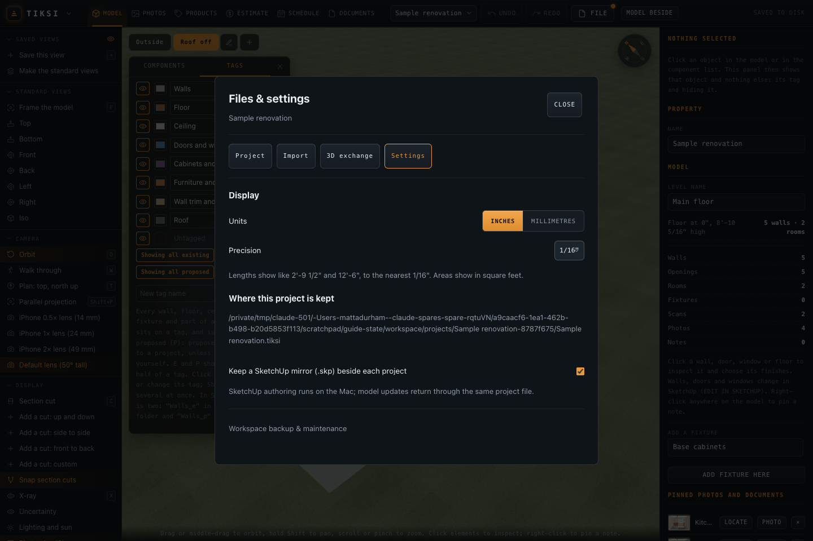

Settings groups display, where the project is kept and workspace maintenance. This synthetic screenshot shows the static edition’s folder controls; the local server displays the canonical Mac file path instead.

### Try it

1. Open FILE → Settings and choose INCHES (feet and inches, square feet) or MILLIMETRES (square metres). Precision sets how finely lengths show: 1/16" and 1 mm unless you change it. Stored lengths are never rounded.
2. Render quality and lighting are MODEL's own: open Lighting and sun under DISPLAY in MODEL.
3. With the local server, Where this project is kept shows its canonical .tiksi path on the Mac. Desktop and Tailscale clients share those files and originals.
4. In the static edition, CHOOSE FOLDER links the open project to a folder. OPEN FROM FOLDER reopens a saved copy, and KEEP THEM IN ONE FOLDER links projects without a folder of their own. These controls depend on browser folder permission.
5. Open Workspace backup & maintenance and choose SAVE WORKSPACE BACKUP to export every property together. Browser-storage maintenance applies to the static edition.

### Other features here

**Keep a SketchUp mirror.** With the local server and SketchUp on this Mac, each project gets a .skp beside its canonical .tiksi. Keep Tiksi open on the Mac while authoring so saved native edits return to the shared project; phone clients see the synced results. The static edition instead needs a linked folder. EDIT IN SKETCHUP in MODEL opens the native file on the Mac.

**Save workspace backup.** Exports every property together. Keep a .tiksi per property for ordinary project handoffs.

**Add demo projects.** Adds sample projects to the workspace without replacing unrelated properties.

**Onboard with a coding agent.** Under Workspace backup & maintenance: a prompt to paste into Claude or Codex, opened in the Tiksi checkout with a site-visit folder, so the agent follows Tiksi's onboarding steps for this property.

**Clean unused storage.** Removes unreferenced browser assets only after the offered review/confirmation. Keep them if you need them for an older JSON-only project.

**Replace from backup.** A separate explicit restoration action that replaces the workspace. Use ordinary OPEN / IMPORT to merge a project instead.

> **Good to know:** Local-server project files are authoritative. Migration preserves a recovery bundle before removing old browser data. SAVED TO DISK — CLOSE OLDER TIKSI TABS means the files are saved; close older app tabs to finish browser cleanup. Converter and reconstruction jobs are separate copies, so removing a job does not manage the saved project files.

## Use Tiksi on a phone

**Where:** The side panel (the menu button)

On a phone Tiksi opens on the model, full screen, with one side panel behind the menu button at the top left. The panel offers capture first, then the model's views and switches, then every page, the GUIDE and FILE. Controls are sized for a finger on any touch screen; a narrow window on a computer keeps its mouse sizes.

### Try it

1. Tap the menu button. TAKE A PHOTO opens the camera: the photo joins this property's PHOTOS, and MODEL asks you to tap where it was taken. ADD A NOTE asks you to tap where the note belongs. DONE in the banner over the model stops either.
2. Under View, Saved views, Show, Tags and Levels, flip what the model shows; the panel stays open for the next switch. Quality on this device sets how finely this phone draws, separately from the computer.
3. Under Pages, open any page, the GUIDE or FILE. The bar at the top of each page keeps the menu button, the page name and the save state; tap the save state for its full wording.
4. DESKTOP LAYOUT at the foot of the panel shows the computer's layout on this phone. PHONE LAYOUT in its top bar comes back.

### Other features here

**Mark up on a phone or an iPad.** Mark up, under Measure in the side panel on a phone or MARK UP in the tool column on an iPad, opens the drawing bar over the model. For an Apple Pencil, turn Scribble off in the iPad's Settings, Apple Pencil: with it on, the iPad can swallow pencil strokes on a web page.

**PHOTOS on a phone.** One column with the camera first. A tapped photo's details slide up over the gallery; CLOSE, or the photo again, puts them away.

**ESTIMATE on a phone.** A room's scope items stack as cards: the name across the top, its numbers in boxes under it. Removing an item asks first; REMOVED RECORDS (FILE) brings it back.

**SCHEDULE on a phone.** Tap a bar for its dates and slack; the line above the chart shows them.

**DOCUMENTS on a phone.** Sheets and saved documents are for looking at: arrange sheets and save PDFs on the Mac. Product documents in the project folder open on the Mac running Tiksi.

**PHOTO TO 3D on a phone.** Open it from FILE → Import. The camera takes one photo per tap. TAKE A PHOTO then reads TAKE ANOTHER PHOTO with the count so far; CLEAR SELECTION starts the count again.

> **Good to know:** A phone keeps only what it has not sent yet; the Mac holds the project. The save state in the bar says whether everything has reached it.

## Shortcuts and common questions

Use the visible tooltips and inspector labels when you forget a control. These are the most useful navigation, saving and recovery patterns.

### Other features here

**Save / open.** Cmd/Ctrl+S: save. Cmd/Ctrl+Shift+S: save as. Cmd/Ctrl+O: open.

**Model navigation.** Drag or middle-drag: orbit. Shift+drag or right-drag: pan. Wheel or pinch: zoom. F: frame. O: orbit. W: walk. T: top, in parallel projection. Shift+P: parallel projection on or off. C: section. X: X-ray. G: the Scan capture tag. K: the Furniture and fixtures tag. Page Up / Page Down: previous or next saved view. D: measure. P: pin photo. N: note. Right-click: note menu.

**Mark up.** U: mark up on or off, in MODEL. While it is on, P: pen. H: highlighter. E: eraser. N: numbered note. V: move the view. 1, 2, 3: line width. Space-drag: move the view. Cmd/Ctrl+Z and Cmd/Ctrl+Shift+Z: undo and redo a mark. Esc: leave.

**Undo.** UNDO / REDO on the top bar work in MODEL and PHOTOS → VIDEOS (applied tape readings), and for the projects in ESTIMATE and SCHEDULE. Cmd/Ctrl+Z: undo. Cmd/Ctrl+Shift+Z or Ctrl+Y: redo. History is per project for the current session. Escape ends an active tool action.

**Where is save/import?.** Open FILE at the top (on a phone, FILE in the side panel). Project handles .tiksi files; Import handles captures and photos; 3D exchange handles editing in other applications.

**Why is my phone empty?.** Use the same Mac and server port through Tailscale. Reload the phone web app after an upgrade, then check the connection and SAVED TO DISK status. The local server shares every saved project and its assets. The static hosted edition and branch previews are separate workspaces.

**Why is a model untextured?.** Import the complete texture package or a self-contained GLB. An OBJ or glTF that points to missing files cannot supply those images.

**Why is reconstruction disabled?.** Check the local engine status and the photo count. The native engine requires supported Mac hardware and at least 20 original images.

**Why is my estimate unpriced?.** Add a verified price with the matching unit. Ambiguous product matches and units other than the supported takeoff price unit need manual review.

**Can I return to this chapter?.** The guide URL includes its chapter. Bookmark or copy the address, or open GUIDE from the Tiksi menu (the logo).

---

The guide is generated from `js/guide-content.js`. Screenshots and demos are reproducible with `tools/capture-guide.mjs` and the synthetic `tools/guide-fixture.mjs`; capture runs refuse the live port. Rebuild this Markdown copy with `node tools/build-guide-markdown.mjs`.
