# Tiksi user guide

A screenshot walkthrough of capture, design, materials and project work.

[Open the interactive guide](https://mattadurham.github.io/tiksi/#/guide) · [Download the PDF](js/guide-assets/tiksi-user-guide.pdf)

Open **GUIDE** at the top of Tiksi for chapter search, expandable screenshots and short recordings. The screenshots use a synthetic sample property with drawn reference images and fictional products/prices. They contain no owner project data.

## Contents

- [Your first renovation workflow](#start)
- [Save, open and move your work](#files)
- [Bring in a scan or Polycam capture](#capture)
- [Draw and correct a floorplan](#plan)
- [Inspect and edit the 3D model](#model)
- [Edit elsewhere and compare before/after](#exchange)
- [Choose and customize finishes](#materials)
- [Keep photos attached to the room](#photos)
- [Reconstruct a model from photos](#reconstruct)
- [Research real products and suppliers](#sourcing)
- [Turn the design into scoped work](#projects)
- [Keep specifications and ordering links](#products)
- [Compare scope against the budget](#budget)
- [Sequence the work](#schedule)
- [Print a useful specification sheet](#sheets)
- [Settings, backups and storage](#settings)
- [Shortcuts and common questions](#shortcuts)

## Your first renovation workflow

Tiksi connects a property, its design, reference photos and project work. Start with one room and follow it all the way to a scope and a specification sheet.

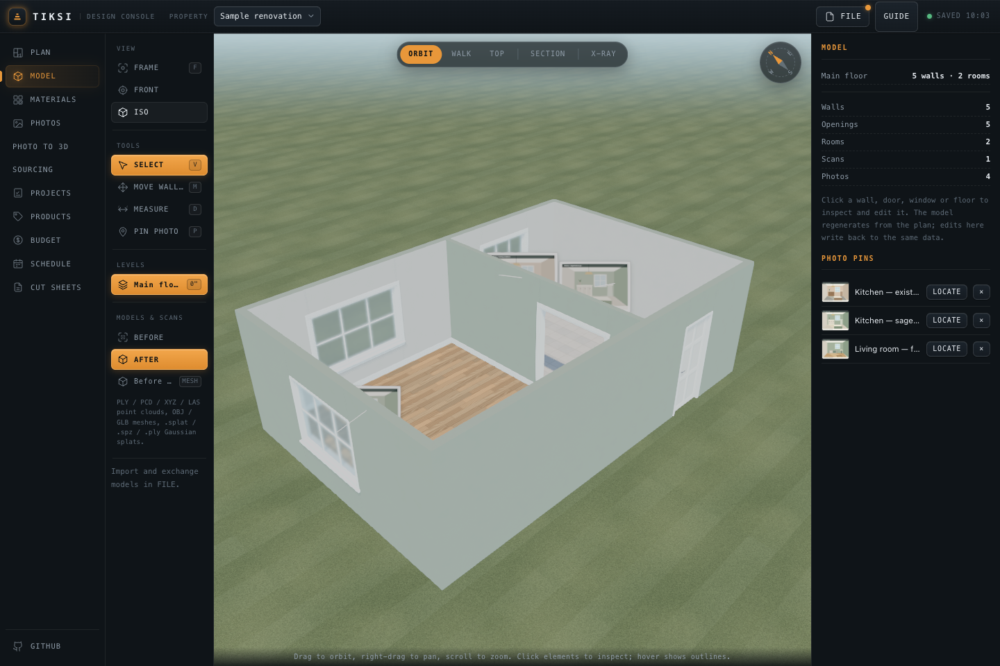

The same sample property appears throughout this guide. The left rail changes views; FILE holds saving, importing and settings.

### Where everything lives

| Workspace | Use it for |
| --- | --- |
| FILE | Open, import, save, exchange models and change settings. |
| PLAN | Trace and measure the room; edit walls, openings and levels. |
| MODEL | Inspect the 3D design, imported scans, photo pins and before/after. |
| MATERIALS | Choose and tune finishes or make a material from a photo. |
| PHOTOS | Keep site images, notes, room links and model pins together. |
| PHOTO TO 3D | Reconstruct a textured model from overlapping photographs. |
| SOURCING | Research products and compare cited supplier evidence. |
| PROJECTS | Turn the design into scoped work, quantities and dependencies. |
| PRODUCTS | Keep specifications, vendor links and selected product prices. |
| BUDGET | Compare low, likely and high costs against a budget cap. |
| SCHEDULE | See durations, task dependencies and the critical path. |
| CUT SHEETS | Print a specification sheet for a scope item or product. |

### A useful first session

1. Choose FILE → Project → NEW PROPERTY, or keep the demo property while you learn.
2. Use FILE → Import for a scan, Polycam link or photos. If you already have a floorplan image, use PLAN → UPLOAD IMAGE.
3. In PLAN, check the scale and review or draw walls, rooms, doors and windows. Open MODEL to inspect the result.
4. In PHOTOS, add reference images and pin them to the model. In MATERIALS, choose the proposed finishes.
5. In PROJECTS, add scope items, quantities, costs and durations. Link products and model elements to the work.
6. Review BUDGET, SCHEDULE and CUT SHEETS. Finish with FILE → Project → SAVE PROJECT so the work travels in a .tiksi file.

> **Good to know:** The screenshots and recordings use a synthetic sample renovation. Their drawings, images, products and prices illustrate the controls; they are not a surveyed room or a supplier quote.

## Save, open and move your work

**Where:** FILE → Project

Save a property as a .tiksi file. It carries the plan, models, original captures, pinned photos, materials, linked projects and specified products together.

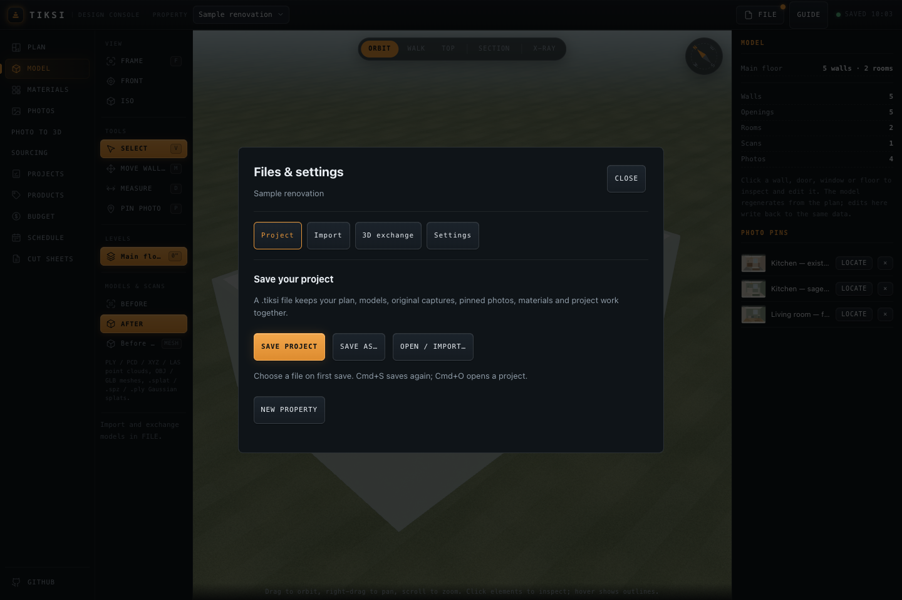

FILE → Project is the home for SAVE PROJECT, SAVE AS, OPEN / IMPORT and NEW PROPERTY.

### Try it

1. Open FILE → Project and choose SAVE PROJECT. On the first save, choose a filename and destination when your browser offers a picker.
2. Use SAVE AS when you want another file destination. Later SAVE PROJECT actions update the remembered file in browsers that support it, or download a file in other browsers.
3. To reopen work, choose OPEN / IMPORT and select its .tiksi file, or drop the file on Tiksi.
4. Opening updates the property with the same ID and leaves unrelated properties in place. Choose the property at the top of the app to switch between them.
5. To keep a whole project folder, use FILE → Settings → LINK FOLDER. Use OPEN FROM FOLDER to inspect and reopen its project files.

Find saving, importing and settings in one place

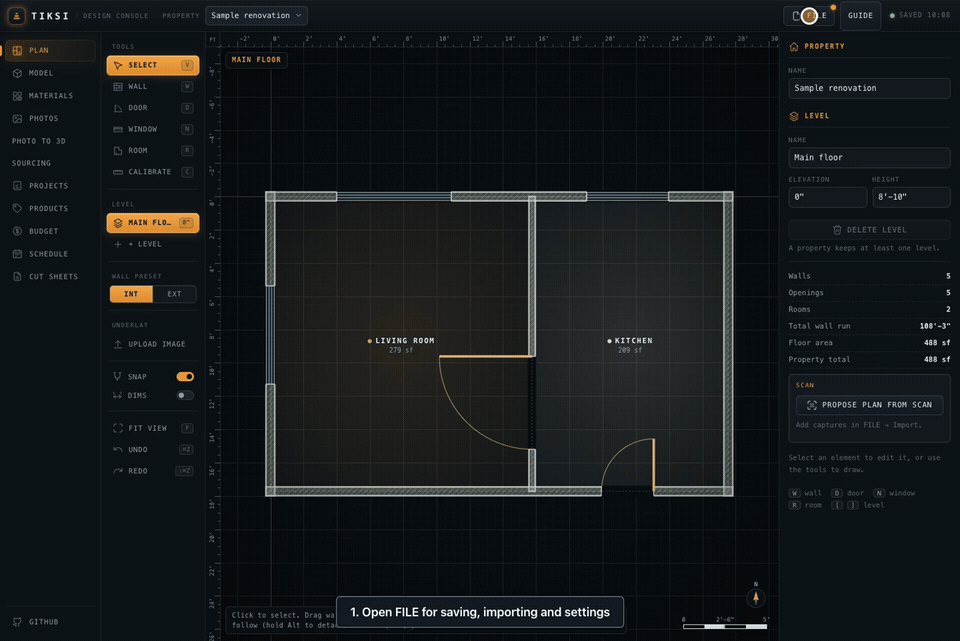

Open FILE, look at Project, switch to Import, inspect 3D exchange, then open Settings. Saving and opening project files are in the Project tab. The recording shows the app controls; your operating system supplies the file picker.

[Download the video](js/guide-assets/files.mp4)

### Other features here

**Keyboard saving.** Cmd/Ctrl+S saves; Cmd/Ctrl+Shift+S saves a new copy; Cmd/Ctrl+O opens a project file.

**Synced folders.** A linked folder can live in your normal cloud drive. Browser folder permission and storage are separate on every device.

**File copy vs design fork.** SAVE AS preserves the property IDs. Reopening that copy updates the same property; it does not create a second independent design in this workspace.

**Newer file protection.** If a linked folder contains a newer project copy, open that copy before saving over it.

**Whole-workspace backup.** FILE → Settings → Workspace backup & maintenance → SAVE WORKSPACE BACKUP includes every property.

> **Good to know:** Browser autosave protects the current browser copy. A .tiksi file or a workspace backup is the portable copy you can keep, share and move to another browser. The local server does not synchronize browser workspaces.

## Bring in a scan or Polycam capture

**Where:** FILE → Import

Start from a phone scan, a shared Polycam capture, a mesh or point cloud, or a set of reference photos. Successful imports keep their original files with the property.

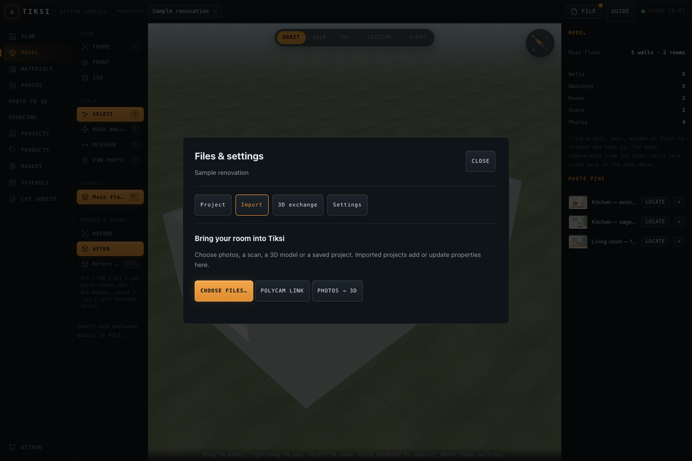

FILE → Import offers CHOOSE FILES, POLYCAM LINK and PHOTOS → 3D.

### Try it

1. For an exported scan, open FILE → Import → CHOOSE FILES. Choose a self-contained GLB or the complete exported ZIP with its textures.
2. For a shared capture, choose POLYCAM LINK and paste the share URL. You can also paste a Polycam URL into the console when no text field is focused.
3. Follow the import log. If the public link cannot provide a model, download the model from Polycam and use the file-drop fallback.
4. A normal file import opens its reference model in MODEL. Select the mesh in the left column and choose PROPOSE PLAN FROM SCAN when you want editable walls, rooms, openings, levels and a tracing underlay. Correct the proposal in PLAN.
5. The Polycam link workflow proposes a plan during import. When that workflow adds a scan to an existing plan, choose whether it is the next floor, a rescan, a separate building or reference only before applying it.

### Other features here

**Meshes, clouds and splats.** MODEL can display several capture types. A mesh has surfaces; a cloud has points; a splat is a visual reference.

**Propose plan later.** In MODEL, select a mesh scan and choose PROPOSE PLAN FROM SCAN. The PLAN property inspector also offers the action for its available source mesh.

**Multi-file imports.** Keep OBJ/MTL/images and glTF/buffers/images together. Choose their complete package rather than a model that refers to missing texture files.

**Originals and handoffs.** FILE → 3D exchange retains original source downloads and diagnostic handoffs for formats that need an agent or authoring application.

> **Good to know:** A shared Polycam link must expose a downloadable artifact. Room proposals need review, especially around furniture, glazing and diagonal walls. Point clouds and splats are references; the mesh-to-plan action does not automatically turn them into building elements.

## Draw and correct a floorplan

**Where:** PLAN

The plan is editable building geometry. Walls, openings and rooms become the 3D model and can link to photos, materials and scope items.

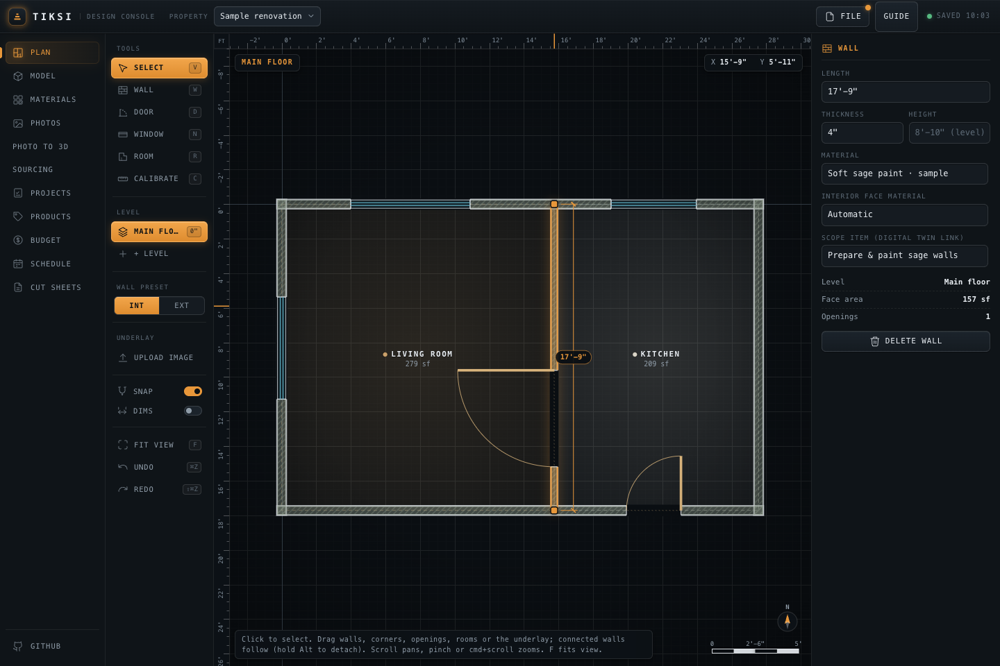

Plan tools are on the left of the canvas. Select an element to edit dimensions, materials and scope links in the right inspector.

### Try it

1. Use UPLOAD IMAGE for a tracing underlay, or select a photo in PHOTOS and choose PLAN UNDERLAY.
2. Choose CALIBRATE, mark two points with a known separation, enter the real distance in the inspector and apply the scale.
3. Choose WALL, then click successive wall endpoints. Use the interior/exterior preset for the starting thickness. Escape ends the current drawing action.
4. Place doors and windows on walls. Outline each room with the ROOM tool so it can have its own floor finish and area.
5. Choose SELECT and click an element. Type precise dimensions in the inspector or drag a wall/corner. Joined geometry follows the edit.
6. Use + LEVEL for another storey and set its elevation and wall height. Each level has its own underlay and plan geometry.

Select a wall and change its dimensions

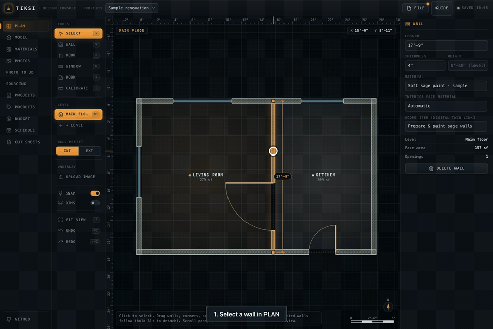

In PLAN, use SELECT and click a wall. Edit the wall height in the inspector to eight feet. Open MODEL to inspect the updated design.

[Download the video](js/guide-assets/plan.mp4)

### Other features here

**Sticky walls.** Dragging a wall slides its straight run and connected geometry. Hold Alt/Option to move that wall on its own.

**Snapping and dimensions.** SNAP helps with endpoints, axes and angles. DIMS displays wall dimension strings.

**Underlay editing.** Select the image to change opacity, or drag it to align its position. Remove it without deleting the traced walls.

**Navigation and undo.** Scroll pans. Pinch or Cmd/Ctrl+scroll zooms. Space-drag or middle-drag also pans; F fits the view. Cmd/Ctrl+Z undoes plan edits.

> **Good to know:** Calibrate the underlay before tracing: calibration changes the image scale, not walls you already drew. Rooms need their own ROOM polygons to create floor surfaces and floor-area takeoffs. Recheck scan-generated geometry against measurements on site.

## Inspect and edit the 3D model

**Where:** MODEL

The 3D view combines the plan-generated building, imported captures and photo pins. It is also a place to edit model elements and inspect imported materials.

Use the tool column for camera and inspection actions. The inspector follows the selected wall, room surface or imported model.

### Try it

1. Open MODEL and use FRAME if the room is outside the camera. Drag to orbit, scroll to zoom, or use the TOP control for a plan-like view.
2. Click a wall, floor or ceiling to inspect it. Change the offered dimensions or material in the inspector.
3. Choose MOVE WALLS, select a native wall and drag its gizmo. Joined walls and room corners follow. Return to PLAN for exact outlines; imported mesh surfaces do not expose native wall controls.
4. Use SECTION to cut through the building and reveal interiors. Use X-RAY to inspect overlapping references.
5. For lighting and render quality, open FILE → Settings → Model environment. For an image export, use FILE → 3D exchange → SAVE VIEW IMAGE while MODEL is open.

### Other features here

**Walk mode.** Choose WALK, then use W/A/S/D or the arrow keys to move and Shift to move faster. Drag to look or click the canvas to capture the mouse. Escape releases it or exits walk mode.

**Measure surfaces.** Choose MEASURE and click two surface points to display a distance. CLEAR MEASURES removes temporary measurements; image export can include them.

**Levels.** Show or hide levels in the model while retaining their geometry in the property.

**Imported references.** Select a scan/model to inspect placement, scale and available materials. A reference remains separate from native plan elements.

**Photos on surfaces.** Pinned photos stay attached to the model. Select a pin to open its reference image.

**Finish takeoff.** A selected imported model can map material slots and create a measured finish estimate. See the exchange chapter for that workflow.

> **Good to know:** Start with Low or Medium quality on a laptop and raise it when needed. A screenshot or exported render communicates appearance; it does not replace a dimensional site check.

## Edit elsewhere and compare before/after

**Where:** FILE → 3D exchange

Export a Tiksi design or selected imported model, edit it in SketchUp or Blender, then return the result while keeping a before state and the project work.

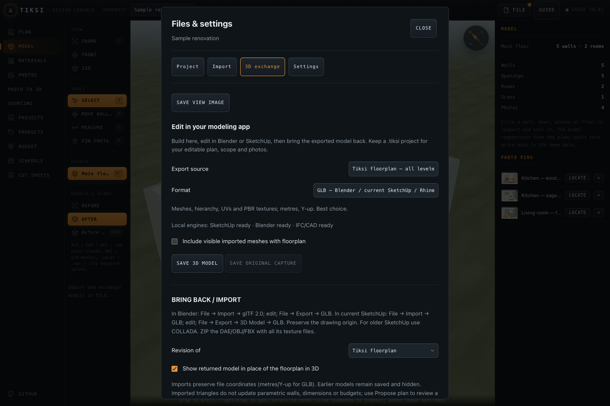

The exchange panel chooses what to export, the file format and the model that a returned revision belongs to.

### Try it

1. Save the .tiksi project first. Open FILE → 3D exchange and choose the floorplan or imported model to export.
2. Choose SketchUp, Blender or an interchange format such as GLB. Save the generated file and open it in the target application.
3. Edit and save/export from the other application. Keep the drawing origin and units consistent so the returned model aligns.
4. In the exchange panel, choose the prior model or Tiksi floorplan under Revision of, then choose IMPORT / BRING BACK MODEL. Keep Show returned model in place of the floorplan enabled. Tiksi preserves the before state automatically.
5. In MODEL, use BEFORE and AFTER to compare from the same camera. Select the visible model to inspect the appropriate materials.
6. Map material slots to catalog finishes and choose CREATE FINISH ESTIMATE. Review the resulting scope quantities, product matches and prices in PROJECTS and BUDGET.

Compare the preserved before state with the proposed design

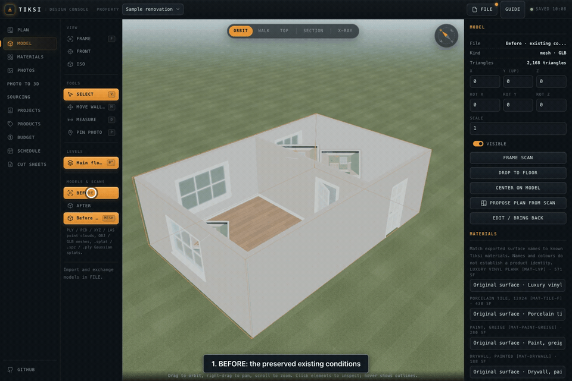

Open MODEL with a saved comparison. Choose BEFORE, inspect the earlier model, then choose AFTER. The camera stays in place while the visible design changes.

[Download the video](js/guide-assets/exchange.mp4)

### Other features here

**Native engines.** SketchUp and Blender use installed local engines. Optional CAD readers cover IFC, STEP/IGES, DXF surfaces, Rhino render meshes, E57 and LAZ.

**Other exports.** GLB carries PBR maps; COLLADA and OBJ include texture packages; STL carries geometry. Original native files remain available separately.

**Originals and conversion history.** Choose an imported source and SAVE ORIGINAL CAPTURE to download it. Expand Conversion history / agent handoffs, then REFRESH CONVERSIONS to save a handoff or delete a server copy. Server job history is separate from .tiksi saves.

**Agent interpretation.** Unconverted native files keep their original bytes, logs and interpretation packet. Download the packet for Codex or Claude to continue the work.

**Measured finishes.** Triangle surface quantities include transforms. Unique saved per-square-foot product matches can supply draft prices and product links.

> **Good to know:** A returned mesh does not automatically rewrite parametric walls or dimensions. Use PROPOSE PLAN FROM SCAN and review the result if you need a new editable plan. BEFORE / AFTER appears for returned revisions; ordinary plan edits do not create that comparison automatically. Keep native sources for their constraints and BIM relationships. Review measured areas, waste, labor and prices before ordering.

## Choose and customize finishes

**Where:** MATERIALS

Materials control the appearance of walls, floors and ceilings. Use the built-in catalog, customize it, or turn a close-up photograph into a surface material.

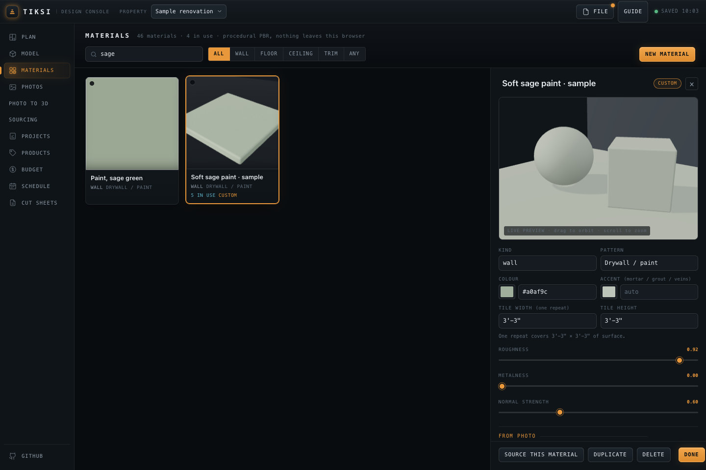

Select a material to open its preview and controls. The catalog can be searched and filtered by use.

### Try it

1. Open MATERIALS and search or filter the catalog. Select a material to preview it.
2. Adjust color, roughness and the controls offered by its pattern. For tile or plank patterns, set real repeat dimensions.
3. Use DUPLICATE when you want a separate variation. Use NEW MATERIAL for a new custom finish.
4. For a photographed finish, select its image in PHOTOS and choose MATERIAL, or select/upload a source image in the material editor.
5. Assign the material from a selected wall or room in PLAN or MODEL. Use SOURCE THIS MATERIAL to research a purchasable match.

### Other features here

**Pattern controls.** Color, accent, repeat size, roughness, metalness and normal strength let you tune procedural patterns. Drag the live preview to orbit; scroll to zoom.

**Usage links.** The editor shows where a material is in use, helping you understand what an edit will change.

**Built-in reset.** RESET TO DEFAULT restores a built-in material. Custom copies can be kept as separate alternatives.

**Appearance vs product.** A visual finish is not yet a manufacturer specification. Link a sourced product and its price to the scope when selected.

## Keep photos attached to the room

**Where:** PHOTOS

The photo gallery holds site references and panoramas with notes, room links, model links and scope links. A photo can also become a plan underlay, a material or a 3D pin.

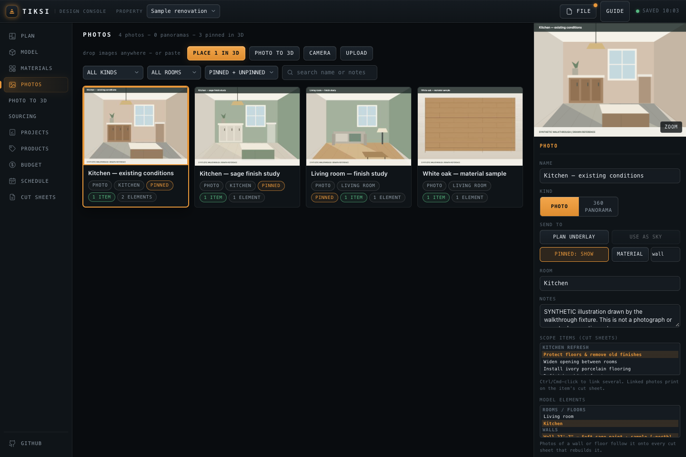

Select a gallery card to open its inspector. Send to offers PLAN UNDERLAY, PIN IN 3D, MATERIAL and panorama lighting.

### Try it

1. Use UPLOAD to add reference images, or CAMERA on a supported phone/browser.
2. Select a card and give it a useful name, room and notes. Link the relevant scope items and model elements.
3. Choose PIN IN 3D, then click the matching surface in MODEL. Use the gallery’s PLACE … IN 3D action to place unpinned photos one after another.
4. Return to PHOTOS to filter by room, kind or pin status. Double-click a card or choose ZOOM for a large viewer.
5. Choose DOWNLOAD when you need the original file, or save the property as .tiksi to carry all the images with the project.

Place a reference photo on a model surface

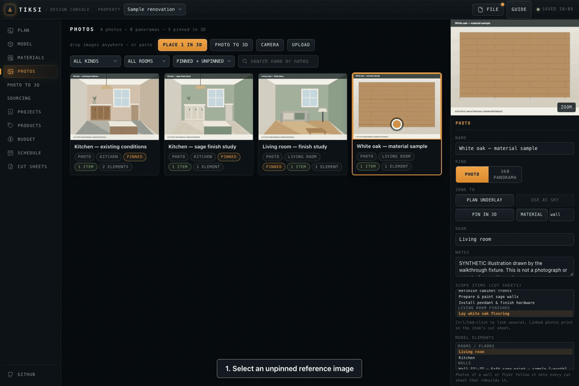

Open PHOTOS and select an unpinned reference card. Choose PIN IN 3D, then click the matching surface in MODEL to place it. Finish placement, then use PHOTO PINS → LOCATE to find a saved pin. The photo stays linked to the property.

[Download the video](js/guide-assets/photos.mp4)

### Other features here

**Plan reference.** PLAN UNDERLAY sends the selected image to the active level for tracing and calibration.

**Material from a photo.** MATERIAL creates a photo-based finish that you can tune in MATERIALS.

**360 panorama.** Mark a true equirectangular image as 360 PANORAMA, then USE AS SKY for the model environment.

**Cut-sheet evidence.** Scope links make relevant photos appear on the corresponding specification sheet.

**Find or move a pin.** In MODEL, clear the selection and use a PHOTO PINS → LOCATE button to fly to a pin. Select the pin for notes, card size, MOVE PIN or REMOVE PIN; removing a pin keeps the photo.

> **Good to know:** Ordinary photos do not automatically supply reliable camera positions. Place their pins yourself unless a capture provides usable pose data. The sample images in this guide are illustrations.

## Reconstruct a model from photos

**Where:** PHOTO TO 3D

On a supported Mac, Apple Object Capture can turn overlapping original photographs into a textured model. Use Polycam for a room capture when that is the more practical route.

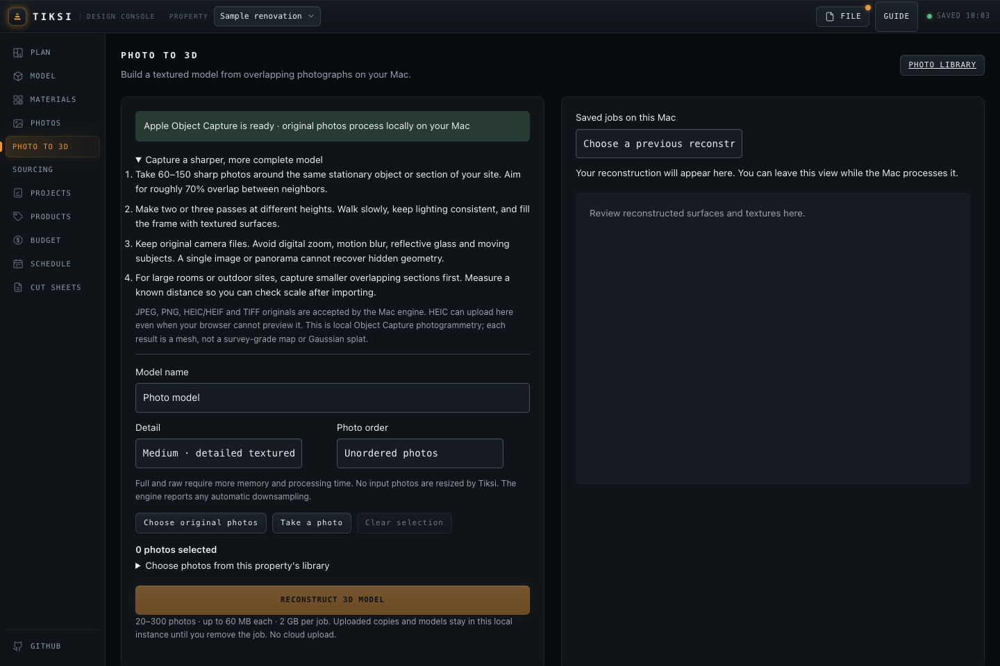

PHOTO TO 3D separates selecting photos and reconstruction settings from reviewing saved jobs and importing a result.

### Try it

1. Take sharp photographs while moving around the subject or space: aim for 60–150 images with about 70% overlap from two or three heights. Keep lighting consistent and retain the originals.
2. Open PHOTO TO 3D. Choose original photos or select stored gallery images; the local engine requires at least 20 images.
3. Name the model, choose detail and photo order, then start RECONSTRUCT 3D MODEL. Preview detail is useful for checking a capture before a larger run.
4. Monitor the job. You can leave the workspace and return to the saved job on this Mac.
5. When complete, choose Review in 3D, Save GLB or Save native OBJ and maps. Choose Add to this property to keep the result with the design, then check its placement and scale in MODEL against a known dimension.

### Other features here

**Original image retention.** Selected originals are sent to this local Mac for the reconstruction job. Property photos retain their original bytes.

**Detail settings.** Higher detail can take more time and memory. A poor capture is not fixed simply by selecting Raw.

**Capture limits.** The current engine accepts 20–300 original photographs, up to 60 MB each and 2 GB per job. Panoramas are excluded. Keep the Mac awake during processing.

**Job management.** Cancel a running job when needed. Removing a terminal job deletes that job’s server copies separately from property photos.

> **Good to know:** Reconstruction needs the local server, the native worker and supported Mac hardware. Reflective, transparent or low-texture spaces can reconstruct poorly. No reconstruction is shown as completed in this guide using the illustrated sample images.

## Research real products and suppliers

**Where:** SOURCING

Start from a material, a model element, a product or a brief. Sourcing researches alternatives and keeps the evidence with the selections you save.

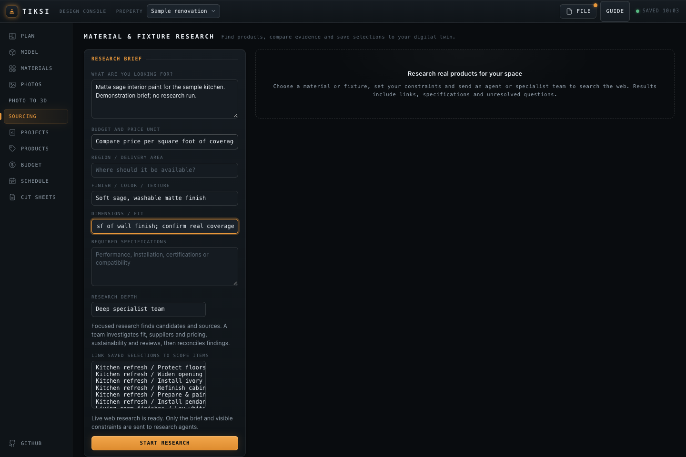

The sourcing brief collects the required product, budget, region, dimensions and specifications before research starts.

### Try it

1. Open SOURCING, or choose SOURCE THIS MATERIAL / RESEARCH ALTERNATIVES from the relevant material or product.
2. Describe what you need and include finish, size, price unit, budget, region and required performance. Link scope items when appropriate.
3. Choose Focused agent or Deep specialist team, then START RESEARCH. The local server needs its research provider to be ready.
4. Review candidates, vendor offers and cited evidence. Select candidates and use COMPARE SELECTED for a side-by-side view.
5. Use SAVE TO PRODUCTS for a chosen candidate. Review the saved product and its scope links before using its price in the project.

### Other features here

**Browse while it works.** Return to other workspaces while research runs, then reopen the job.

**Evidence and unknowns.** Inspect opened sources, fit notes, conflicts and missing information instead of relying on a product name alone.

**Revisit progress.** The job panel exposes current status and cancellation. Returning to SOURCING restores the current saved job; cancellation does not resume it later.

**Selection history.** Saved product selections carry their research context and evidence in project files.

> **Good to know:** Live sourcing needs the local server and a current, signed-in Codex CLI on its host. The availability message explains setup problems. The screenshot shows a brief, not fabricated live results. Saving a candidate does not order it; confirm current supplier price, availability, price units and fit before purchasing.

## Turn the design into scoped work

**Where:** PROJECTS

A project is a package of work such as kitchen finishes. Its scope items hold quantities, cost ranges, durations, dependencies and links back to the design.

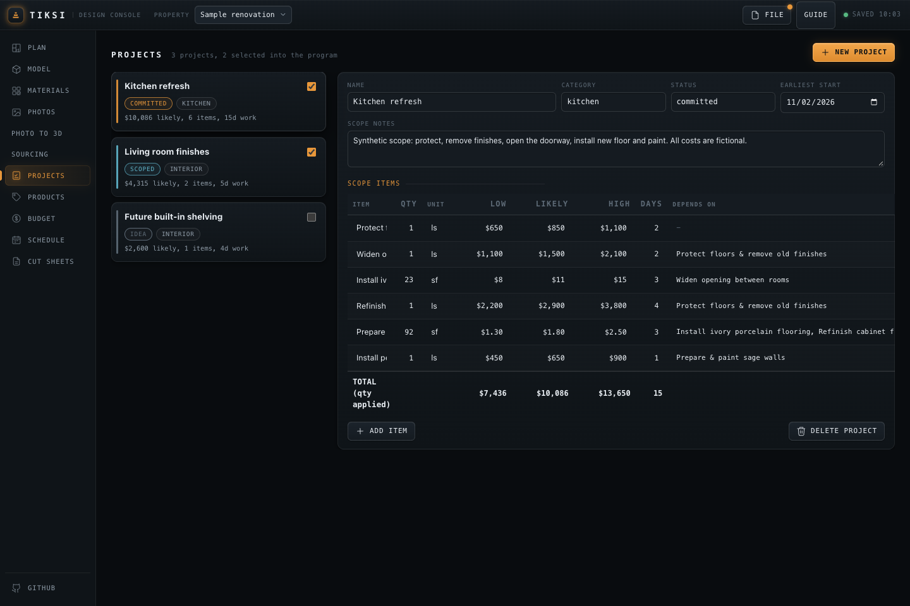

Choose a project to edit its scope. Each row can carry quantity, unit, low/likely/high unit costs, days and predecessors.

### Try it

1. Choose NEW PROJECT, give it a name, category, status and earliest start, and write the scope notes.
2. Use ADD ITEM for each piece of work. Name it clearly and enter its quantity and unit.
3. Enter low, likely and high unit costs. Keep quantity and price units consistent; the totals are calculated from these inputs.
4. Add duration in days. Use the predecessor summary control to choose the items that must finish first.
5. Link model elements from the PLAN/MODEL inspector and products from PRODUCTS. Relevant photos can be linked in PHOTOS.
6. Use the project’s selection checkbox to include or exclude it from the budget program and schedule.

### Other features here

**Draft finish estimates.** CREATE FINISH ESTIMATE on an imported model can seed measured scope items. Review and complete them here.

**Dependencies.** Select several predecessors when a task depends on more than one item. Check the schedule for cycles or missing durations.

**Element links.** A scope item can refer to the wall, room or model surface that generated the work.

**Selection vs deletion.** Deselecting a project removes it from program calculations while retaining its scope for comparison.

**Across properties.** PROJECTS lists workspace-wide work. A new project belongs to the active property, but selecting another property does not filter the project list, budget or schedule.

> **Good to know:** Costs are per quantity unit: 120 square feet at $5 per square foot totals $600. Use one lump-sum quantity for a lump-sum quote. Set zero duration days for budget-only items; they stay out of the schedule.

## Keep specifications and ordering links

**Where:** PRODUCTS

Products are the real fixtures and materials you may buy. Keep manufacturer details, specifications, price units and vendor links connected to the scope.

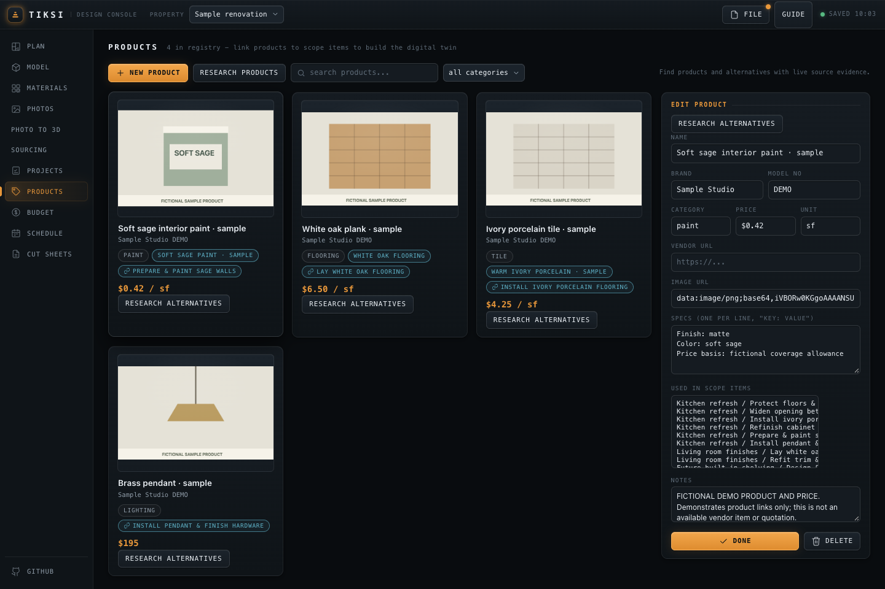

Open a product card to inspect or edit its name, price, unit, vendor URL, specification lines and scope links.

### Try it

1. Choose NEW PRODUCT for a manual entry, or save a candidate from SOURCING.
2. Enter brand, model, category, specification lines and notes. Add the vendor URL and an image URL if available.
3. Record the price with its unit: each, square foot or linear foot, for example. Do not mix a package price with a surface-area quantity.
4. Choose the scope items where the product is used. Review the matching project cost entries.
5. Open the vendor link to confirm purchase details, or use CUT SHEETS to print the saved specification for a contractor or supplier.

### Other features here

**Research alternatives.** Reopen sourcing from an existing product without losing its current saved specification.

**Evidence history.** Products saved from research retain cited evidence and source context.

**Estimate matching.** A unique product/material match with a per-square-foot price can contribute to a model finish estimate. Ambiguous matches stay unpriced.

> **Good to know:** Tiksi stores purchasing information and vendor links. It does not place orders, manage supplier inventory or confirm a current quote. The sample prices in this guide are fictional.

## Compare scope against the budget

**Where:** BUDGET

The current-budget report rolls up selected projects and scope items into low, likely and high estimates. Use it to compare the renovation program with a budget cap.

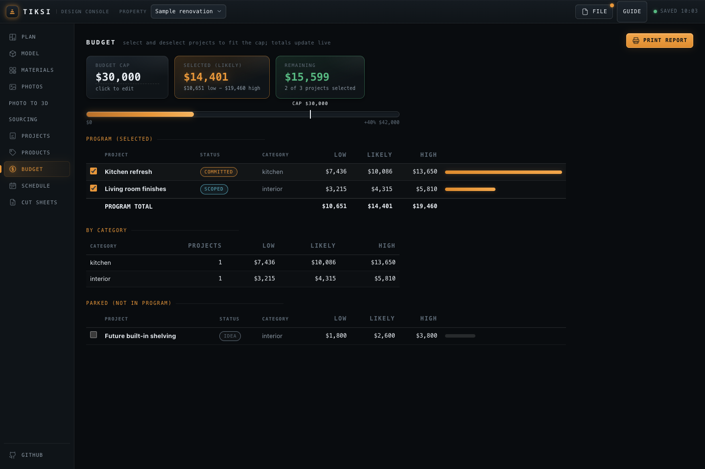

Budget totals follow the selected projects and their scope quantities and cost inputs. PRINT REPORT creates a shareable report.

### Try it

1. Enter or revise scope quantities and unit costs in PROJECTS first.
2. Open BUDGET and set the program budget cap in the offered control.
3. Compare low, likely and high totals, the category/project breakdown and the remaining budget.
4. Check or uncheck projects directly in BUDGET, or use their PROJECTS checkboxes, to compare alternatives without deleting scope.
5. Use PRINT REPORT to print or save a PDF through the browser print dialog.

### Other features here

**Cost ranges.** The report preserves uncertainty as low/likely/high values instead of presenting one guessed price.

**Program selection.** Only selected projects contribute to the program totals, across every property in the workspace.

**Quantity changes.** Updating a scope item quantity or cost updates the report. Products provide specification context; scope costs still need review.

> **Good to know:** Budget totals are only as complete as the scope inputs. Include labor, waste, freight, tax and contingency where applicable to your estimate.

## Sequence the work

**Where:** SCHEDULE

The schedule uses scope-item durations and predecessors to lay out the selected projects. The critical path shows which dependency chain controls the finish.

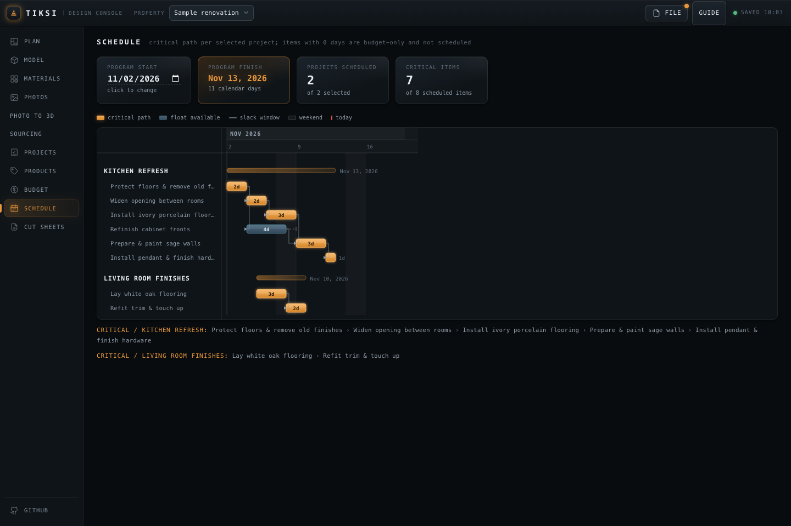

The Gantt view connects tasks with dependency arrows and distinguishes critical work from tasks with float.

### Try it

1. In PROJECTS, enter each scope item’s duration and select its predecessors.
2. Set the project’s earliest start and ensure the project is selected for the program.
3. Open SCHEDULE and set Program start. Inspect the Gantt chart, task dates, dependencies and critical path. A later project Earliest start delays that project.
4. Return to PROJECTS to fix missing durations, dependency cycles or sequencing assumptions, then review the updated schedule.

### Other features here

**Critical path.** A delay along the controlling dependency chain moves the modeled project finish.

**Float.** Some tasks can move within their float without extending the modeled finish.

**Today marker.** The time axis shows today so you can compare the planned sequence with the current date.

**Calendar days.** Durations use calendar days, with weekends shaded. Items at zero days are budget-only and are omitted. Dependencies and critical paths are calculated within each selected project.

> **Good to know:** The schedule is calculated from the entered durations and dependencies. It does not automatically resolve crew capacity, delivery dates or permit constraints; include those in your planning.

## Print a useful specification sheet

**Where:** CUT SHEETS

Cut sheets gather the information attached to a scope item or product into a printable handoff: dimensions, materials, photos, specified products and cost context.

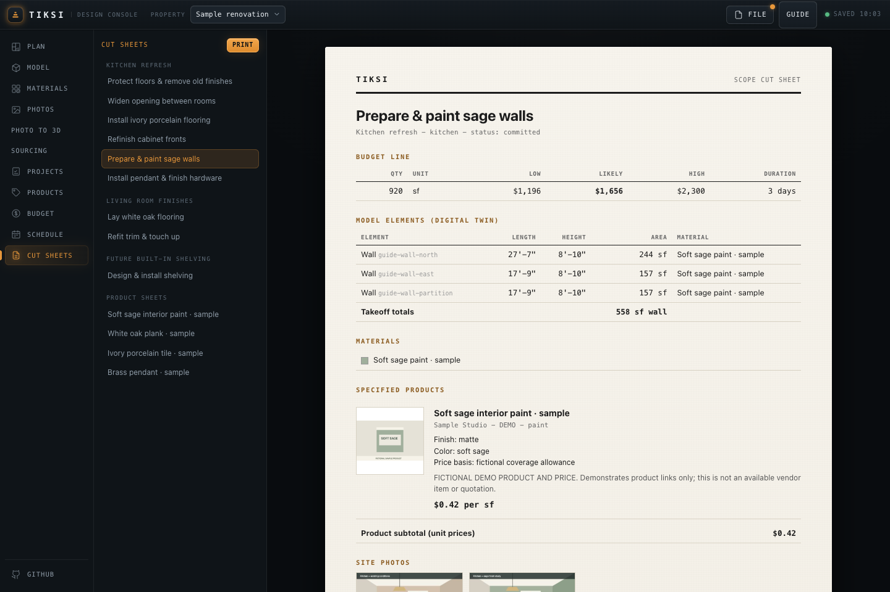

Choose a scope item or product from the list, review its sheet, then PRINT.

### Try it

1. Link the relevant model elements, materials, photos and products before printing.
2. Open CUT SHEETS and select the scope item you want to communicate, or choose a product sheet.
3. Review the generated content. Missing information is best completed in PROJECTS, PRODUCTS or PHOTOS.
4. Choose PRINT and use the browser print dialog to print or save a PDF.

### Other features here

**Scope-item sheets.** Combine the work description with linked elements, takeoffs, materials, site photos and products.

**Product sheets.** Show the saved manufacturer/model details, specification lines, price unit and vendor link.

> **Good to know:** These are specification handoffs built from your saved information. Review them before issuing instructions or ordering materials.

## Settings, backups and storage

**Where:** FILE → Settings

Display units, model environment, project folders and workspace maintenance live in the same File panel. Most everyday work needs only project saves.

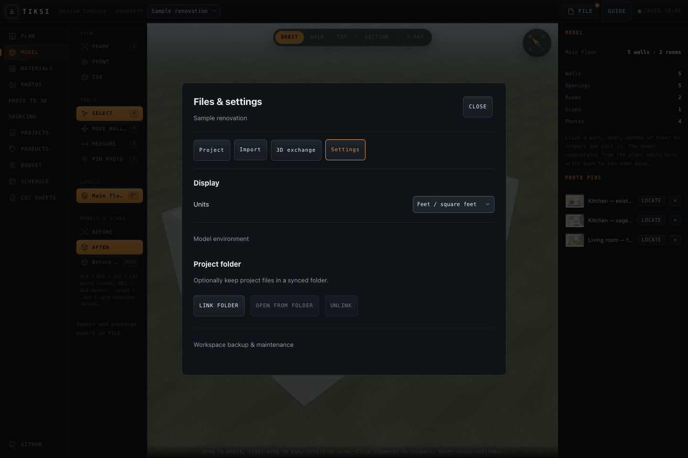

Settings groups display, model environment, project-folder controls and the separate workspace-maintenance section.

### Try it

1. Open FILE → Settings to choose feet/square feet or metres/square metres.
2. For rendering, open MODEL first, then FILE → Settings → Model environment. Adjust quality, lighting and the offered view settings.
3. Use LINK FOLDER for file-based project keeping, OPEN FROM FOLDER to reopen a project and UNLINK to stop using the folder.
4. Open Workspace backup & maintenance when you want a whole-workspace backup or need to inspect unused browser storage.

### Other features here

**Keep a SketchUp mirror.** With a linked folder and SketchUp installed on this Mac, each project also gets a .skp beside its .tiksi. Walls, openings and rooms you move, resize, copy, delete or rename in SketchUp come back into the plan when you save there. The status line under the switch shows the last sync and any conflicts.

**Save workspace backup.** Exports every property together. Keep a .tiksi per property for ordinary project handoffs.

**Add demo projects.** Adds sample projects to the workspace without replacing unrelated properties.

**Clean unused storage.** Removes unreferenced browser assets only after the offered review/confirmation. Keep them if you need them for an older JSON-only project.

**Replace from backup.** A separate explicit restoration action that replaces the workspace. Use ordinary OPEN / IMPORT to merge a project instead.

> **Good to know:** Browser storage, linked folders and local-server job files are separate. Removing a converter or reconstruction job removes its server copies; it is not a substitute for managing saved project files.

## Shortcuts and common questions

Use the visible tooltips and inspector labels when you forget a control. These are the most useful navigation, saving and recovery patterns.

### Other features here

**Save / open.** Cmd/Ctrl+S: save. Cmd/Ctrl+Shift+S: save as. Cmd/Ctrl+O: open.

**Plan navigation.** F: fit view. Scroll: pan. Pinch or Cmd/Ctrl+scroll: zoom. Space-drag or middle-drag: pan. [ and ]: step between levels.

**Plan drawing.** V: select. W: wall. D: door. N: window. R: room. C: calibrate. Click the first point or double-click to close a room polygon.

**Model navigation.** F: frame. O: orbit. W: walk. T: top. C: section. X: X-ray. M: move walls. D: measure. P: pin photo.

**Plan undo.** Cmd/Ctrl+Z: undo. Cmd/Ctrl+Shift+Z: redo. Escape ends an active tool action.

**Move one wall.** Alt/Option while dragging isolates that wall from the normal connected-wall behavior.

**Where is save/import?.** Open FILE at the top. Project handles .tiksi files; Import handles captures and photos; 3D exchange handles editing in other applications.

**Why is my phone empty?.** Each browser/device has its own workspace. Open a saved .tiksi file there; connecting to the same Mac does not synchronize the browser data.

**Why is a model untextured?.** Import the complete texture package or a self-contained GLB. An OBJ or glTF that points to missing files cannot supply those images.

**Why is reconstruction disabled?.** Check the local engine status and the photo count. The native engine requires supported Mac hardware and at least 20 original images.

**Why is my estimate unpriced?.** Add a verified price with the matching unit. Ambiguous product matches and units other than the supported takeoff price unit need manual review.

**Can I return to this chapter?.** The guide URL includes its chapter. Bookmark or copy the address, or use GUIDE at the top of Tiksi.

---

The guide is generated from `js/guide-content.js`. Screenshots and demos are reproducible with `tools/capture-guide.mjs` and the synthetic `tools/guide-fixture.mjs`; capture runs refuse the live port. Rebuild this Markdown copy with `node tools/build-guide-markdown.mjs`.
